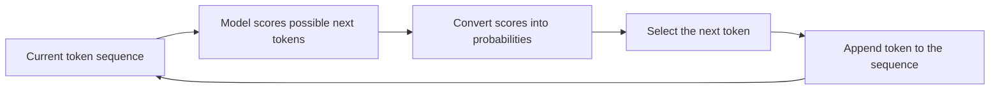
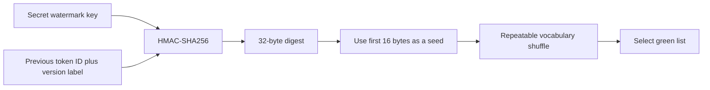

# Our LLM Watermarking Project, Explained in Plain Language

**Reading goal:** Understand the idea, the complicated terms, what the code does, and what our results actually mean.  
**Project scope:** The first 30% implementation milestone.  
**Current state:** Working code, passing tests, and a completed synthetic demonstration. The real paraphrase and back-translation experiment has not run successfully yet.

This guide accompanies [PROJECT_SUMMARY.md](PROJECT_SUMMARY.md). The summary is the detailed technical record; this document teaches the ideas behind it.

## 1. What are we trying to build?

Imagine a company operates an AI writing system and wants to recognize text produced through its own system later.

One approach is to inspect the writing style and guess whether it looks like AI. That is difficult because a person or another AI can rewrite the text and change those stylistic clues.

Our approach is to influence the AI's word choices slightly while it writes. We use a secret rule that makes certain choices a little more likely. Over a sufficiently long passage, those small preferences can leave a measurable pattern.

Later, a detector that knows the secret rule checks the passage for that pattern.

The main question is whether enough of the pattern remains after the passage is rewritten or translated.

We are not putting a visible label into the text, hiding a sentence inside it, or adding metadata to the document. The signal is a change in the statistics of the selected tokens.

## 2. What is a statistical watermark?

Think of a coin that normally lands heads about half the time. If someone quietly changes it so that heads becomes more likely, one toss tells you very little. A hundred tosses can reveal the change.

A statistical text watermark works on a related principle:

- One token is usually weak evidence.
- Many token choices can reveal an unusual pattern.
- We measure the strength of that pattern rather than look for a fixed phrase.

The watermark does not guarantee that every favored token will be selected. It changes the odds repeatedly during generation.

That is why the word **statistical** matters: detection is based on a pattern across multiple observations, with uncertainty, rather than a perfect yes/no marker embedded in one location.

## 3. What is a token? Is it just a word?

A token is a unit of text that the model understands as one vocabulary entry. It can be a whole word, part of a word, punctuation, or a special control symbol.

For illustration, a tokenizer might split:

```text
unbelievable
```

into pieces resembling:

```text
un | believable
```

The actual split depends on the tokenizer; this example is not a recorded Llama or Qwen tokenization result.

Each token has an integer ID. The model works with those IDs internally. The exact ID assigned to a particular piece of text is tokenizer-specific.

### Vocabulary

The vocabulary is the complete collection of token entries available to the model. It is like the model's catalog of possible next pieces of text.

### Tokenizer

The tokenizer converts text into token IDs and IDs back into text. It must be consistent between generation and detection. A detector using a different tokenizer can interpret the same sentence as a different sequence and reconstruct the wrong watermark pattern.

### Special tokens

Some tokens have control purposes, such as marking the end of an answer or filling unused positions in a batch. Our green-list vocabulary excludes these special IDs.

The model can still produce a special token, such as an end marker. Excluding an ID from the watermark vocabulary does not itself prohibit the model from generating it.

## 4. How does a language model choose what to write next?

Suppose the current text is:

> The child opened the

The model evaluates possible next tokens. Words such as “door,” “book,” and “box” may receive relatively high scores in that context.

Generation repeats this process:



The model does not ordinarily write the entire answer in one operation. It makes a sequence of next-token decisions. Our watermark operates at each of those decisions.

### Model weights

Weights are the learned numbers inside the model. During training, they are adjusted so that useful language patterns influence the model's predictions.

**Pretrained weights** have already learned from a large training process. **Random weights** have not learned meaningful language. This distinction is central to understanding our smoke test later in this guide.

## 5. What are logits?

Logits are the raw scores the model assigns to possible next tokens before turning those scores into probabilities.

A logit is not a percentage. It can be positive, negative, or zero. The difference between scores matters more than their absolute values.

For example:

| Candidate token | Illustrative logit |
| --- | ---: |
| door | 4 |
| book | 3 |
| box | 2 |

“Door” receives the greatest preference in this invented example, but its score of 4 does not mean a 4% or 40% chance.

The watermark changes selected logits before sampling. It does not edit the finished paragraph afterward.

## 6. What is softmax?

Softmax turns a set of raw scores into probabilities that sum to 1. It gives a higher probability to a higher score while retaining a probability distribution over the candidates. [SciPy softmax documentation](https://docs.scipy.org/doc/scipy/reference/generated/scipy.special.softmax.html)

Its calculation has two conceptual steps:

1. Turn each score `s` into the positive value `exp(s)`.
2. Divide each value by the sum of all those values.

So a token's probability is:

```text
exp(token score) / sum of exp(scores of every candidate)
```

You do not need to implement softmax manually in this project. The generation library handles the conversion and sampling. Understanding it explains why adding a logit bias changes the odds of selecting a token.

## 7. What are the green list and red list?

At a generation step, we divide the eligible vocabulary into two groups:

- **Green list:** Token choices that receive the watermark preference.
- **Red list:** The other eligible choices.

These are names for mathematical groups. Green does not mean good, factual, safe, or grammatically correct. Red does not mean incorrect or forbidden.

The model's normal language scores still matter. A red token can be selected when it fits the sentence better, and a green token with a very poor original score may still be unlikely.

### The groups depend on context

A token is not permanently green. In our implementation, the green list depends on the immediately preceding token and the secret key.

After one previous token, “door” might be green. After another previous token, it might be red.

This changing partition is why the detector must inspect the token sequence, not simply count a fixed dictionary of special words.

## 8. What does gamma mean?

Gamma, written as `gamma` or the Greek letter `γ`, is the fraction of eligible vocabulary entries assigned to the green list.

Our default requested value is 0.25:

> About one quarter of the eligible vocabulary is green at each step.

If there were exactly 100 eligible IDs, the list would contain 25 green IDs. If there are 127, a quarter would be 31.75 IDs, which is impossible because entries must be counted as whole numbers.

Our code rounds down:

```text
green IDs = floor(0.25 × 127) = 31
actual green fraction = 31 / 127 ≈ 0.2441
```

The detector uses the actual fraction, not an idealized 0.25. This prevents integer rounding from introducing an avoidable counting error.

Gamma describes the size of the favored group. It does not say that exactly that fraction of generated tokens will be green. Applying the watermark is intended to raise the observed green fraction above its baseline.

## 9. What does delta mean?

Delta, written as `delta` or `δ`, is the amount added to the logits of green tokens.

Our default is:

```text
delta = 2
```

The rules are:

```text
Green token: add 2 to its original logit
Other token: leave its original logit unchanged
```

### Worked example with eight equally likely tokens

Assume eight candidate tokens initially have identical logits. Two are green and six are red. This is an illustration, not a measured pretrained-model result.

Before the watermark:

| Group | Number of tokens | Combined probability |
| --- | ---: | ---: |
| Green | 2 | 25% |
| Red | 6 | 75% |

After adding a bias of 2 to the green logits, their softmax weights are multiplied by `exp(2)`, approximately 7.39. The combined green probability becomes:

```text
(2 × 7.39) / ((2 × 7.39) + 6) ≈ 71.1%
```

The same group now receives about 71.1% of the probability in this simple equal-score example.

Real model logits are not equal. Sampling temperature, top-p filtering, and language context also affect the final distribution, so the example is not a prediction of our real experiment's green ratio.

### Why not make delta enormous?

A stronger bias can make the signal easier to detect, but it can also pull the model toward choices that fit the sentence less well. We need to study the balance between signal strength and writing quality.

We have not measured that quality tradeoff on pretrained-model text yet. Delta 2 is a starting configuration, not a proven optimal value.

## 10. What is a cryptographic hash?

A hash function turns some input data into a fixed-length output often called a **digest**. It is useful to think of that output as a compact mathematical fingerprint.

In this project we use SHA-256 as the hash function inside HMAC. Its output is 256 bits, or 32 bytes.

The same input gives the same output. A change in the input usually leads to a very different output.

### Hashing is not encryption

Encryption is designed so that someone with the right key can recover the original message. A hash is not a reversible encoding of its input.

Our watermark does not encrypt the generated passage. Readers can see the text normally. The hash contributes to the rule for choosing favored vocabulary entries.

### A fingerprint has limits

A fixed-length hash cannot be a unique encoding of every possible input. Different inputs can theoretically share an output. The project does not depend on a claim that collisions are mathematically impossible.

More immediately, hashing a small public input without a secret would allow other people to compute the same result. That is why we use a keyed construction.

## 11. What is HMAC, and why do we use it?

HMAC stands for **Hash-based Message Authentication Code**. It combines a secret key and a message using a standard construction built around a cryptographic hash function. Its conventional purpose is message authentication between parties that share a key. [HMAC specification](https://www.rfc-editor.org/rfc/rfc2104)

In our project, we use its output to derive a repeatable secret-dependent vocabulary shuffle seed.

### The inputs in our code

We give HMAC two pieces of information:

1. A secret key belonging to this watermark setup.
2. A message containing the previous token ID and a fixed version label.

Conceptually:



The same key and previous token reproduce the same digest and green list. Changing the key generally changes the resulting partition.

The detector can therefore reconstruct the lists used during generation without storing one list for every generated token.

### Why not use an ordinary hash of the previous token?

If the rule depended only on a public token ID and a public ordinary hash, anyone could calculate the same partitions. HMAC introduces a secret input into the partition rule.

That secret dependence is useful for our baseline, but it is not a proof that the entire watermark system is secure against every attack. Other properties, including the partition generator and attacker access to outputs, also matter.

### HMAC does not certify the completed passage

We are not computing an HMAC tag over the whole final paragraph and attaching it to the document. Here, HMAC helps determine token preferences during generation. Later attribution is still a statistical test.

This distinction explains why possessing a secure HMAC building block does not turn the final z-score into a perfect cryptographic signature.

## 12. What are bytes, bits, serialization, and big-endian order?

These are ways of representing data precisely for a computer.

| Term | Simple meaning | Role in our project |
| --- | --- | --- |
| Bit | A single 0 or 1 | Unit used to describe hash/key sizes |
| Byte | Eight bits | Unit used for the secret key and digest |
| Serialization | Converting a value into an agreed sequence of bytes | Ensures the previous token is represented identically in both components |
| Big-endian | Writing the most significant byte first | Fixes the byte ordering of the token ID |

Our code writes the previous token ID as eight bytes. For example, integer 42 is represented in hexadecimal as:

```text
00 00 00 00 00 00 00 2A
```

The exact convention is less important than using the same convention everywhere. If the generator and detector represented the number differently, they could calculate different HMAC digests.

The fixed version label is also part of the input. It identifies the calculation's purpose and version so that a future construction can deliberately use a different message format.

## 13. What is a secret key? What is a seed?

They are related but serve different roles.

### Secret key

The key is the private input shared between generation and detection. Our real experiment code creates 32 random bytes when no key file is supplied.

The key should be retained to detect those outputs later. It should not be included in public experiment bundles.

Our prototype stores it in a local file without encrypting it. The code excludes key files and results from ordinary Git tracking, but that does not prevent a person from manually sharing the file.

### Watermark shuffle seed

For each previous token, HMAC derives a number used to initialize the vocabulary shuffle. It is an intermediate value, not the permanent key itself.

### Sampling seed

We also set a separate random seed for the model's token sampling. That seed helps repeat or compare experiments.

| Item | Main purpose | Usually secret? |
| --- | --- | --- |
| Watermark key | Establishes the private partition rule | Yes |
| HMAC-derived shuffle seed | Recreates one context's vocabulary partition | Derived from the secret key |
| Generation sampling seed | Controls experimental randomness in token selection | No secrecy required for this prototype |

Do not confuse setting `seed = 1234` for an experiment with choosing a secure watermark key. They solve different problems.

## 14. What is pseudorandomness? What is PCG64?

A pseudorandom generator produces a sequence that looks random but is calculated by a deterministic algorithm. Give it the same starting seed and the same operations, and it produces the same sequence.

This is exactly what we need for partition reconstruction: generation and detection must produce the same apparent shuffle.

PCG64 is the particular NumPy generator used by our implementation. The code explicitly selects it instead of relying on an unspecified default generator. [NumPy PCG64 documentation](https://numpy.org/doc/stable/reference/random/bit_generators/pcg64.html)

### Random-looking does not mean cryptographically secure

PCG64 is not used here as a cryptographic security guarantee. We use it for a repeatable research-baseline permutation. HMAC and PCG64 have different jobs: HMAC makes the seed depend on a secret, while PCG64 turns that seed into a reproducible shuffle.

The actual source code is marked with this limitation. We should not describe the complete construction as a proven unforgeable watermark.

### What is a permutation?

A permutation is a rearrangement of a collection without adding or removing entries. Imagine shuffling a list of numbered vocabulary cards, then taking the first quarter as green.

The vocabulary order, generator choice, seed calculation, and operations must agree between generation and detection.

## 15. What does “deterministic” mean?

Deterministic means the same specified inputs and algorithm produce the same result.

For our watermark partition:

```text
same key + same previous token + same scheme settings
    → same green list
```

The detector must be deterministic in that sense. It should not invent a new random green list while checking a passage.

Generation itself uses sampling. Fixing a sampling seed helps reproduce it under the same environment, but exact model outputs can still depend on library versions, numerical behavior, device, and implementation details. A seed alone is not a complete reproducibility record.

This is why our real experiment code also records versions, model commit, vocabulary fingerprint, decoding settings, and device.

## 16. What is a LogitsProcessor? How does our code fit into Transformers?

Transformers is the library that loads models and manages text generation. A `LogitsProcessor` is a hook that receives the next-token scores and returns adjusted scores.

Our hook changes only the scores for green tokens:

```text
Model calculates scores
    → our processor adds the green bias
    → generation applies its remaining decoding operations
    → one next token is sampled
```

We do not modify the model's learned weights or retrain it. We add a controlled preference during inference, which means the process of using an already constructed model.

The original project description called for a `LogitsWarper`. We implemented the required bias through a `LogitsProcessor` passed to `generate()`. The practical requirement is that our code can adjust next-token scores at generation time.

### Batch handling

A batch is a group of sequences processed together. Different sequences may have different previous tokens, so they need different green lists. Our processor handles each batch row separately, and a test checks this behavior.

### Caching

Caching means remembering a result to avoid recomputing it. Our code remembers a limited number of green lists and membership sets for recently used previous tokens. It does not store unlimited history.

## 17. What are temperature, top-p, and top-k?

These settings control how the model samples the next token.

### Temperature

Temperature scales the scores used for sampling. Lower values usually make high-scoring choices more dominant. Higher values spread probability more broadly.

Our real-run default is 0.8. The smoke test used 1.

Temperature also affects how strongly an added score difference influences sampling. Delta should therefore be interpreted together with the decoding settings, not in isolation.

### Top-p

Top-p keeps a set of high-probability candidates whose combined probability reaches the selected limit, then samples from that restricted set.

With a default of 0.95, the generator uses a candidate set reaching roughly 95% of the probability mass before renormalizing it. This is not necessarily 95% of vocabulary entries.

### Top-k

Top-k keeps a fixed number of highest-scoring candidates. Our code uses `top_k = 0`, which disables this filter.

These settings affect writing and watermark behavior. For a fair paired comparison, the control and watermarked completion use the same decoding settings apart from the watermark bias.

## 18. How can the detector work without the language model?

The detector does not need to ask the model what it would have written. It checks a property of the token sequence already present in the passage.

For each usable adjacent token pair, it:

1. Reads the previous token ID.
2. Reconstructs that context's green list using the key.
3. Checks whether the current token is on that list.
4. Adds the result to its counts.

The ingredients are the tokenizer and secret partition rule, not the generation model's neural-network weights.

This makes detection lighter than running generation, although tokenizer dependencies still need to be installed.

### Why skip the first token?

The generator saw a prompt before its first completion token. A standalone detector checking only the answer does not know the exact last prompt token.

Rather than guess that missing context, our detector skips the first completion token. It starts with the next transition, where both previous and current tokens are present in the supplied text.

### Why remove the prompt before scoring?

The prompt was supplied by the user; our processor did not create its token choices. Including it would dilute or distort measurements of the generated completion.

## 19. What are green-token count and green ratio?

The green count is how many usable token transitions satisfy the secret rule. The green ratio is the proportion that satisfy it.

Example:

```text
Usable transitions: 200
Green transitions: 80
Green ratio: 80 / 200 = 0.40 = 40%
```

If the baseline expected fraction were 25%, a 40% observed ratio would be an excess. The detector then asks whether that excess is large compared with ordinary chance variation.

Counts and ratios serve different purposes. A ratio is useful for comparing proportions, while the number of observations determines how much statistical evidence the proportion provides.

## 20. What is a hypothesis test? What is the null hypothesis?

A hypothesis test asks whether an observation is unusually far from a specified baseline model.

Our baseline, called the **null hypothesis**, is that there is no watermark-driven green-token excess. In the idealized counting model, each scored transition has a baseline green probability equal to gamma.

Under that model:

```text
expected green count = gamma × number of scored transitions
```

If gamma is 0.25 and there are 200 scored transitions, the expected count is 50.

The observed count will rarely be exactly 50. Random variation can produce somewhat more or less. The statistical test measures whether the observed excess is ordinary variation or unusually large under the model.

This is an approximation used for our baseline. Real language is dependent and structured, so the assumptions need empirical checking before strong confidence claims.

## 21. What is a z-score? A worked example

A z-score measures how far the observed count is from the expected count, using a scale that accounts for ordinary variation.

The rule in our detector is:

```text
z = (observed green count - expected green count)
    / expected standard deviation
```

For our idealized model:

```text
expected green count = gamma × T
expected standard deviation = sqrt(T × gamma × (1 - gamma))
```

Here `T` is the number of scored transitions.

### Example

Assume gamma is exactly 0.25, `T = 200`, and the observed green count is 80. These are illustrative numbers.

1. Expected green count: `0.25 × 200 = 50`.
2. Excess above expectation: `80 - 50 = 30`.
3. Expected standard deviation: `sqrt(200 × 0.25 × 0.75) ≈ 6.12`.
4. Z-score: `30 / 6.12 ≈ 4.90`.

The count is about 4.9 expected standard deviations above the baseline.

### How to read common values

| Z-score | Plain-language interpretation under the baseline |
| --- | --- |
| Near 0 | Green count is close to the expected count |
| Negative | Fewer green transitions than expected |
| Moderately positive | Some excess; may not reach the selected threshold |
| Strongly positive | Larger green-token excess relative to expected variation |

A z-score is not a percentage, a writing-quality score, or a probability that the author is an AI.

## 22. What are threshold and p-value?

### Threshold

A threshold is a declared cutoff for making a decision. Our default is:

```text
z >= 4 → signal detected
z < 4 → threshold not reached
```

There is no special law saying every watermark should use 4. It is an experimental setting that must be assessed using appropriate controls.

“Threshold not reached” is not proof that a watermark was never present. Rewriting, short length, unsuitable parameters, or a mismatched key/tokenizer can weaken the signal.

### P-value

The approximate p-value asks:

> If the baseline statistical model applied, how often would a z-score at least this large occur?

The detector calculates the upper tail of a normal distribution using `scipy.stats.norm.sf(z)`. The letters `sf` mean survival function, which here gives the probability beyond the selected score.

A small p-value means the observed excess is unusual under the assumed baseline. It does not directly give the probability that the baseline is true, nor the probability that an AI wrote the passage.

Our field is named `p_value_approx` to make that limitation explicit.

## 23. Why does passage length matter?

Suppose two passages both have a 40% green ratio and gamma is 25%.

| Scored transitions | Green transitions | Green ratio | Illustrative z-score |
| --- | ---: | ---: | ---: |
| 50 | 20 | 40% | About 2.45 |
| 200 | 80 | 40% | About 4.90 |

The ratio is identical, but the longer passage provides more observations supporting that excess.

This is why a shortened paraphrase can have a smaller z-score even if its green ratio changes very little. The graph should be interpreted alongside lengths and ratios, which the evaluation records.

More text is not automatically independent evidence: repetition and other dependencies still matter.

## 24. What is a bigram? Why do we deduplicate repeated bigrams?

A bigram is a pair of adjacent tokens. For example, a token sequence might contain the same pair many times.

In our single-previous-token scheme, the same pair produces the same green/not-green decision every time. Counting an identical pair repeatedly can make repetitive text appear to provide many fresh observations when it is reusing the same relationship.

Deduplication means we count each distinct token pair once by default.

For example:

```text
Sequence: A B A B A B
Transitions: AB, BA, AB, BA, AB
Without filtering: 5 counted transitions
With filtering: 2 distinct counted transitions
```

This is one practical correction for repeated evidence. It does not make all language observations perfectly independent or fully calibrate the detector.

The `--count-repeats` flag lets us compare behavior without the filter.

## 25. What is tokenization round-trip checking?

The model first creates token IDs. We then decode those IDs into ordinary text. A standalone detector converts the ordinary text back into IDs.

Ideally, the relevant sequence is preserved, but special-token removal and tokenizer behavior can lead to differences.

Our real evaluation saves two measurements for control and original generations:

- A z-score from raw completion IDs.
- A z-score from the saved text after it is encoded again.

If those scores differ, we can investigate the conversion before blaming a paraphrase attack.

The completed standalone fixture test used a deliberately simple local tokenizer and verified exact agreement. That does not yet prove agreement for actual Llama or Qwen natural-language outputs.

## 26. What are controls, paired comparisons, and false positives?

### Control

A control is a comparison sample that does not receive the treatment being studied. Our control completion is generated without the watermark processor.

It lets us see whether the detector reports a signal even when we did not intentionally insert one.

### Paired comparison

For each prompt, we generate a control and a watermarked completion with the same model and decoding settings. We also set the same sampling seed for that pair.

The outputs can still differ because the watermark changes sampling probabilities. The pairing improves the experimental comparison; it does not imply that the two texts should be identical.

### False positive

A false positive is a detection on an unwatermarked control. A false negative is a failure to reach the threshold on a sample known to have received the watermark.

In the smoke test, none of twenty controls reached the threshold. That is a useful observation about those twenty samples. It does not prove the real-world false-positive rate is zero or extremely small.

Estimating a rare error rate requires much more suitable data than twenty controls. That broader calibration is beyond the requested initial milestone.

## 27. What is a paraphrase attack?

Paraphrasing expresses approximately the same meaning with different wording and sentence structure.

Example:

> Original: The train arrived late because of heavy rain.

> Paraphrase: Heavy rainfall delayed the train's arrival.

The meaning is similar, but many tokens and neighboring-token relationships change.

Our watermark depends on those relationships. A rewritten token can change its own green membership and also change the context used to score the next token.

For this project, the word **attack** means a transformation used to test the watermark. It does not necessarily mean malicious behavior; ordinary editing can produce the same challenge.

### Recursive paraphrasing

Recursive paraphrasing means rewriting an already rewritten version:

```text
Original → Rewrite 1 → Rewrite 2 → Rewrite 3
```

We detect the signal after each round to observe how it changes.

### Why must attacks run without the watermark?

If the rewriting model also received our watermark processor, it could insert a fresh signal. The detector might then recognize the new watermark rather than a surviving trace of the original.

Our paraphrase calls deliberately omit the processor.

### What if the paraphraser changes the meaning?

Then a lower z-score may accompany an invalid or overly destructive transformation. A useful attack should preserve meaning sufficiently to reflect realistic rewriting. The prompt requests this, but manual checking is still required for our milestone.

## 28. What is back-translation?

Back-translation means translating text into another language and then translating it back.

Our implemented path is:

```text
Original English → French → New English
```

The resulting English may preserve the main meaning while changing word choices and sentence structure. We can then test whether the original watermark remains detectable.

The translation adapter uses two Marian translation models, one for each direction. In our experiment design, back-translation starts from the original watermarked text, not from the third paraphrase.

### Beam search

Our translation configuration uses four beams. Beam search keeps several promising partial translations while generating, then selects an output according to the model's scoring procedure. It is different from random token sampling.

### Context and output limits

Translation models can accept only a bounded number of input tokens. They also have output limits. Our code rejects oversized input or an output that reaches its cap without the expected end marker.

This avoids silently losing part of a passage and calling that shortened output a successful translation.

## 29. What is distribution shift?

A distribution describes how outcomes are spread across possibilities. In our setting, it can describe token choices and token relationships.

Watermarking shifts those choices toward the green groups. Rewriting changes the token relationships again, creating a different distribution for the detector to examine.

That difference is called distribution shift: the text being tested no longer behaves like the text originally generated.

A watermark can remain detectable if enough of its relevant patterns survive. It can fail if rewriting removes too much of the signal. The amount of survival is something to measure, not assume.

Our observed synthetic substitutions show a weakening signal under that artificial transformation. We have not yet measured semantic rewriting or translation shift.

## 30. What is a smoke test? Why did we use random model weights?

A smoke test is an early check that the major pieces can work together.

We could not download the pretrained models in the session, but we could construct a small random model locally. That allowed us to exercise:

- Actual Transformers generation.
- Our actual custom processor.
- Token sampling on the GPU.
- Our actual detector.
- Result storage and graph creation.

The random model has not learned fluent language. Its output is artificial token sequences, so this test cannot answer whether the watermark preserves writing quality.

### What ran

We used twenty synthetic sample contexts. For each one, we scored:

1. An unwatermarked generated sequence.
2. A watermarked generated sequence.
3. The watermarked sequence with 10% of positions selected for replacement.
4. The watermarked sequence with 30% selected for replacement.
5. The watermarked sequence with 60% selected for replacement.

That gives `20 × 5 = 100` scored rows.

The replacement positions receive random eligible token IDs. A replacement can accidentally select the original ID. The transformations do not preserve meaning and are not paraphrases or translations.

## 31. What do our measured results mean?

These measurements come from the completed random-model smoke test:

| Condition | Mean z-score | Samples detected |
| --- | ---: | ---: |
| Unwatermarked control | -0.324 | 0/20 |
| Watermarked | 14.859 | 20/20 |
| Synthetic 10% replacement | 11.861 | 20/20 |
| Synthetic 30% replacement | 7.075 | 20/20 |
| Synthetic 60% replacement | 2.421 | 2/20 |

The results show that the implemented bias creates a strong signal in this artificial setup. Replacing more token positions reduces the measured signal, and most heavily perturbed samples fall below the threshold.


Each line is one sample. The dashed line is the threshold. Points above it reach the selected detection cutoff.

### What the results do not show

They do not show that real Llama output will reach the same scores, that translated text is detectable, or that the system withstands semantic paraphrasing.

A strong demonstration on random weights is useful implementation evidence, but a pretrained model has meaningful and uneven language preferences. Its behavior must be tested separately.

The fixture detector validation also succeeded: a separate process reconstructed the scores for a control and a watermarked sample using a local tokenizer and key. That confirms the standalone detection path works in the controlled setup.

## 32. What are unit tests and integration tests?

### Unit test

A unit test checks a relatively small piece of behavior. Examples in our project include verifying that the same key creates the same green list and that a known count gives the expected z-score.

We have seven unit tests. All passed in the working dependency environment.

### Integration test

An integration test checks several pieces together. Our smoke run checks generation, processor, detector, GPU execution, exports, and plotting in one workflow.

### End-to-end research experiment

The remaining full milestone run must use a pretrained model, natural-language prompts, actual semantic attacks, and the final graphs. That is a stronger validation than the current random-model integration exercise.

Passing tests does not mean every possible model and input has been validated. It means the specific checked behaviors worked.

## 33. What are CSV, JSON, JSONL, a manifest, and a checkpoint?

| Term | Plain explanation | Use in our project |
| --- | --- | --- |
| CSV | Rows and columns in a simple text table | Per-sample results that can be opened in spreadsheet software |
| JSON | Structured text containing named values, lists, and objects | Settings, summaries, token sequences, and status |
| JSONL | One JSON object on each line | Adds experiment records incrementally |
| Manifest | A record of the setup used for an experiment | Model, tokenizer fingerprint, key location, settings, versions, and prompts |
| Checkpoint | A saved state or saved progress record | Already scored samples remain available if the run fails |

### Why save incrementally?

If translation fails after generation succeeds, we should retain the original and paraphrase measurements. Incremental files reduce the amount of completed work lost.

### Does checkpointing mean the script resumes automatically?

No. Our script retains completed records, but a new run creates a new results folder. Automatic resume is not implemented.

### What is a tokenizer fingerprint?

It is a hash of the tokenizer's vocabulary mapping. It helps compare whether two runs used the same mapping. It is an identification aid, not an encryption mechanism or a model authenticity certificate.

## 34. What are PyTorch, CUDA, a GPU, and float16?

### PyTorch

PyTorch performs the numerical calculations used by the neural-network models. A tensor is its structured collection of numbers, such as a vector, table, or higher-dimensional array.

### GPU

A GPU can perform many compatible numerical calculations in parallel. That often makes model execution faster than doing the same work on a CPU.

This machine has an RTX 4070 Laptop GPU. We verified that the smoke test used it.

### CUDA

CUDA is NVIDIA's software platform used by a compatible PyTorch build to run calculations on the GPU. Having an NVIDIA GPU does not by itself guarantee that a particular Python environment can use it.

The interpreter we reused has CUDA-enabled PyTorch, and its CUDA availability check passed.

### Float16 and float32

These are ways to store approximate numerical values using different amounts of memory. Float16 uses sixteen bits per value; float32 uses thirty-two.

Our pretrained-generation adapter chooses float16 weights on CUDA and float32 on CPU. Reduced precision helps memory use, but it also changes numerical behavior. We did not measure actual pretrained-model memory use because its download failed.

### Releasing models

The evaluation releases the causal model before loading translation weights and loads the two translation models sequentially. This helps avoid keeping all model weights in GPU memory at the same time.

## 35. What are virtual environments and dependencies?

A dependency is a library the project needs, such as Transformers or SciPy.

A virtual environment is a separate Python environment where a project's libraries can be installed without changing the system Python's packages. Our intended project environment is `.venv`.

### Why did we use another environment?

New dependency installation was blocked, while an existing environment elsewhere in the workspace already had the main libraries and GPU support. We reused that interpreter without changing its packages.

The launcher records its path in `.runtime/python-path.txt`. This is useful on this machine but is not portable to a different computer.

### Why record versions?

Different library versions can change model loading, numerical results, or generation behavior. Recording versions makes unexpected differences easier to explain.

The existing environment is still missing Sacremoses, which is part of the intended translation dependency setup. The translation path has not been tested successfully here.

## 36. What caused the workspace and download errors?

There were separate problems, so it is important not to treat them as one issue.

### Workspace setup failure

At first, Codex could not create terminal processes or write files. It reported `setup refresh had errors`. After the user's external setup change, terminal access recovered and the project could be saved.

The original failure prevented implementation from reaching disk. The code now documented in the project was saved during the later successful phase.

### Temporary-directory permissions

Creating the project environment failed while Python tried to write pip's installation files inside a temporary folder. A project-local helper was added to address that folder-permission behavior.

### Pip offline configuration

Pip reported `PIP_NO_INDEX=1`. That tells pip not to consult package indexes for distributions, so the attempted package downloads did not work.

### Unavailable proxy for model downloads

Hugging Face requests were routed to a local proxy address, `127.0.0.1:9`, where no connection could be established. A proxy is an intermediate route for network requests. If it is unavailable, a request can fail before reaching the actual model server.

This failure happened while loading the tokenizer for the small Qwen trial. It produced zero scored passages.

We did not bypass the session's offline restrictions. Completing the real experiment requires a correctly configured download environment or suitable local model files.

## 37. What is C4? What is RealSumm? Are we using them?

They were named in the original brief as possible evaluation datasets. They would supply real passages or benchmark material for a broader study.

Our current input file contains twenty manually specified topics. It is not a sample downloaded from either dataset.

Using a dataset requires an explicit preparation step: obtain the data, select and record examples, build prompts or prefixes, and preserve the source information needed to explain the evaluation.

The requested first milestone does not require the proposed 5,000-passage scale. We should not describe our twenty-topic prototype as a completed C4 or RealSumm benchmark.

## 38. What remains before our first 30% is complete?

The original milestone includes both code and a small real experiment.

| Part | Plain-language status |
| --- | --- |
| Secret-rule vocabulary grouping | Built and tested |
| Bias applied during model generation | Built and tested with a random model |
| Independent detector | Built and tested |
| Twenty topic prompts | Saved |
| Paraphrase/translation workflow | Written; real execution pending |
| Synthetic demonstration and graph | Completed |
| Real twenty-prompt attack measurements and graph | Not completed |

The remaining task is to obtain the pretrained and translation models, ensure the translation dependencies are available, run the twenty prompts, inspect the attack outputs, and save the real graph.

The default experiment would produce six conditions per prompt:

```text
20 controls
+ 20 watermarked originals
+ 20 first paraphrases
+ 20 second paraphrases
+ 20 third paraphrases
+ 20 back-translations
= 120 scored texts
```

That finishes the agreed small milestone. We do not need to add a web application, train a classifier, or run thousands of samples to satisfy this scope.

## 39. How would I explain this to an evaluator?

### Short explanation

> Our system slightly favors a secret, changing group of tokens while an AI writes. A separate detector reconstructs those groups and checks whether the passage contains unusually many favored tokens. We then test how much of that signal survives rewriting and translation.

### If asked why HMAC is involved

> HMAC combines our secret key with the previous token to derive a repeatable shuffle seed. That lets generation and detection reconstruct the same favored group without publishing a fixed list of words.

### If asked what the z-score means

> It measures how much the favored-token count exceeds its baseline expectation, relative to expected random variation. Longer passages can provide stronger evidence for the same excess proportion.

### If asked what we have proved so far

> We have checked that the software inserts and detects the intended statistical pattern in an offline random-model demonstration. The real pretrained-model paraphrase and translation experiment is still pending because downloads were blocked.

These descriptions are simpler than the technical notation while preserving the limits of our evidence.

## 40. Quick glossary

| Term | Meaning in one sentence |
| --- | --- |
| Attribution | Connecting a text to an origin or generation process using evidence |
| Watermark | A signal deliberately inserted during generation |
| Statistical signal | A pattern visible through repeated observations rather than a fixed visible marker |
| Token | One vocabulary unit used by a model |
| Token ID | The integer representing a token |
| Tokenizer | The converter between text and token IDs |
| Vocabulary | The model's collection of available token entries |
| Context | Earlier tokens used to interpret or choose the next token |
| Logit | Raw score assigned to a next-token candidate |
| Softmax | Conversion of scores into normalized probabilities |
| Sampling | Choosing a token according to a probability distribution |
| Green list | Context-dependent vocabulary group receiving the watermark preference |
| Gamma | Fraction of eligible vocabulary put in the green group |
| Delta | Amount added to green-token logits |
| Hash | Fixed-size mathematical digest of input data |
| HMAC | Standard keyed construction around a hash function |
| Secret key | Private input needed to recreate the watermark rule |
| Seed | Starting value for a repeatable pseudorandom calculation |
| PCG64 | NumPy generator used for our repeatable vocabulary shuffles |
| Deterministic | Same specified inputs and operations produce the same result |
| Permutation | A rearrangement of a collection |
| Bigram | A pair of adjacent tokens |
| Deduplication | Counting repeated instances of the same pair only once |
| Null hypothesis | The baseline statistical model being tested |
| Z-score | Standardized difference between observed and expected green count |
| P-value | Tail probability of the observation under the assumed baseline |
| Threshold | Cutoff for a detection decision |
| False positive | Detecting a signal in an unwatermarked control |
| False negative | Missing a signal in text known to have received a watermark |
| Paraphrase | A rewrite that aims to preserve meaning |
| Back-translation | Translation into another language and back |
| Distribution shift | A change in the pattern of outcomes being analyzed |
| Inference | Running a model to produce predictions rather than training it |
| Pretrained weights | Parameters already learned through training |
| Random weights | Parameters that have not learned meaningful language |
| Smoke test | Early exercise checking whether major components work together |
| Unit test | Check of a relatively small behavior |
| Integration test | Check of several components acting together |
| Manifest | Saved description of an experiment's setup |
| Checkpoint | Saved progress or state that survives a failure |
| Dependency | Software library required by the project |
| Virtual environment | Separate Python package environment |
| CUDA | NVIDIA platform used for compatible GPU calculations |

## 41. Where to look next

- [PROJECT_SUMMARY.md](PROJECT_SUMMARY.md) records the full implementation, files, commands, and evidence.
- [VALIDATION.md](VALIDATION.md) provides the compact test and experiment status.
- [watermark.py](watermark.py) contains the secret partition rule and logit processor.
- [detect.py](detect.py) contains counting and z-score calculations.
- [evaluate.py](evaluate.py) contains the real experiment workflow.
- [attacks.py](attacks.py) contains paraphrase instructions and translation handling.
- [smoke summary](results/synthetic-smoke-20261008-085721/summary.json) contains the measured synthetic results.

The central idea to retain is: **slightly change token-selection odds using a reproducible secret rule, count the resulting pattern later, and measure how much remains after editing.**
