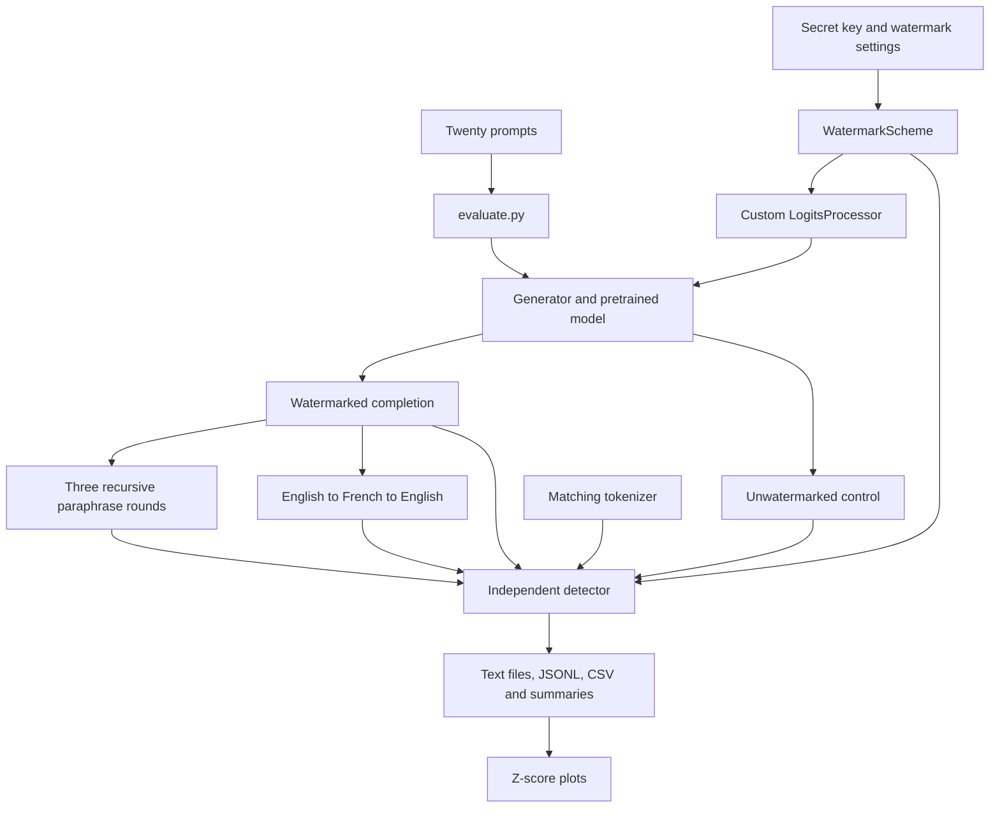

# Paraphrase-Resistant Statistical Watermarking for LLM Output Attribution

## Project implementation and work summary

**Prepared:** 8 October 2026  
**Workspace:** `D:\codings\llm-watermark-prototype`  
**Agreed scope:** The first 30% implementation milestone only  
**Current status:** Core code implemented and tested; pretrained-model attack evaluation remains blocked by downloads.

This document records what was designed, implemented, executed, measured, and left unfinished. It is a summary of the actual project state, suitable for a technical handoff or progress review. It does not treat the synthetic integration experiment as evidence of resistance to semantic paraphrasing.

For simpler explanations and worked examples of the technical terms, see [PROJECT_EXPLAINED.md](PROJECT_EXPLAINED.md).

## 1. Executive overview

We built a Python prototype that inserts a keyed statistical signal while a language model generates tokens and detects that signal afterward using green-token counts and a z-score. The generator and detector use the same deterministic vocabulary partitioning function. Detection can run independently without loading the generation model's weights.

The code also implements the intended evaluation workflow: paired watermarked and unwatermarked completions, three recursive paraphrase rounds, English-to-French-to-English back-translation, incremental result export, and comparison plots.

The following work has actually completed:

- Project files were created on disk after workspace execution recovered.
- Seven unit tests passed, including the actual Transformers logit processor test.
- A CUDA integration smoke test ran real Transformers generation with randomly initialized tiny GPT-2 weights across twenty sample seeds.
- That smoke test scored one hundred condition/sample combinations and exported a CSV, summary, token sequences, and graph.
- A separate detector process reproduced the saved green-token counts and z-scores for both a control and a watermarked fixture.
- The graph was visually inspected and explicitly labels its synthetic scope.
- The project was indexed using the codebase knowledge graph tools.

The following has not completed:

- Loading a pretrained text-generation model for this project.
- Generating the twenty natural-language watermarked passages required by the milestone.
- Executing the implemented semantic paraphrase and translation attacks.
- Producing the real before/after attack z-score plots.

The attempted pretrained-model run failed at tokenizer download before any completion was generated. The remaining blocker is the execution environment's download/network configuration, together with a missing translation dependency in the borrowed interpreter.

## 2. Objective and scope of the 30% milestone

### 2.1 Research problem

The project studies whether a signal embedded at generation time remains detectable after text is rewritten. Instead of training a classifier to recognize general AI-writing patterns, the prototype creates a specific signal and tests for excess use of tokens associated with that signal.

The working question is:

> How does statistical watermark strength change after recursive paraphrasing and back-translation?

The title describes the research direction. The current baseline is not yet demonstrated to be paraphrase-resistant.

### 2.2 Agreed deliverables

| Original milestone item | Implemented component | Execution evidence | Status |
| --- | --- | --- | --- |
| Custom generation hook using an HMAC seed and green-list bias | `watermark.py`, integrated through `generate.py` | Partition tests, batched processor test, actual random-model generation | Implemented and exercised |
| Independent green-ratio/z-score detector | `detect.py` | Unit tests and separate CLI process comparison | Implemented and exercised |
| Twenty prompts subjected to a paraphrase/translation loop | `prompts.json`, `attacks.py`, `evaluate.py` | Pretrained-model attempt failed before generation | Implemented; real execution pending |
| Before/after perturbation graph | `plot_results.py` | Separate synthetic graph exists from `smoke.py` | Real graph pending |

The milestone is therefore not fully complete as originally specified. Its code and synthetic integration checks are complete enough to review, but the natural-language experiment still needs to run.

### 2.3 Work outside the agreed scope

The current milestone does not require a 5,000-passage benchmark, production hosting, a user interface, model fine-tuning, a new watermark algorithm, or a comparison against every published scheme. Large-scale evaluation, broader statistical calibration, and advanced robustness improvements belong to later work, if requested.

No arbitrary completion percentage beyond the user's milestone label is assigned here. Completion is tracked against the concrete deliverables in the table above.

## 3. Architecture

The implementation separates watermark rules, model execution, attacks, detection, and reporting.



The detector does not call the text-generation model. It needs the matching tokenizer, eligible vocabulary, secret key, partition settings, and implementation version. Model weights are necessary for text generation and attacks, not for provenance scoring.

A second path, `smoke.py`, replaces pretrained weights with a small randomly initialized model. It validates the integration mechanically and applies synthetic token substitutions. It is deliberately separate from the natural-language research experiment.

## 4. Files created and responsibilities

| File | Responsibility |
| --- | --- |
| `watermark.py` | Shared HMAC seeding, deterministic green-list construction, eligible vocabulary selection, tokenizer fingerprint, and custom processor factory |
| `generate.py` | Pretrained causal-model loading, CPU/CUDA selection, chat formatting, reproducible sampling seeds, optional watermark processor, and completion extraction |
| `detect.py` | Token counting, repeated-bigram handling, z-score and approximate p-value, key loading, and independent detector CLI |
| `attacks.py` | Paraphrase instruction construction and Marian translation adapter |
| `evaluate.py` | Real experiment orchestration, key creation, manifest recording, incremental exports, memory release between models, status tracking, and final plots |
| `plot_results.py` | Paired paraphrase trajectories and condition comparison plots from recorded measurements |
| `smoke.py` | Offline random-model integration exercise over twenty seeds and synthetic substitutions |
| `check_detector.py` | Creates a local fixture tokenizer and validates the standalone detector against saved smoke samples |
| `test_watermark.py` | Seven unit tests using Python's `unittest` framework |
| `prompts.json` | Twenty fixed explanatory topic prompts |
| `requirements.txt` | Declares the project's Python dependencies |
| `run.ps1` | Windows launcher for tests, smoke checks, and the real experiment |
| `install_dependencies.py` | Project-local workaround for temporary-directory permissions during pip installation |
| `.gitignore` | Excludes virtual environments, runtime files, generated results, caches, and key files |
| `README.md` | Setup and usage instructions, methodological limits, and reference links |
| `VALIDATION.md` | Concise record of checks, measured smoke results, and the download blocker |
| `PROJECT_SUMMARY.md` | This comprehensive work summary |

### 4.1 Local runtime directories

| Directory or file | Current role |
| --- | --- |
| `.venv/` | A project environment was partially created; dependency installation did not complete |
| `.runtime/tmp/` | Project-local temporary directory used while investigating installation failures |
| `.runtime/huggingface/` | Cache destination selected for model downloads |
| `.runtime/matplotlib/` | Writable Matplotlib configuration/font cache |
| `.runtime/python-path.txt` | Records the working interpreter reused for validation |
| `results/` | Stores timestamped experiment and smoke-test artifacts |

The recorded interpreter points to an existing environment in another workspace project. Its packages were reused without installing or changing packages in that environment. This is a local convenience, not a portable dependency setup.

## 5. Watermark generation method

### 5.1 Eligible vocabulary

The implementation reads token IDs from the tokenizer vocabulary, removes special-token IDs, deduplicates the remaining IDs, and sorts them. Sorting establishes a consistent vocabulary order across generator and detector.

Let the number of eligible IDs be `V`. For a requested green fraction `gamma_requested`, the partition size is:

```text
green_size = floor(gamma_requested * V)
gamma_actual = green_size / V
```

The detector uses `gamma_actual`, since integer rounding can make it differ from the requested fraction. Invalid fractions, an empty key, or a partition that is empty or includes the entire eligible vocabulary are rejected.

### 5.2 Context and HMAC seed

The current baseline uses the immediately preceding token ID as context. It does not hash an arbitrarily long prompt or a multi-token context window.

The message consists of a fixed version-specific prefix and the previous token serialized as an unsigned 64-bit big-endian integer:

```text
message = version_prefix || previous_token_as_8_bytes
digest = HMAC-SHA256(secret_key, message)
seed = integer_from_first_16_digest_bytes
```

This avoids ambiguous token-ID string serialization and gives the generation and detection components identical seed inputs.

### 5.3 Vocabulary partition

The seed initializes an explicit NumPy `PCG64` generator. A deterministic permutation of the eligible vocabulary is produced, and the first `green_size` IDs form the green list. Eligible IDs outside that list form the implicit red list.

The implementation identifies this construction as `hmac-pcg64-v1`. Green-list arrays and membership sets are cached with a maximum of 128 context entries each. Repeated contexts can reuse partition calculations.

**Security boundary:** HMAC is cryptographic, but PCG64 is not a cryptographic pseudorandom generator. The current implementation is a keyed research baseline, not a proven cryptographically secure watermark construction.

### 5.4 Logit modification

For the next-token logit of candidate token `v` at step `t`:

```text
modified_logit(v) = original_logit(v) + delta, if v is green
modified_logit(v) = original_logit(v), otherwise
```

The processor returns modified scores for each batch row. It clones the input scores before applying the bias, so the original scores are not modified in place. With `delta = 0`, scores are returned unchanged. Negative or non-finite bias values are rejected.

The hook is a custom Transformers `LogitsProcessor` returned by `make_processor()`. It is passed to `model.generate()` through a `LogitsProcessorList`. This satisfies the required generation-time bias behavior, although the original brief used the `LogitsWarper` name.

### 5.5 Sampling and completion handling

`Generator` loads a tokenizer and pretrained causal model. It uses CUDA with float16 weights when CUDA is available and CPU with float32 otherwise. Chat templates are used when supplied by the tokenizer.

Generation uses sampling rather than greedy decoding. The watermark processor is optional, allowing controls and attacks to use the same adapter without embedding a signal.

The prompt tokens are removed from the returned IDs before scoring. Text is decoded with special tokens omitted and tokenization cleanup disabled. Raw completion IDs are preserved for comparison with decoded and re-tokenized text.

## 6. Independent detection method

### 6.1 Input requirements

The CLI receives a text file and loads the specified tokenizer. The key comes from `--key-file` or the `WATERMARK_KEY` environment variable. The key loader requires at least sixteen bytes. Real experiments generate a random 32-byte key when none is supplied.

To reproduce a result, use the same tokenizer revision, eligible vocabulary, key, green fraction, partition algorithm, and repeated-bigram policy as the generator. The experiment manifest records information needed to identify these settings.

### 6.2 Scorable tokens

The detector walks adjacent token pairs. It excludes:

- The first token, whose preceding prompt context is unavailable in standalone detection.
- Pairs where the previous or current token is outside the eligible vocabulary.
- Repeated occurrences of an already observed token pair when deduplication is enabled.

Deduplication is enabled by default. The `--count-repeats` option disables it. Therefore `scored_tokens` can be lower than the raw completion length or the re-tokenized length.

For no scorable tokens, the detector returns null ratio, z-score, and p-value, with `detected = false`. This is an unscorable case; it is not evidence that the text has no watermark.

### 6.3 Statistic

Define:

| Symbol | Meaning |
| --- | --- |
| `T` | Number of scorable token transitions after filtering |
| `G` | Number of those transitions whose current token is green |
| `gamma` | Actual green partition fraction |

The detector computes:

```text
green_ratio = G / T
z = (G - gamma * T) / sqrt(T * gamma * (1 - gamma))
p_value_approx = scipy.stats.norm.sf(z)
```

The detection decision is `z >= threshold`, with a default threshold of 4. A higher positive z-score indicates greater green-token excess under the selected scheme.

The p-value is explicitly labeled approximate. Token dependence, repeated contexts, and properties of model-generated language complicate calibration. Twenty control samples cannot establish a rare false-positive guarantee.

### 6.4 Meaning of a detection

The detector tests for a signal associated with the supplied key and construction. It is not a general AI-text classifier and does not establish a person's identity, prove authorship, or determine the exact model that wrote arbitrary text.

It also does not guarantee detection after a complete semantic rewrite. That is the research measurement the attack experiment is intended to investigate.

## 7. Intended real experiment

### 7.1 Default configuration

| Setting | Default |
| --- | --- |
| Generation model | `meta-llama/Llama-3.2-1B-Instruct` |
| Requested revision | `main`; resolved commit recorded after loading |
| Prompt count | 20 |
| Requested green fraction | 0.25 |
| Green-token logit bias | 2.0 |
| Detection threshold | 4.0 |
| Sampling temperature | 0.8 |
| Top-p | 0.95 |
| Top-k | Disabled with `top_k=0` |
| Maximum new tokens | 320 |
| Base seed | 1234 |
| Paraphrase rounds | 3 |
| Back-translation path | English to French to English |
| Repeated-bigram filtering | Enabled |

The prompt asks for about 200 words, while generation is bounded by a token limit. This does not force a fixed output length. Actual character, token, and scored-transition counts are recorded.

### 7.2 Conditions and sample count

For each prompt, the script generates an unwatermarked control and a watermarked original using the same seed and sampling settings apart from the watermark processor.

| Condition | Source | Samples in a completed default run |
| --- | --- | ---: |
| `control` | Unwatermarked generation | 20 |
| `original` | Watermarked generation | 20 |
| `paraphrase_1` | Rewrite of original | 20 |
| `paraphrase_2` | Rewrite of paraphrase 1 | 20 |
| `paraphrase_3` | Rewrite of paraphrase 2 | 20 |
| `back_translation` | Original translated to French and back to English | 20 |
| **Total scored texts** | Six conditions per prompt | **120** |

Back-translation branches from the original watermarked passage; it does not follow the third paraphrase round. French intermediate texts are saved but are not counted among the 120 detector-scored English texts.

### 7.3 Recursive paraphrasing

The rewrite instruction asks for different wording and sentence structure while preserving meaning, facts, and approximate length. It asks the model to return only the rewritten passage.

The same causal model adapter is used for generation and paraphrasing in this baseline. The watermark processor is omitted during each paraphrase call. A separate attack model is not implemented.

The three rounds are recursive: each round receives the preceding round's output. Attack seeds are distinct from the original generation seed.

Meaning preservation is requested by the prompt but is not automatically verified. The required real run should include manual inspection of representative outputs for omissions, hallucinations, excessive shortening, or failed rewrites.

### 7.4 Back-translation

The translation adapter uses:

- `Helsinki-NLP/opus-mt-en-fr` for English to French.
- `Helsinki-NLP/opus-mt-fr-en` for French to English.

Translation uses four beams and deterministic decoding. Inputs exceeding the model's context limit are rejected instead of silently truncated. Output is also rejected if generation reaches its limit without the expected end-of-sequence token.

The causal model is released before translation weights are loaded, and the two translation models are loaded sequentially. Garbage collection and CUDA cache release help reduce GPU memory pressure.

This translation path is implemented but has not been executed in this project session.

## 8. Prompt set

The twenty topics stored in `prompts.json` are:

1. Urban trees and cities.
2. Benefits and limitations of solar energy.
3. Public libraries and communities.
4. Importance of coral reefs.
5. Remote work and collaboration.
6. Plastic recycling challenges.
7. Vaccines and immune-system training.
8. Freshwater protection.
9. Satellite navigation.
10. Sleep and learning.
11. Electric and petrol vehicles.
12. Biodiversity in agriculture.
13. Museums and cultural heritage.
14. Public transport advantages and challenges.
15. Passwords and multifactor authentication.
16. Urban expansion and wildlife.
17. Food supply chains.
18. Control groups in scientific experiments.
19. Wind turbines and electricity.
20. Online education benefits and challenges.

These are fixed explanatory prompts created for the prototype. They are not downloaded C4 examples or RealSumm records. No claim is made that the project has processed 5,000 passages or any formal benchmark dataset.

The evaluation CLI accepts a replacement JSON prompt file through `--prompts`, so dataset preparation can be kept separate from watermark generation.

## 9. Result storage and reproducibility

### 9.1 Per-sample measurements

The real evaluation records these fields:

| Field | Description |
| --- | --- |
| `prompt_id` | One-based identifier of the topic prompt |
| `condition` | Control, original, paraphrase round, or back-translation |
| `text_file` | Relative filename of the scored passage |
| `characters` | Saved text length in characters |
| `retokenized_tokens` | Token count when encoded again without added special tokens |
| `scored_tokens` | Transitions used by the detector after filtering |
| `green_tokens` | Green transitions counted |
| `green_ratio` | Green count divided by scored count |
| `z_score` | Standardized green-token excess |
| `p_value_approx` | Approximate one-sided normal tail probability |
| `detected` | Threshold decision |
| `threshold` | Threshold used for that decision |
| `deduplicate` | Whether repeated bigrams were ignored |
| `raw_ids_z_score` | Raw generation-ID score for original/control generations; null for attacked text |

Saving both raw-ID and text-based measurements helps identify decoding/re-tokenization differences that could otherwise look like watermark failure.

### 9.2 Files expected after a completed real run

| Artifact | Purpose |
| --- | --- |
| `manifest.json` | Model identity, resolved commit, vocabulary hash, scheme version, prompts, seeds, settings, dependency versions, device, and translation model identities |
| `status.json` | Loading, running, complete, or failed status; scored-text count and error when applicable |
| `results.jsonl` | Incremental per-text measurements |
| `results.csv` | Tabular version of measurements |
| `summary.json` | Per-condition sample counts, scorable counts, detection counts/rates, mean z-score, and mean scored length |
| `watermark.key` | Random key when no external key file was supplied |
| Condition `.txt` files | Original, control, and attacked English texts |
| Original/control `.token_ids.json` files | Raw completion IDs |
| French `.txt` files | Intermediate translation outputs |
| `paraphrase_z_scores.png` | Paired trajectories through three paraphrase rounds |
| `condition_z_scores.png` | Distributions across controls and all attack conditions |

These are expected outputs of implemented code. The full set is not present for a completed real run because that run has not succeeded.

### 9.3 Failure behavior

Each run gets a new timestamped directory. Already scored samples are written incrementally, and CSV/summary exports are refreshed as records arrive. If an exception occurs within the experiment's guarded execution, the script records a failed status and preserves available measurements.

This is checkpointing, not automatic resume support. There is currently no command to resume a partial run from its last completed condition. A new invocation starts a new directory.

The manifest is written only after successful generation-model loading. Consequently, the observed failed download attempt has a status record and a generated key, but no completed model manifest or scored-text export.

### 9.4 Key handling

The key must be retained to detect the experiment's outputs later. Real experiment keys are saved locally as bytes and are not encrypted by this prototype. `.gitignore` excludes keys and generated results, but users must still avoid including keys in manually shared artifact bundles.

The smoke-test fixture uses an intentionally public constant key. It exists only to reproduce synthetic validation and should not be treated as a secure attribution key.

## 10. Tests executed

The tests run through Python's standard `unittest` runner. `pytest` is declared as an optional testing convenience in the dependency list but is not needed for the executed test command.

| Test | What it checks | Observed result |
| --- | --- | --- |
| `test_partition_agreement_and_key_sensitivity` | Same key/context reproduces partitions; another key changes at least one tested partition; green-list size is correct | Passed |
| `test_invalid_parameters` | Invalid gamma values and empty key are rejected | Passed |
| `test_empty_and_special_boundaries` | Empty/short inputs and ineligible-token boundaries are unscorable rather than causing division errors | Passed |
| `test_known_z_and_deduplication` | Known four-green-transition example gives z=2; repeated-pair filtering affects counts as intended | Passed |
| `test_noncontiguous_vocabulary` | Green lists work for token IDs that are not a contiguous range | Passed |
| `test_batched_processor` | Only green logits receive the bias in two batch rows; input scores are unchanged; delta=0 leaves scores unchanged | Passed |
| `test_synthetic_bias_is_detectable` | A controlled NumPy token-sampling exercise with green bias produces a detectable signal | Passed |

The first test run on the system interpreter passed the six dependency-light tests and skipped the processor test because PyTorch and Transformers were unavailable there. After selecting the existing CUDA environment, all seven tests passed with no skips.

Ten Python files also passed syntax parsing. This verifies syntactic validity, not every runtime path. In particular, neither pretrained generation nor real translation has passed an end-to-end runtime test.

## 11. Offline GPU integration experiment

### 11.1 What actually ran

`smoke.py` constructs a GPT-2 causal model from a local configuration with random weights. It invokes actual Transformers sampling and the actual watermark processor; it does not download pretrained parameters.

| Setting | Smoke configuration |
| --- | --- |
| Model | Randomly initialized tiny GPT-2 |
| Vocabulary size | 128 IDs |
| Eligible vocabulary | IDs 0 through 126; pad ID 127 excluded |
| Green-list size | 31 IDs |
| Actual green fraction | 31/127, approximately 0.2441 |
| Transformer layers | 1 |
| Attention heads | 2 |
| Embedding width | 32 |
| Context positions | 260 |
| Samples | 20 |
| Prompt | Two synthetic token IDs per sample |
| Generated tokens | 200 per control and watermarked sample |
| Sampling | Temperature 1, top-p 1, top-k disabled |
| Bias | 2 |
| Detector threshold | 4 |
| Execution device | CUDA |

For each seed, it generates a control and watermarked sequence. It then selects nominally 10%, 30%, or 60% of the watermarked sequence's token positions and replaces them with sampled eligible IDs. Each replacement condition begins with the original watermarked IDs.

The replacements are synthetic, are not required to preserve meaning, and can coincidentally choose the same ID as the source token. The nominal selected fraction is therefore not necessarily the fraction of IDs that actually change.

This experiment contains five conditions across twenty samples, giving one hundred scored rows. It uses twenty synthetic contexts, not the twenty explanatory prompts in `prompts.json`.

### 11.2 Observed measurements

Source: [saved smoke summary](results/synthetic-smoke-20261008-085721/summary.json).

| Condition | Samples | Mean z-score | Detections at z >= 4 | Observed fraction detected |
| --- | ---: | ---: | ---: | ---: |
| Unwatermarked control | 20 | -0.323660 | 0 | 0% |
| Watermarked | 20 | 14.858979 | 20 | 100% |
| Synthetic replacement of 10% of positions | 20 | 11.861087 | 20 | 100% |
| Synthetic replacement of 30% of positions | 20 | 7.075151 | 20 | 100% |
| Synthetic replacement of 60% of positions | 20 | 2.420828 | 2 | 10% |

These measurements support a narrow implementation conclusion: the configured generation hook produces a detectable green-token excess in the random-model setup, and synthetic replacement weakens the measured signal.

They do not establish a population false-positive rate, meaningful-language quality, robustness to translation, or resistance to semantic paraphrasing.

### 11.3 Graph


Each line represents one synthetic sample. The dashed horizontal line is the declared detection threshold. The graph title explicitly identifies random weights and synthetic substitutions. It was visually inspected after generation.

The natural-language experiment will produce different plots through `plot_results.py`; this smoke figure must remain identified as an integration result.

### 11.4 Artifact directory

The completed smoke directory is:

```text
results/synthetic-smoke-20261008-085721/
```

It includes twenty control-ID files, twenty watermarked-ID files, `results.csv`, `summary.json`, and the PNG graph. The standalone detector validation subsequently added a fixture tokenizer, fixture key, two sample text files, and `standalone_detector_checks.json`.

The smoke script saves raw control and watermarked sequences. It does not currently save every synthetically perturbed sequence as an individual file; their detector measurements are preserved in the CSV, and the replacement procedure and seeds are defined in `smoke.py`.

## 12. Standalone detector validation

`check_detector.py` creates a local WordLevel tokenizer with the same eligible IDs as the smoke setup. It converts the saved first control and watermarked sequences into artificial token-label text, then invokes `detect.py` as a separate process using that local tokenizer and the fixture key.

It compares the returned green counts and z-scores with the corresponding rows in the smoke CSV. Both comparisons passed.

| Measurement | First control | First watermarked sample |
| --- | ---: | ---: |
| Scored transitions | 193 | 196 |
| Green transitions | 47 | 139 |
| Green ratio | 0.2435233161 | 0.7091836735 |
| Z-score | -0.0184728081 | 15.1583361661 |
| Approximate p-value | 0.5073691651 | 3.3369336033e-52 |
| Detection decision | False | True |
| Agreement with saved measurement | Passed | Passed |

Source: [standalone detector checks](results/synthetic-smoke-20261008-085721/standalone_detector_checks.json).

The tiny p-value in the watermarked fixture is the detector's normal approximation under an artificial setup. It is not a calibrated real-world attribution confidence.

This test verifies process separation and scoring agreement for the controlled tokenizer fixture. It does not replace testing the actual Llama/Qwen tokenizer round trip on real completions.

## 13. Environment and troubleshooting work

### 13.1 Initial workspace failure

Earlier terminal attempts failed before commands could start:

```text
helper_unknown_error: setup refresh had errors
```

File-writing attempts also failed. During that period, a complete script was provided in chat, but that was not a successfully saved project. Subsequent checks confirmed the prototype directory did not exist.

The user followed external Windows sandbox troubleshooting steps. After that change, terminal access recovered. The agent did not independently inspect the final global sandbox configuration, so the verified fact is that command execution began working afterward.

The successful phase created the files and artifacts documented here. Earlier chat-only code and unsuccessful write attempts are not counted as completed implementation.

### 13.2 Python temporary-directory permissions

The initial `python -m venv` attempt failed while bootstrapping pip. Python could create a temporary directory but then could not write the bundled pip wheel inside it. Redirecting temporary files into the project still encountered the same mode-related behavior.

`install_dependencies.py` was added to use inherited directory permissions for mode-0700 temporary folders only when their paths are under this project's `.runtime/tmp`. It runs pip installation into the project environment's package directory.

The helper does not alter system ACLs, global sandbox settings, or directories outside the project. Its implementation was added, but a complete dependency installation using it did not succeed because package downloads were separately blocked.

### 13.3 Package installation restriction

Pip configuration reported:

```text
PIP_NO_INDEX=1
```

The install attempt therefore could not obtain the required distributions. An explicit PyPI index argument did not make the attempted installation succeed. The offline configuration was not removed to bypass the session's restriction.

### 13.4 Existing interpreter reused

A search for installed packages found a suitable interpreter at:

```text
D:\codings\mindspace-private-\design-references\tara-film\_tools\tts\Scripts\python.exe
```

Observed versions in that environment were:

| Component | Observed version or availability |
| --- | --- |
| Python | 3.12.10 |
| PyTorch | 2.14.1+cu126 |
| Transformers | 4.46.1 |
| NumPy | 2.5.3 |
| SciPy | 1.18.1 |
| Matplotlib | 3.11.2 |
| CUDA availability | True |
| SentencePiece | Available during dependency inventory |
| Sacremoses | Not available |

The GPU inventory identified an NVIDIA GeForce RTX 4070 Laptop GPU with 8,188 MiB reported memory. The smoke run used CUDA successfully. Pretrained-model memory requirements were not measured because weights were never loaded.

### 13.5 Pretrained model attempt

The attempted real pipeline check used the ungated small model `Qwen/Qwen2.5-0.5B-Instruct` with one prompt and a 128-token output limit. This was intended to check the pipeline before a complete twenty-prompt run; it was not a change to the default Llama configuration.

The attempt failed while requesting `tokenizer_config.json` from Hugging Face. Requests were routed through `127.0.0.1:9`, and the connection was refused. The exact error is preserved in:

```text
results/20261008-085541-448449/status.json
```

The recorded status is `failed`, with `scored_texts = 0`. No meaningful text, paraphrase, or translation measurement resulted from that attempt.

The source of the proxy configuration was not repaired or bypassed. For this project to execute the real run, model downloads must be available from an appropriately configured environment, or compatible local model/tokenizer caches must be supplied. Translation additionally needs its model files and missing dependency.

## 14. Commands and launcher behavior

### 14.1 Re-run checks using the recorded environment

```powershell
cd D:\codings\llm-watermark-prototype
.\run.ps1 test
.\run.ps1 smoke
```

The smoke command creates a new timestamped results directory. The test command does not require model downloads.

### 14.2 Re-run the standalone detector comparison

This command uses the interpreter that passed the checks in this workspace:

```powershell
cd D:\codings\llm-watermark-prototype
& 'D:\codings\mindspace-private-\design-references\tara-film\_tools\tts\Scripts\python.exe' check_detector.py results\synthetic-smoke-20261008-085721
```

The independent detector can also be invoked directly against the existing synthetic fixture:

```powershell
& 'D:\codings\mindspace-private-\design-references\tara-film\_tools\tts\Scripts\python.exe' detect.py results\synthetic-smoke-20261008-085721\01_watermarked.txt --model results\synthetic-smoke-20261008-085721\fixture_tokenizer --key-file results\synthetic-smoke-20261008-085721\fixture.key
```

These commands are tied to this machine's recorded environment. A separately installed project environment can be substituted through `-PythonExe` or by invoking its interpreter explicitly.

### 14.3 Real experiment commands

After download access, dependencies, and model access are available:

```powershell
.\run.ps1 experiment -Model Qwen/Qwen2.5-0.5B-Instruct
.\run.ps1 experiment -Model meta-llama/Llama-3.2-1B-Instruct
```

These are alternatives, not a requirement to run both models. Each defaults to twenty prompts. The Llama option requires access to the requested model repository.

The direct Python CLI in `evaluate.py` additionally exposes the prompt file, revision, output root, key file, gamma, delta, threshold, temperature, top-p, token limit, seed, prompt limit, and repeated-bigram policy.

### 14.4 Interpreter selection

`run.ps1` selects the interpreter in this order:

1. Explicit `-PythonExe` argument, if supplied.
2. The path recorded in `.runtime/python-path.txt`, if that file exists.
3. The project `.venv\Scripts\python.exe`, if present.
4. `python` on the process path.

This ordering matters: creating a new project virtual environment does not automatically override the recorded interpreter. Pass the new interpreter explicitly or deliberately update the local record.

For a fresh environment created outside the restricted session:

```powershell
python -m venv .venv
.\.venv\Scripts\python.exe -m pip install -r requirements.txt
.\run.ps1 test -PythonExe '.\.venv\Scripts\python.exe'
```

A CUDA-capable PyTorch distribution is needed for GPU execution. Installing the requirements alone does not prove that the resulting interpreter can use CUDA; check availability afterward.

## 15. Limitations of the current implementation

| Limitation | Consequence for interpretation |
| --- | --- |
| No successful pretrained text-generation run | Natural-language quality and tokenizer round trips are unverified |
| No executed semantic attacks | Paraphrase/back-translation survival is unknown |
| Random weights in the smoke model | Strong smoke detection cannot be transferred directly to a fluent pretrained model |
| Synthetic substitutions do not preserve meaning | They are mechanical perturbations rather than valid paraphrase attacks |
| Single preceding-token context | Editing a token changes both its own scoring and the following token's context |
| PCG64 partitions | Keyed baseline has no formal cryptographic security guarantee |
| Approximate normal statistic | Reported p-values require empirical scrutiny before real-world confidence claims |
| Twenty controls | Insufficient sample size to establish a rare false-positive rate |
| Manually specified topic prompts | No C4/RealSumm benchmark claim is supported |
| No automatic semantic fidelity metric | Attack quality needs manual checking for the milestone |
| No automatic resume | Interrupted runs retain artifacts but a new run starts afresh |
| Key files stored as local bytes | Secret handling is the user's responsibility when sharing files |
| Broad dependency ranges | Fresh installations can differ from the observed validation environment |
| External interpreter reference | Current launcher setup is machine-specific |
| Translation context/output limits | Long passages may cause an explicit failure rather than a truncated result |

These limits should accompany any progress presentation. They do not invalidate the implemented baseline, but they define what its evidence currently supports.

## 16. Remaining work to finish only the 30% milestone

The remaining work is bounded and does not require expanding into the complete research project.

1. Provide a working environment for required model/tokenizer downloads, or compatible local files.
2. Ensure the selected interpreter has translation dependencies, including Sacremoses.
3. Run a small pretrained-model pipeline check to catch tokenizer, memory, and translation issues.
4. Run the full twenty-prompt configuration across all six conditions.
5. Inspect representative originals, recursive paraphrases, and translations for valid attack behavior and approximate meaning preservation.
6. Verify that the completed run has 120 scored texts, a complete status, manifests, saved intermediates, and both comparison plots.
7. Record the real measurements and replace no synthetic evidence with a research claim.

The milestone can be called complete when generation, independent detection, the twenty-prompt attack loop, and the real graph are all demonstrated. Larger datasets or advanced watermark variants are not prerequisites for this milestone.

## 17. Suggested progress-review wording

The following description matches the evidence available now:

> We implemented an HMAC-seeded green-list statistical watermark using a custom Transformers logits processor and built an independent detector that reports green-token ratio, z-score, and approximate p-value. Seven unit tests and an offline CUDA integration experiment passed. The integration experiment used random model weights and synthetic token substitutions to validate signal insertion and detection. Recursive paraphrase, back-translation, and real-result plotting are implemented, while their twenty-prompt pretrained-model execution remains blocked by model downloads.

Avoid presenting the current work as proven paraphrase resistance, a calibrated AI-text detector, a completed twenty-prompt semantic-attack experiment, or a 5,000-passage benchmark.

## 18. Literature and documentation used

The baseline's green-list approach follows the research direction introduced in [A Watermark for Large Language Models, Kirchenbauer et al., ICML 2023](https://proceedings.mlr.press/v202/kirchenbauer23a.html). The project's keyed seed implementation and software structure are its own baseline choices; they are not a claim of exact reproduction of every paper configuration.

Two references from the original brief were clarified during planning:

- [On the Reliability of Watermarks for Large Language Models](https://arxiv.org/abs/2306.04634) is by Kirchenbauer and collaborators; the reviewed conference version is ICLR 2024.
- Sadasivan and collaborators wrote [Can AI-Generated Text be Reliably Detected?](https://arxiv.org/abs/2303.11156), which is a separate reference.

[Robust Distortion-free Watermarks for Language Models, Kuditipudi et al.](https://arxiv.org/abs/2307.15593) was identified as a later comparative research direction. Its distortion-free method has not been implemented here. No unsupported conference award or venue claim from the original brief is relied upon in this summary.

Technical and operational references include the [Transformers generation utilities](https://huggingface.co/docs/transformers/main/internal/generation_utils), the [Llama model repository](https://huggingface.co/meta-llama/Llama-3.2-1B-Instruct), the [Qwen validation-model repository](https://huggingface.co/Qwen/Qwen2.5-0.5B-Instruct), [PyTorch installation guidance](https://pytorch.org/get-started/locally/), and [Codex Windows sandbox troubleshooting](https://developers.openai.com/codex/windows).

## 19. Related conversation scope

During the session, separate poker-app UI requests were briefly investigated using an existing codebase graph. The user then explicitly set those requests aside and returned focus to the watermarking project. No poker implementation changes were made as part of this work, and no poker deliverables are included in the agreed 30% milestone.

## 20. Evidence index

| Evidence | Local link |
| --- | --- |
| Project usage instructions | [README.md](README.md) |
| Concise validation record | [VALIDATION.md](VALIDATION.md) |
| Shared watermark implementation | [watermark.py](watermark.py) |
| Independent detector | [detect.py](detect.py) |
| Real experiment orchestrator | [evaluate.py](evaluate.py) |
| Attack implementation | [attacks.py](attacks.py) |
| Unit tests | [test_watermark.py](test_watermark.py) |
| Offline smoke implementation | [smoke.py](smoke.py) |
| Standalone detector comparison implementation | [check_detector.py](check_detector.py) |
| Synthetic summary measurements | [summary.json](results/synthetic-smoke-20261008-085721/summary.json) |
| Synthetic per-sample measurements | [results.csv](results/synthetic-smoke-20261008-085721/results.csv) |
| Synthetic graph | [synthetic_smoke_z_scores.png](results/synthetic-smoke-20261008-085721/synthetic_smoke_z_scores.png) |
| Standalone detector comparison results | [standalone_detector_checks.json](results/synthetic-smoke-20261008-085721/standalone_detector_checks.json) |
| Failed pretrained-model attempt | [status.json](results/20261008-085541-448449/status.json) |

**Current milestone boundary:** the code, tests, and offline integration evidence are saved; the real twenty-prompt paraphrase/back-translation experiment and its graph remain the final unfinished deliverable for the requested first 30%.
