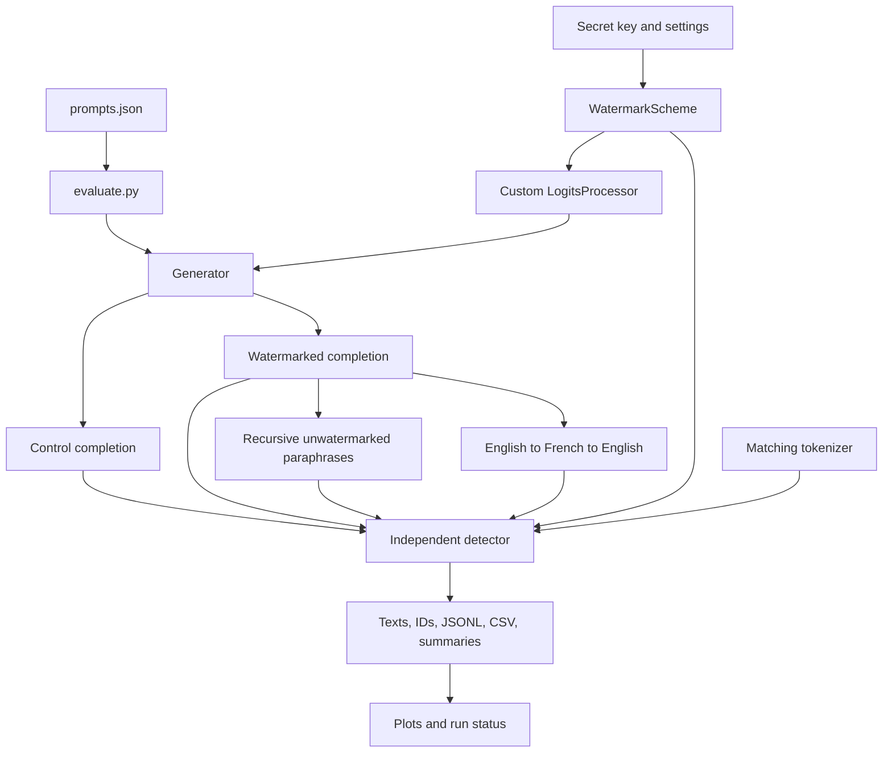

# Statistical Watermarking for LLM Output Attribution

**Problem, proposed solution, implementation, evidence, and remaining work**

**Prepared:** 13 October 2026  
**Project:** `D:\codings\llm-watermark-prototype`  
**Scope:** Detailed technical account of the existing research prototype and its first 30% milestone  
**Evidence cutoff:** Source and saved artifacts inspected on 13 October 2026; saved integration results dated 8 October 2026

The project implements a keyed statistical watermark that influences a language model's token choices during generation. An independent detector reconstructs the keyed rule and measures whether the resulting text contains an unusual excess of favored token transitions. The research question is how much of that signal remains after recursive paraphrasing and English–French–English back-translation.

Core watermark mechanics are implemented and tested. The natural-language generation and attack workflow is implemented, but its pretrained-model execution has not completed. Existing numerical results come from an explicitly synthetic integration experiment using randomly initialized model weights. They establish mechanical signal insertion and detection in that setup; the project's paraphrase-resistance question remains open.

This document uses three distinctions throughout:

- **Implemented:** The behavior exists in source code.
- **Exercised:** A test or saved execution demonstrates that behavior under specified conditions.
- **Established:** Evidence supports a scientific claim within a defined population and threat model.

An implementation can be complete enough to review without establishing its research hypothesis. That distinction is essential to interpreting the current work.

## Contents

1. [The problem and its practical setting](#1-the-problem-and-its-practical-setting)
2. [Research objective and questions](#2-research-objective-and-questions)
3. [Solution concept and alternatives](#3-solution-concept-and-alternatives)
4. [Our approach and design choices](#4-our-approach-and-design-choices)
5. [System architecture](#5-system-architecture)
6. [Watermark construction](#6-watermark-construction)
7. [Generation and sampling](#7-generation-and-sampling)
8. [Independent detection](#8-independent-detection)
9. [Why rewriting can weaken the signal](#9-why-rewriting-can-weaken-the-signal)
10. [The intended natural-language experiment](#10-the-intended-natural-language-experiment)
11. [Artifacts and reproducibility](#11-artifacts-and-reproducibility)
12. [How much is built](#12-how-much-is-built)
13. [Tests and observed results](#13-tests-and-observed-results)
14. [What the evidence supports](#14-what-the-evidence-supports)
15. [Implementation review and known gaps](#15-implementation-review-and-known-gaps)
16. [Environment and operation](#16-environment-and-operation)
17. [Work required to finish the milestone](#17-work-required-to-finish-the-milestone)
18. [Possible later research](#18-possible-later-research)
19. [Relationship to published research](#19-relationship-to-published-research)
20. [Glossary and evidence index](#20-glossary-and-evidence-index)

## 1. The problem and its practical setting

### 1.1 The question of text provenance

Consider a service that generates a passage, which is then copied into another document. A later reader may have access to the passage but no access to the original generation session. The service would like a way to recognize a signal associated with its own generation process.

This becomes harder when the passage is edited. Someone may change words, reorder sentences, shorten the text, paraphrase it repeatedly, or translate it into another language and back. These transformations can preserve much of the meaning while changing the exact token sequence on which a detector operates.

Our project's problem is therefore precise: **can a detectable generation-time signal survive specified meaning-preserving transformations, and how does its strength change?**

Potential applications include provenance research, identifying material produced through an instrumented writing service, and studying how generation traces survive reuse. These are motivating scenarios, rather than deployment capabilities already demonstrated by this prototype.

### 1.2 Why provenance and general AI classification differ

A general AI-text classifier examines an unknown passage and attempts to distinguish human writing from machine writing. Its decision may rely on learned patterns or other properties of the text distribution. Such a classifier can be evaluated on texts from many sources, but a detected pattern does not necessarily identify a specific generating system.

Our watermark detector has a narrower input assumption: a particular key and watermark construction are known. The generator deliberately introduces a preference, and the detector tests for that preference. A positive result concerns the selected keyed scheme. It does not establish the writer's identity or prove that every sentence originated from the same system.

Similarly, a negative result means that the configured test did not find enough evidence. The text may have been unwatermarked, too short, strongly rewritten, encoded with mismatched settings, or simply produced a weak realization of the signal.

### 1.3 The difficulty of preserving evidence while changing wording

Text is discrete. Replacing one token can remove a favored choice and change the context used to classify the next choice. Meaning is also represented through many possible wordings. A detector based on exact local transitions must cope with this flexibility.

The central tension is among three desired properties:

| Property | Desired behavior | What must be measured |
| --- | --- | --- |
| Quality | Watermarked text remains useful and fluent | Readability, factual consistency, instruction adherence |
| Detectability | Original watermarked text produces a measurable signal | Scores and detection rates under fixed settings |
| Robustness | Signal remains after valid transformations | Detection after attacks, alongside attack fidelity and length |

A stronger bias can increase the favored-token signal, but its effect on quality is an empirical question. A rewrite that removes the signal by deleting most of the passage is also a different attack from a faithful rewrite of similar length. Robustness claims must describe both the detector's outcome and what the transformation did to the text.

### 1.4 The threat model for this milestone

The implemented experiment models an instrumented generator and a detector that knows the key. The attacks are unwatermarked rewrites by the same causal model and deterministic back-translation through two translation models. The detector receives the resulting English text and matching tokenizer settings.

| Actor or element | Capability assumed in the prototype |
| --- | --- |
| Generator operator | Can install a custom logits processor and choose a secret key |
| Detector operator | Knows the key, eligible vocabulary, algorithm, and tokenizer |
| Paraphrase process | Receives the passage and rewrites it without the watermark processor |
| Translation process | Translates the original through French and back to English |
| Evaluation runner | Saves texts, scores, configuration, and intermediate French passages |

There is no adaptive attack using repeated detector queries, key extraction experiment, spoofing evaluation, or compromised-key model in the current code. Such threats may matter later, but this milestone measures two specific rewriting paths.

## 2. Research objective and questions

### 2.1 Main objective

Build a reproducible baseline that can insert a keyed token-level statistical watermark, detect it independently, and quantify its change under recursive paraphrasing and back-translation.

The name “paraphrase-resistant watermarking” describes the research direction. Resistance is a hypothesis to test, rather than an outcome already achieved by the existing results.

### 2.2 Questions the experiment is designed to answer

1. Do watermarked originals have higher green-token ratios and detection scores than paired unwatermarked controls?
2. How do scores change after the first, second, and third recursive paraphrase?
3. How do scores change after English–French–English back-translation?
4. How much of any score change accompanies changes in length or failure to preserve meaning?
5. How do raw completion-token scores compare with scores after decoding and re-tokenizing the same text?

The runner measures scores and lengths. Meaning preservation currently requires human inspection; the code does not automatically answer that part of the question.

### 2.3 Success criteria for the first milestone

The first milestone requires a demonstrated generation hook, independent detector, twenty-prompt attack loop, and real before/after plots. A negative robustness finding can still complete the experiment: discovering that an attack destroys detectability is a valid result if the experiment and attack are sound.

Completing this milestone does not require proving universal resistance, reaching a specified detection rate, training a model, or introducing a novel algorithm. Its purpose is to establish a functioning baseline and an honest measurement of that baseline.

## 3. Solution concept and alternatives

### 3.1 Insert a preference and test for its accumulation

The solution operates at the point where a model chooses its next token. For each step, a secret rule selects a subset of vocabulary IDs. These are called green tokens. Their model scores receive a small positive adjustment, making them more likely to be sampled.

No single token is required to reveal the watermark. The detector looks across many transitions and measures whether green choices occur more often than the declared baseline fraction.

This green-list direction follows the framework introduced by Kirchenbauer and collaborators. Their work describes softly promoting a randomized token subset and detecting the resulting signal without generation-model parameters. Our HMAC/PCG64 implementation is a project-specific baseline, rather than a claim of exact reproduction of their software or guarantees. [A Watermark for Large Language Models](https://proceedings.mlr.press/v202/kirchenbauer23a.html)

### 3.2 Where this approach fits

| Approach | Evidence it uses | Relationship to our project |
| --- | --- | --- |
| General text classifier | Properties learned or inferred from writing | A different detection problem; not implemented here |
| External provenance record | A record attached to or associated with content | Could complement watermarking; not implemented here |
| Retrieval of known outputs | Matching against saved generated passages | Would require an output corpus; not implemented here |
| Keyed statistical watermark | A deliberately biased generation distribution | The implemented approach |
| Keyed sampling/alignment scheme | A relationship between sampling randomness and text | A possible later baseline; not implemented here |

These methods answer related questions through different assumptions. Our choice is appropriate for a controlled experiment where the generator can be instrumented and detection should run without loading its model weights.

### 3.3 What “model-independent detector” means here

The detector is independent of model weights and generation API calls. It is not independent of tokenization. It needs the same vocabulary interpretation and partition settings that were used during generation.

This matters because text visible to a reader must be converted back into token IDs before the detector can reconstruct the secret partitions. If tokenization changes, the sequence of contexts and choices can change too.

## 4. Our approach and design choices

### 4.1 A small, explicit baseline

The implementation uses a one-token context, HMAC-SHA256 seed derivation, deterministic PCG64 vocabulary permutations, an additive logits bias, and a green-count z-score. Each piece is small enough to inspect and test separately.

This supports a research baseline whose failures can be diagnosed. The experiment also preserves raw IDs, decoded text, and re-tokenized scores, so generation mechanics and text-level detection can be compared.

### 4.2 Decisions and their consequences

| Decision | Purpose | Consequence or tradeoff |
| --- | --- | --- |
| Use only the preceding token | Keep partition reconstruction local and simple | An edit affects local transition scoring; repeated contexts reuse partitions |
| Derive seeds with HMAC | Bind partition choices to a secret key and an explicit context encoding | Key matching is necessary; HMAC alone does not secure the whole scheme |
| Use PCG64 permutations | Produce deterministic vocabulary subsets using an explicit generator | PCG64 is not a cryptographic PRNG |
| Add a soft bias | Keep every eligible token available while changing relative preference | Quality and signal depend on model and decoding settings |
| Share one scheme implementation | Avoid duplicate partition logic in generator and detector | Agreement tests still need to catch integration mistakes |
| Deduplicate bigrams | Avoid counting identical transitions repeatedly as fresh evidence | Effective sample length decreases; full independence is not established |
| Pair seeds and prompts | Compare controls and originals under similar generation settings | Outputs diverge; matched seeds do not make passages equivalent |
| Use the same model for paraphrases | Keep the first experiment simple | Results describe one attack setup, not all paraphrasers |
| Load translation models sequentially | Reduce simultaneous GPU memory demands | Translation is a later phase and adds download dependencies |
| Save incremental measurements | Retain scored work if a later stage fails | Automatic resume is not implemented |

### 4.3 The engineering contribution at this stage

The project integrates an established watermarking direction into a concrete Python pipeline, implements keyed partition agreement, separates detection from generation weights, and provides both unit-level and independent-process checks. Its additional contribution is an evaluation workflow that is designed to preserve enough artifacts for interpretation.

An original robustness improvement, a formal security proof, or a calibrated attribution guarantee has not been developed. Future contributions should be evaluated against this baseline rather than assumed from its name.

## 5. System architecture



### 5.1 Module responsibilities

| File | Responsibility |
| --- | --- |
| [watermark.py](watermark.py) | Scheme version, keyed partition construction, vocabulary selection, fingerprint, logits processor |
| [generate.py](generate.py) | Pretrained tokenizer/model loading, device selection, prompt formatting, sampling, completion extraction |
| [detect.py](detect.py) | Key loading, token-transition filtering, statistic, text scoring, standalone CLI |
| [attacks.py](attacks.py) | Paraphrase instruction and Marian translation adapter |
| [evaluate.py](evaluate.py) | Natural-language experiment, manifests, recording, model lifecycle, failures |
| [plot_results.py](plot_results.py) | Recursive paraphrase trajectories and condition comparison figures |
| [smoke.py](smoke.py) | Offline random-weight generation and synthetic substitutions |
| [check_detector.py](check_detector.py) | Local tokenizer fixture and separate-process detector comparison |
| [test_watermark.py](test_watermark.py) | Seven unit tests |
| [prompts.json](prompts.json) | Twenty fixed explanatory topic prompts |
| [run.ps1](run.ps1) | Windows launcher and interpreter selection |
| [requirements.txt](requirements.txt) | Python dependencies |
| [install_dependencies.py](install_dependencies.py) | Project-local pip installation helper for temporary-directory permission issues |

### 5.2 Two execution paths

The natural-language path loads pretrained weights and runs actual rewrites and translations. It is the path needed for the research question.

The smoke path initializes a tiny model with random weights. It tests whether Transformers invokes the custom processor and whether the detector recognizes the induced excess. Its substitutions operate on token IDs and are not intended to preserve meaning. The paths share watermark and detection mechanics but answer different validation questions.

## 6. Watermark construction

### 6.1 Tokens and the eligible vocabulary

A token can represent a word, a word fragment, punctuation, or a control symbol. The model assigns each vocabulary entry an integer ID. The watermark uses IDs, rather than visible words, to define its partitions.

`vocabulary_ids(tokenizer)` removes special-token IDs from the tokenizer vocabulary. `WatermarkScheme` deduplicates and sorts the remaining IDs into an integer array. This supports noncontiguous IDs and establishes a deterministic initial ordering.

If the eligible vocabulary has size `V` and the requested fraction is `gamma_requested`, then:

```text
green_size = floor(gamma_requested × V)
gamma_actual = green_size / V
```

The detector uses `gamma_actual`. For example, the smoke vocabulary has 127 eligible IDs. A request for 0.25 produces 31 green IDs, so the actual fraction is `31/127 ≈ 0.244094`.

An empty key, a fraction outside `(0, 1)`, or a partition that is empty or covers the entire vocabulary is rejected. The low-level scheme accepts a nonempty key; the user-facing key loader separately enforces at least sixteen bytes.

### 6.2 Seed derivation

At a generation step, let `previous_token` be the final ID already in the sequence. The implementation constructs:

```text
message = b"llm-watermark-v1\x00" || uint64_big_endian(previous_token)
digest = HMAC-SHA256(key, message)
seed = integer_from_first_16_digest_bytes(digest, byte_order="big")
```

The fixed prefix identifies the seed-message construction. The eight-byte encoding gives the previous token an unambiguous representation. The first sixteen bytes of the digest yield a 128-bit seed.

The seed has two useful properties for this implementation: the same key/context pair recreates the same partition, and changing the key generally changes partitions. Unit tests exercise both properties across several contexts.

### 6.3 Partition creation and caching

The seed initializes `numpy.random.PCG64` through an explicit NumPy `Generator`. A permutation of the sorted eligible vocabulary is created; the first `green_size` IDs form the green array.

The complement is the implicit red list. The code does not need to store it. Green arrays are marked read-only, and a second representation as an immutable set supports detector membership checks.

Both `green_ids()` and `green_set()` use an LRU cache with a maximum of 128 entries per decorated method. Entries are keyed by the method's arguments, including the scheme instance. This makes repeated contexts cheaper; it does not eliminate the cost of partitions for new contexts.

### 6.4 Applying the bias

For candidate token `v`, previous token `c`, and original logit `l(v)`:

```text
modified_logit(v) = l(v) + delta, if v belongs to green_ids(c)
modified_logit(v) = l(v),         otherwise
```

`make_processor()` returns a Transformers `LogitsProcessor`. It clones the scores, derives indices for each batch row, and adds the bias at those indices. It does not mutate the caller's original score tensor. A zero bias returns scores unchanged; negative or non-finite bias values are rejected.

The hook is passed through a `LogitsProcessorList` to `model.generate()`. This provides generation-time biasing without retraining model weights.

### 6.5 A simplified probability example

Suppose the model's total original probability mass on green tokens is `q`. With temperature 1 and no subsequent truncation, adding `delta` to green logits changes that mass to:

```text
q_after = q × exp(delta) / (1 − q + q × exp(delta))
```

For the illustrative values `q = 0.25` and `delta = 2`, this is approximately `0.711`. The bias increases aggregate preference; it does not require every output token to be green.

The example is a mathematical illustration, not a prediction of the real experiment. Model probabilities are nonuniform, green mass varies with context, and our default decoding also uses temperature and top-p filtering. Under an idealized temperature-only calculation, scaling the modified logits changes the effective odds multiplier to `exp(delta / temperature)`; top-p introduces further changes.

### 6.6 Security interpretation

The declared scheme version is `hmac-pcg64-v1`. HMAC is used to bind seeds to a key, but PCG64 is not a cryptographic pseudorandom generator. The combination should be described as a keyed research construction, not as a proven cryptographically secure system.

The implementation does not establish resistance to output-based key inference, forgery, detector-query attacks, or spoofing. Keeping the key private is necessary for the intended experiment, but secrecy alone is not a complete security argument.

## 7. Generation and sampling

### 7.1 Loading and device selection

`Generator` loads `AutoTokenizer` and `AutoModelForCausalLM` from the selected model and revision. It chooses CUDA when available and CPU otherwise. CUDA loading uses float16; CPU loading uses float32. The model is switched to evaluation mode.

If the tokenizer lacks a pad token, the adapter assigns its end-of-sequence token as padding. When a chat template exists, the prompt is formatted as a user message with a generation prompt. Otherwise it is tokenized directly.

### 7.2 Reproducible sampling configuration

Before generation, the adapter sets PyTorch's seed and, on CUDA, CUDA seeds. It then calls generation with sampling enabled, the configured temperature and top-p, `top_k=0`, and a maximum new-token count.

These seeds make a run reproducible under compatible conditions. They do not guarantee identical sequences across devices, dependency versions, numerical kernels, or model revisions. The manifest records several of those conditions so differences can be investigated.

### 7.3 Prompt removal and text decoding

The returned sequence includes input tokens and completion tokens. The adapter removes the input portion before returning IDs. It decodes the completion while omitting special tokens and disabling tokenization cleanup.

This prevents prompt text from being scored as generated output. It also preserves the raw completion sequence for comparison with the sequence obtained by re-tokenizing the visible text. The two can differ because special tokens are omitted and tokenizer encoding/decoding need not preserve every boundary exactly.

### 7.4 Controls and attacks

Watermarking is optional. Controls use an empty processor list. Watermarked originals use the custom processor. Paraphrases use the same model adapter without that processor, so the attack does not intentionally re-embed the selected watermark.

The baseline uses the same causal model for originals and paraphrases. A result from this setup must be described with that model relationship; a separate paraphraser could behave differently.

## 8. Independent detection

### 8.1 Inputs and matching requirements

The standalone CLI takes a text file, tokenizer model/revision, key, green fraction, threshold, and repeated-bigram policy. The key comes from a file or `WATERMARK_KEY`. The CLI loads the tokenizer, reconstructs the scheme, and prints JSON statistics.

Correct reconstruction requires matching the key, tokenization, eligible IDs, fraction, partition algorithm, and counting policy. The current CLI expects the caller to supply these correctly; it does not automatically read and validate the experiment manifest.

### 8.2 Which transitions are counted

For a token sequence `[x0, x1, ..., xn]`, the detector examines adjacent pairs. It asks whether `xi` is green under the partition derived from `x(i−1)`.

It excludes the first completion token because standalone text lacks the preceding prompt context. It skips a pair if either ID is outside the eligible vocabulary. With default deduplication, an identical `(previous, current)` pair is counted only once.

Deduplication matters because an identical pair has an identical classification. Counting it many times would repeatedly amplify the same observed relation. The filter reduces this problem but does not make all remaining observations independent.

### 8.3 The statistic

| Symbol | Meaning |
| --- | --- |
| `T` | Number of scorable transitions after filtering |
| `G` | Number of those transitions classified green |
| `gamma` | Actual green-list fraction |
| `z` | Standardized excess of green transitions |

The implementation calculates:

```text
green_ratio = G / T
z = (G − gamma × T) / sqrt(T × gamma × (1 − gamma))
p_value_approx = scipy.stats.norm.sf(z)
detected = z >= threshold
```

The default threshold is 4. A large positive score indicates green excess under the configured scheme. An empty or unscorable input returns null ratio, z-score, and p-value, with `detected=false`.

For an illustrative passage with `T=200`, `G=100`, and `gamma=0.25`, the score is approximately `8.165`. This example shows how counting becomes a standardized score; it is not an observed project sample.

### 8.4 Why length must be reported

Writing `r = G/T`, the same formula becomes:

```text
z = (r − gamma) × sqrt(T / (gamma × (1 − gamma)))
```

At a fixed excess green ratio, the score grows with `sqrt(T)`. If an attack halves the number of scorable transitions while leaving the ratio unchanged, the score falls by a factor of approximately `sqrt(1/2)`.

Therefore, a lower post-attack score can reflect weaker green preference, reduced length, or both. The runner records characters, re-tokenized token count, and scored transitions to help separate these effects.

### 8.5 P-values and decision limits

The normal tail calculation is an approximation under a simplified null model. Natural token dependence, repeated contexts, and the evaluation protocol complicate calibration. A p-value is not the probability that a human wrote the text or the probability that a particular service generated it.

The threshold is a declared experimental choice. Empirical false-positive estimates require suitable controls and enough samples. The current twenty synthetic controls cannot establish a rare false-positive rate for natural-language text.

## 9. Why rewriting can weaken the signal

### 9.1 Replacement changes choices and contexts

Consider three consecutive tokens `a, b, c`. The detector scores `(a,b)` and `(b,c)`. Replacing `b` with `d` creates `(a,d)` and `(d,c)`, changing both classifications. Even if `c` is retained, its partition is now derived from a different previous token.

For this one-token context, replacement does not permanently shift an absolute-position key stream. Surviving adjacent pairs can retain their original classification. Insertions, deletions, and reordering still break or create local relationships and may alter re-tokenization.

### 9.2 Recursive paraphrasing

The first rewrite may retain some original wording. Later rounds receive the previous rewrite, not the original, so retained fragments can diminish or change over time. Whether enough favored transitions survive is an empirical question. The code does not assume monotonic score reduction; a rewrite can also accidentally increase a score.

### 9.3 Back-translation

The original is translated into French, then the French passage is translated back into English. This can change lexical choices and sentence structure through a separate model path. The watermark detector scores the final English text using the original generation tokenizer. French passages are saved for inspection, not scored as comparable English detector samples.

### 9.4 Validity of an attack

A useful attack evaluation must account for meaning, facts, length, and whether the intended operation occurred. A response containing a refusal, a commentary about rewriting, or a much shorter summary should not silently be interpreted as an equally faithful paraphrase.

Current code requests meaning and approximate length preservation in the paraphrase instruction. It does not enforce those properties. This makes manual inspection part of completing the milestone and motivates stronger checks later.

## 10. The intended natural-language experiment

### 10.1 Default settings

| Setting | Default |
| --- | --- |
| Generation model | `meta-llama/Llama-3.2-1B-Instruct` |
| Requested revision | `main`; resolved model commit recorded when available |
| Prompt count | 20 |
| Requested gamma | 0.25 |
| Delta | 2 |
| Threshold | 4 |
| Temperature | 0.8 |
| Top-p | 0.95 |
| Top-k | 0, disabled |
| Maximum new tokens | 320 |
| Base seed | 1234 |
| Recursive paraphrase rounds | 3 |
| Translation route | English → French → English |
| Repeated-bigram filtering | Enabled |

Each topic prompt asks for approximately 200 words in coherent prose. The token limit bounds generation; it does not enforce the requested word count. Actual lengths must be inspected.

### 10.2 Prompt population

The twenty prompts are fixed explanatory topics: urban trees, solar energy, public libraries, coral reefs, remote work, plastic recycling, vaccines, freshwater, satellite navigation, sleep, vehicles, biodiversity, museums, public transport, authentication, wildlife, food supply chains, scientific controls, wind turbines, and online education.

These prompts provide a small, understandable integration sample. They are not C4 or RealSumm samples and do not define a broad natural-language population. No benchmark-scale claim follows from their count.

### 10.3 Conditions and branches

| Condition | Input/source | Scored texts |
| --- | --- | ---: |
| `control` | Unwatermarked completion of each topic | 20 |
| `original` | Watermarked completion of each topic | 20 |
| `paraphrase_1` | Rewrite of the original | 20 |
| `paraphrase_2` | Rewrite of paraphrase 1 | 20 |
| `paraphrase_3` | Rewrite of paraphrase 2 | 20 |
| `back_translation` | Original translated through French | 20 |
| **Total** | Six English conditions per prompt | **120** |

Back-translation branches directly from the original. It does not follow paraphrase 3. Twenty French intermediate passages are additional artifacts outside the 120 scored English texts.

### 10.4 Execution sequence

For each prompt, the runner generates a control and original with seed `base_seed + prompt_id`. Each paraphrase uses `base_seed + 1000 × round_number + prompt_id`. Every resulting text is scored and exported immediately.

After all control/original/paraphrase outputs, the causal model is released. The English-to-French model translates all originals and saves the French outputs. That model is released before the French-to-English model loads. The resulting English back-translations are scored, and both comparison plots are generated.

This produces 100 scored English texts before translation and 20 afterward. A translation failure can therefore leave substantial partial measurements while still failing the full experiment.

### 10.5 Translation configuration

The adapter uses `Helsinki-NLP/opus-mt-en-fr` and `Helsinki-NLP/opus-mt-fr-en`. It uses four-beam deterministic decoding. Input is tokenized without truncation and checked against the model's maximum position limit. Output is rejected if it reaches the limit without the expected EOS token.

The default original generation cap does not guarantee that a passage fits the translation tokenizer's context: different tokenizers can produce different lengths. A successful small pipeline check must verify both translation directions before committing to the full run.

## 11. Artifacts and reproducibility

### 11.1 What a successful real run saves

Every natural-language experiment creates a timestamped output directory. Its planned contents are:

| Artifact | Purpose |
| --- | --- |
| `NN_control.txt`, `NN_original.txt` | Visible original/control completions |
| `NN_control.token_ids.json`, `NN_original.token_ids.json` | Raw completion IDs for original/control comparisons |
| `NN_paraphrase_1.txt` through `NN_paraphrase_3.txt` | Recursive attack outputs |
| `NN_french.txt` | Intermediate translation for inspection |
| `NN_back_translation.txt` | Final English translation attack output |
| `results.jsonl` | Appended per-text measurements |
| `results.csv` | Tabular measurements rebuilt after each scored text |
| `summary.json` | Per-condition sample counts and aggregate scores |
| `manifest.json` | Scheme, model, decoding, environment, and prompt information |
| `status.json` | Loading, running, complete, or failed state |
| `paraphrase_z_scores.png` | Paired score trajectories across rewrite rounds |
| `condition_z_scores.png` | Score distribution across all six conditions |
| `watermark.key` | Random key when the runner generates one |

This table describes code behavior for the intended real run. The completed synthetic run uses a different artifact layout, and the failed pretrained run did not reach most of these outputs.

### 11.2 Per-text measurement schema

| Field | Meaning |
| --- | --- |
| `prompt_id` | The topic's position in the selected prompt list |
| `condition` | Control, original, rewrite round, or back-translation |
| `text_file` | Relative saved text filename |
| `characters` | Visible text length |
| `retokenized_tokens` | Tokens obtained by encoding the saved text |
| `scored_tokens` | Eligible transitions after filtering/deduplication |
| `green_tokens` | Green transitions among scored transitions |
| `green_ratio` | Green transitions divided by scored transitions |
| `z_score` | Standardized green excess |
| `p_value_approx` | Approximate one-sided normal tail probability |
| `detected` | Threshold decision |
| `threshold`, `deduplicate` | Counting and decision settings |
| `raw_ids_z_score` | Raw completion-ID score for control/original, otherwise null |

Raw IDs are not saved for paraphrases in the current runner. Their decoded texts and re-tokenized measurements are saved. For originals and controls, a difference between raw and re-tokenized scores can identify an encoding boundary that deserves inspection.

### 11.3 Manifest coverage

The manifest records the scheme version, model name, requested revision, resolved model commit when available, vocabulary SHA256, requested/actual gamma, delta, threshold, temperature, top-p, output cap, base seed, deduplication policy, device, PyTorch/Transformers/NumPy versions, selected prompts, key path, and translation model names. Translation commits are added later in the workflow.

The record is useful but incomplete for full reproduction. It does not hash all tokenizer processing configuration, pin translation loading to recorded revisions, capture every effective generation default, or record a source-code commit. The inspected directory has no Git repository metadata. Reproduction therefore requires preserving the source snapshot as well as the manifest and dependencies.

### 11.4 Key handling

If no key file is supplied, the experiment generates 32 random bytes and saves them in its output directory. If a file is supplied, the loader reads its bytes. The manifest records the path; it does not embed the key itself.

The smoke key is deliberately public and serves only as a test fixture. A real experiment's key should be excluded from a publicly shared artifact bundle when secrecy is part of the intended setup. The current implementation does not include a managed key service, rotation policy, or multiple-key attribution workflow.

### 11.5 Partial results and failure status

Each successful recording step saves text, appends JSONL, exports CSV/summary, and updates status. Ordinary exceptions inside the main experiment handler produce a failed status with the count of scored texts and the error message.

The runner does not resume from these checkpoints. Hard termination or an interrupt outside the handled exception path can also leave an earlier status rather than a final failed marker. “Complete” means the runner reached its final stage; current code does not separately certify every text's semantic validity.

## 12. How much is built

### 12.1 Completion should be described through deliverables

The phrase “first 30% milestone” names the agreed project scope. It is not a measured statement that precisely 30% of a full research system has been completed. The most useful assessment is whether each scoped deliverable is implemented, exercised, and supported by relevant evidence.

| Deliverable | Source exists | Execution evidence | Current assessment |
| --- | --- | --- | --- |
| Keyed deterministic partitions | Yes | Partition agreement and key sensitivity tests | Built and exercised |
| Generation-time bias | Yes | Batched test and actual Transformers random-model generation | Built and exercised in synthetic setup |
| Independent detection | Yes | Statistic tests and separate CLI fixture checks | Built and exercised |
| Pretrained model adapter | Yes | Saved attempt failed at tokenizer download | Built; successful pretrained execution pending |
| Twenty topic prompts | Yes | JSON prompt file inspected | Prepared |
| Paired natural-language originals/controls | Yes, orchestration | No successful saved outputs | Execution pending |
| Three recursive paraphrases | Yes | No successful saved semantic attacks | Execution and validity review pending |
| English–French–English translation | Yes | No successful saved translation attacks | Execution and validity review pending |
| Incremental natural-language measurements | Yes | Failure status exists; scored real rows absent | End-to-end exercise pending |
| Real attack comparison figures | Yes | No real experiment figures | Execution pending |
| Synthetic integration experiment | Yes | 100 saved measurements and graph | Completed |
| Documentation | Yes | README and three earlier supporting guides | Available; this document adds a consolidated technical account |

### 12.2 Capability layers

The **algorithm layer** is working under its unit and synthetic checks: partition reconstruction, bias application, counting, and statistic calculation.

The **natural-language workflow layer** is implemented but has not completed against pretrained generation and translation models. Its model, tokenizer, memory, output-quality, and attack interactions remain to be exercised together.

The **research evidence layer** currently consists of synthetic integration measurements. It does not yet contain the twenty-prompt semantic attack comparison needed to answer the main question.

The **operational layer** is a local command-line prototype. A production service, web interface, model training workflow, multiple-tenant key management, monitoring, and broad benchmark suite have not been built as part of this milestone.

### 12.3 Current status in one paragraph

We have built a modular Python baseline for keyed green-list watermarking and independent detection, plus a full small-experiment workflow. Core mechanics pass seven tests and recognize the watermark in a saved random-model integration run. Pretrained generation, recursive paraphrasing, back-translation, and their real comparison plots remain the unfinished demonstration required to complete the first milestone.

## 13. Tests and observed results

### 13.1 Fresh verification on 13 October 2026

During the review immediately preceding this document, `.\run.ps1 test` completed all seven tests with no skips. The standalone `detect.py` command was then run separately on the existing control and watermarked text fixtures using the local fixture tokenizer. Both outputs matched saved green counts and z-scores.

The saved twenty-seed smoke experiment itself was inspected rather than regenerated during that review. This distinction separates newly rerun checks from historical integration evidence.

### 13.2 What the seven unit tests cover

| Test | Behavior exercised |
| --- | --- |
| Partition agreement and key sensitivity | Two equivalent schemes produce matching partitions; another key changes at least some tested partitions |
| Invalid parameters | Rejects selected invalid gamma values and an empty key |
| Empty and special boundaries | Unscorable sequences return null scores |
| Known z-score and deduplication | Checks a hand-constructed score and repeated-pair counts |
| Noncontiguous vocabulary | Partition selection uses supplied IDs rather than assuming a dense range |
| Batched processor | Checks row-specific green bias, unchanged input scores, and zero-delta behavior |
| Synthetic bias detectability | A probability simulation produces a score above the default threshold |

These are meaningful core checks. They do not cover full pretrained generation, translation, semantic fidelity, every invalid numerical input, manifest compatibility, interruption recovery, or attack-result completeness.

### 13.3 Synthetic integration design

The saved run initializes a tiny random GPT-2 with vocabulary size 128, embedding dimension 32, one layer, and two attention heads. ID 127 is padding; the watermark operates over IDs 0–126. No pretrained weights are loaded.

For twenty samples, it constructs a short synthetic prompt and generates 200 completion tokens for a control and a watermarked condition with paired sampling seeds. It then starts from the original watermarked sequence for each substitution condition, selects nominally 10%, 30%, or 60% of its positions, and replaces them with sampled eligible IDs.

There are five conditions across twenty samples: 100 measurements. Replacements can select the same ID already present, so the nominal selected percentage is not guaranteed to equal the exact percentage changed. Each substitution condition starts from the original, rather than recursively modifying a preceding attack.

The smoke test ran on CUDA according to its saved metadata. It validates actual Transformers generation mechanics and synthetic perturbations. Its texts are not fluent pretrained-model passages, and its substitutions do not establish meaning preservation.

### 13.4 Saved aggregate results

Source: [synthetic summary](results/synthetic-smoke-20261008-085721/summary.json).

| Condition | Samples | Mean z-score | Detected at z ≥ 4 | Observed fraction |
| --- | ---: | ---: | ---: | ---: |
| Control | 20 | −0.323660 | 0 | 0% |
| Watermarked | 20 | 14.858979 | 20 | 100% |
| Synthetic replacement of 10% of positions | 20 | 11.861087 | 20 | 100% |
| Synthetic replacement of 30% of positions | 20 | 7.075151 | 20 | 100% |
| Synthetic replacement of 60% of positions | 20 | 2.420828 | 2 | 10% |


The pattern is consistent with successful bias insertion and dilution under replacement in this setup. The apparent strength should not be transferred directly to a pretrained model: a random model's probability structure, vocabulary size, and lack of meaningful language make it a different experimental setting.

### 13.5 Independent-process detector comparison

`check_detector.py` builds a local WordLevel tokenizer matching the eligible smoke IDs, converts the first control and watermarked sequences into artificial token-label text, and invokes `detect.py` as a separate process. Its saved checks compare green counts and z-scores with the smoke CSV.

| Measurement | First control | First watermarked fixture |
| --- | ---: | ---: |
| Scored transitions | 193 | 196 |
| Green transitions | 47 | 139 |
| Green ratio | 0.2435233161 | 0.7091836735 |
| Z-score | −0.0184728081 | 15.1583361661 |
| Approximate p-value | 0.5073691651 | 3.3369336033e−52 |
| Decision | Not detected | Detected |
| Saved comparison | Passed | Passed |
| Fresh direct CLI check | Matched | Matched |

This is evidence that a separate detector process can reproduce the fixture's measurements without generation weights. It does not verify a real Llama/Qwen tokenizer round trip. The very small approximate p-value is also not an empirically calibrated attribution confidence.

### 13.6 Saved pretrained-model failure

A one-prompt check selected `Qwen/Qwen2.5-0.5B-Instruct` and a 128-token cap. It failed requesting tokenizer configuration from Hugging Face through an unavailable proxy at `127.0.0.1:9`.

The [saved status](results/20261008-085541-448449/status.json) reports `status=failed` and `scored_texts=0`. This establishes where that attempt stopped. It does not establish whether the same network conditions still hold today; downloads were not retried for this document.

## 14. What the evidence supports

### 14.1 Supported statements

- Generation and detection share a deterministic keyed partition implementation.
- The processor correctly modifies batched logits in the tested cases.
- Actual Transformers generation with the processor creates detectable green excess in the saved random-model setup.
- A separate detector process reproduces the controlled fixture's score.
- Synthetic token substitution weakens the measured signal in the saved experiment.
- Real attack orchestration and plotting exist in source.

### 14.2 Statements still requiring evidence

- Watermarked pretrained-model passages retain acceptable language quality.
- The baseline survives faithful semantic paraphrasing at a specified detection rate.
- The baseline survives back-translation under the configured models.
- A score threshold gives a calibrated false-positive rate on natural language.
- The key construction resists inference or spoofing.
- The system generalizes across models, languages, domains, or arbitrary text lengths.

### 14.3 Why twenty controls are insufficient

The twenty saved controls are synthetic samples. Even if twenty independent samples came from the relevant natural-language population, observing zero false positives would leave substantial uncertainty.

Under a binomial model with zero events in `n` trials, an exact one-sided 95% upper bound is `1 − 0.05^(1/n)`. For `n=20`, that is approximately 13.9%. This calculation is illustrative: its assumptions do not turn the synthetic controls into a calibrated natural-language evaluation. It shows why zero out of twenty cannot support a rare-error claim.

### 14.4 Reporting real attack results fairly

For each attack, report detection rate, green ratio, score distribution, scored length, and whether the attack preserved the intended content. Paired changes per prompt are useful because they show the trajectory from each original.

An attack with a lower score and approximately unchanged length suggests different behavior from an attack with a lower score and major shortening. A high survival rate among faithful attacks is stronger evidence than a high rate dominated by outputs that copied the original. An unsuccessful paraphrase instruction should be identified as an attack failure, rather than counted as proof of resistance.

## 15. Implementation review and known gaps

### 15.1 Strengths of the current build

The responsibilities are separated into small modules. Vocabulary partitioning is shared rather than independently reimplemented. The detector uses the actual fraction after rounding, handles unscorable inputs, and filters repeated pairs. The processor preserves input tensors. Generation strips prompt IDs and preserves raw completion IDs. The runner records settings and partial progress. Translation has explicit limits, and model loading is sequenced to reduce memory pressure.

These choices improve inspectability and make the baseline a useful starting point for experiments. They do not replace execution against actual pretrained outputs.

### 15.2 Gaps found in source review

| Gap | Consequence | Appropriate next improvement |
| --- | --- | --- |
| No successful real run | Main research question remains unanswered | Run a small full pipeline and then the twenty-prompt experiment |
| No semantic or output-validity gate | Empty, shortened, or invalid rewrites can be included | Flag unscorable/invalid outputs and review attack fidelity |
| Detector does not validate the manifest | Mismatched settings can yield plausible but irrelevant scores | Add a manifest-based loading and compatibility check |
| Fingerprint hashes only vocabulary | Tokenizers with equal vocabularies can still encode differently | Preserve/hash processing and special-token configuration |
| Translation revisions are not load parameters | A later rerun can load different revisions | Pin models/tokenizers to recorded revisions |
| English-to-French commit is persisted only later | Failure before reverse-model loading can leave partial provenance absent | Persist manifest updates immediately after each model loads |
| Direct CSV/JSON overwrites | A hard stop can leave partially written files | Use atomic replacement for snapshot files |
| No resume mechanism | An interrupted real run starts again | Resume validated completed conditions using saved state |
| Hard termination is not covered by ordinary exception handling | Status can remain `running` despite a stopped process | Treat status as a run record, with explicit interruption reconciliation |
| Limited workflow tests | Exports and failure paths are not automatically exercised | Add focused tests for meaningful integration boundaries |
| Broad dependencies and external interpreter | Fresh installs may differ from the validated setup | Create a project environment and record exact working dependencies |

These are review findings and proposed improvements. This document does not claim they have been fixed.

### 15.3 Quality and completion checks

The runner's completion status is procedural. It can accept an unscorable generated passage, for which the detector returns null statistics, and still eventually finish. Summaries record the number of scorable samples, but a single completion marker is not sufficient to certify a valid research run.

The next run should explicitly verify expected sample counts, nonempty text, scorable outputs, coherent paraphrases, completed translations, and readable plots. A later automated gate should distinguish an attack failure from a detector failure.

### 15.4 Performance at larger vocabulary sizes

For a previously uncached context, partition creation permutes the eligible vocabulary. This costs work proportional to vocabulary size. Membership-set construction also requires allocating green IDs. The processor extracts the previous token from the scoring device and creates a device tensor of green indices on each generation step.

The tiny smoke vocabulary cannot establish the overhead on a real model's vocabulary. Profiling should measure tokens per second and peak memory with and without the processor before introducing optimizations. Caching device indices or changing partition construction would also need agreement and versioning checks; performance changes should preserve reproducible scoring.

### 15.5 Statistical and security boundaries

Repeated-bigram filtering addresses repeated evidence but does not establish independence. The approximate normal statistic needs empirical calibration. Trying several keys, thresholds, or document windows and reporting only the strongest result would also change the testing procedure; the present experiment uses a declared key and threshold.

Key secrecy, HMAC use, and deterministic agreement do not imply protection against every attacker. A future security evaluation would need explicit capabilities, query budgets, spoofing tests, and a construction appropriate to those claims.

## 16. Environment and operation

### 16.1 Technology stack

| Dependency | Use |
| --- | --- |
| PyTorch | Model inference, sampling, tensors, device support |
| Transformers | Causal and Marian models, tokenizer adapters, generation hooks |
| NumPy | Vocabulary permutations and synthetic randomization |
| SciPy | Normal survival function for approximate p-values |
| Matplotlib | Saved comparison plots |
| SentencePiece and Sacremoses | Declared tokenization/translation dependencies |
| Python unittest | Current seven-test suite |

`pytest` is declared in requirements, but the launcher invokes `unittest`. The requirements use minimum versions with a Transformers upper bound below version 5; they are not a lockfile.

### 16.2 Interpreter selection and portability

`run.ps1` chooses an explicit `-PythonExe` first, then `.runtime/python-path.txt`, then the project's `.venv`, then `python` on PATH. The recorded path currently references an existing interpreter in another workspace project.

This precedence means creating a fresh local virtual environment does not automatically make the launcher use it. Pass its path explicitly. The launcher also selects project-local Hugging Face and Matplotlib cache/config directories.

Earlier documentation records failed dependency downloads, a partially created local environment, and a missing Sacremoses package in the reused environment. Those are historical observations rather than a new complete dependency inventory. The fresh test and detector checks establish that the selected interpreter supports those specific operations.

### 16.3 Typical commands

Run the current core tests:

```powershell
cd D:\codings\llm-watermark-prototype
.\run.ps1 test
```

Run a new synthetic integration experiment:

```powershell
.\run.ps1 smoke
```

After pretrained models and translation dependencies are available, run a small complete pipeline check:

```powershell
.\run.ps1 experiment -Model Qwen/Qwen2.5-0.5B-Instruct -Limit 1
```

Run the default twenty-prompt experiment with the selected model:

```powershell
.\run.ps1 experiment -Model Qwen/Qwen2.5-0.5B-Instruct
```

The project's original default remains Llama. The Qwen choice is a small alternative already used in the failed attempt, not a model whose completed results have been demonstrated here.

For a separately prepared local environment, pass it explicitly:

```powershell
.\run.ps1 test -PythonExe '.\.venv\Scripts\python.exe'
```

For independent detection, replace the example placeholders with the actual run, model, and resolved tokenizer-compatible revision:

```powershell
python detect.py results\RUN\01_original.txt --key-file results\RUN\watermark.key --model MODEL --revision COMMIT
```

Custom gamma, threshold, or repeat settings must also match the experiment. The README's concise command assumes their defaults. `check_detector.py` can validate a smoke directory using a local tokenizer fixture and the same working interpreter.

### 16.4 Installation helper

`install_dependencies.py` redirects temporary files under this project's `.runtime/tmp`, adjusts the requested mode for certain temporary-directory creation calls in that path, and invokes pip with a target under the project's `.venv/Lib/site-packages`.

It is a narrow environment workaround, not an experiment component or a complete replacement for ordinary virtual-environment setup. It does not supply missing pretrained weights or establish network availability. Successful project-local installation through this helper has not been demonstrated in the recorded work.

## 17. Work required to finish the milestone

### 17.1 Execution sequence and acceptance evidence

| Step | Work | Evidence needed before advancing |
| --- | --- | --- |
| 1 | Prepare a working project environment | Core tests pass; generation and translation dependencies import |
| 2 | Make selected model/tokenizer files available | Both causal model and translation directions load |
| 3 | Run one prompt through all six conditions | Six scored English texts, saved French intermediate, valid outputs, plots |
| 4 | Resolve real integration failures | Model context, memory, tokenization, and output problems handled |
| 5 | Run all twenty prompts | 120 English measurements and 20 French intermediate texts |
| 6 | Review attack fidelity and lengths | Recorded examples of meaningful rewrites/translations and any exclusions |
| 7 | Inspect scores and figures | Paired score changes, summaries, raw/re-tokenized comparisons |
| 8 | Update validation documentation | Actual model/settings/results, honest conclusions, remaining limits |

A one-prompt run is useful because it reaches translation and plotting as well as causal generation. A generation-only success would leave major integration boundaries unchecked.

### 17.2 A completed-run checklist

- The intended prompt count and six conditions are present.
- Every expected measurement refers to a saved readable text.
- Null or invalid measurements are identified and explained.
- Originals and paraphrases are coherent enough for the stated task.
- Meaning changes, copying, substantial shortening, and failed rewrites are documented.
- French intermediates and final back-translations are saved and inspected.
- The manifest identifies model and dependency settings sufficiently for the reported run.
- Both real comparison plots exist and reflect the recorded measurements.
- Status reports completion, and artifact counts agree with that status.
- Synthetic results remain labeled separately from semantic attack results.

This is an experiment acceptance standard, not a requirement that detection survives every attack. The milestone is complete when the system and its real measurements are demonstrated and reviewed.

## 18. Possible later research

The following ideas are future directions, not changes already implemented or prerequisites for the bounded first milestone.

### 18.1 Stronger evaluation

Use more prompts and domains, suitable human-written negatives, held-out settings, confidence intervals, and explicit attack-fidelity assessment. Evaluate several passage lengths because detection power depends on scorable transitions. Test more than one paraphraser and document the relationship between generation and attack models.

A robustness comparison should hold its reporting procedure fixed and report paired score/length changes. Parameter sweeps should separate exploratory tuning from a held-out final evaluation.

### 18.2 Quality versus signal

Measure the effect of gamma, delta, temperature, and sampling truncation on both text usefulness and detectability. A configuration with a stronger signal is not automatically preferable if it substantially worsens output. This project has not yet measured that tradeoff with pretrained text.

### 18.3 Alternative constructions

Possible comparisons include different context windows, cryptographic partition mechanisms, keyed sampling approaches, and detectors that search document spans. Each would need an explicit scheme version and independent agreement checks.

Larger context windows can change the reach of an edit; a local edit may alter several later partitions. Span detection can find watermarked fragments in larger documents but introduces a different testing procedure. These choices should be justified through measured attack behavior rather than assumed improvements.

### 18.4 Operational development

If the research baseline becomes a service, later work could include managed keys, manifest-based detection, compatibility validation, durable run state, profiling, user-facing interpretation, and deployment monitoring. Production readiness would require a separate scope and acceptance criteria.

## 19. Relationship to published research

### 19.1 Green-list watermarking

Kirchenbauer and collaborators' ICML 2023 paper introduces a framework that favors a randomized green subset during generation and statistically detects the signal. Our implementation takes that direction as its baseline. The project's explicit HMAC message encoding, PCG64 partitions, caching, and experiment orchestration are implementation choices. Published results do not automatically apply to these choices or our models. [A Watermark for Large Language Models](https://proceedings.mlr.press/v202/kirchenbauer23a.html)

### 19.2 Reliability after rewriting

Kirchenbauer and collaborators' reliability study evaluates transformations including human and model paraphrasing and mixture with other text. It reports that residual fragments can support detection when sufficient text is observed. This motivates measuring retained signal and length jointly, but does not predict that our twenty-prompt baseline will succeed. The paper is identified as ICLR 2024 in its primary record. [On the Reliability of Watermarks for Large Language Models](https://arxiv.org/abs/2306.04634)

### 19.3 Adversarial detection limits

Sadasivan and collaborators investigate recursive paraphrasing, vulnerabilities of several detector types, and watermark spoofing. Their results motivate evaluating an attack rather than inferring robustness from an original-text score. They should not be reduced to a claim that every detector always fails: the paper discusses sensitivities under particular conditions and theoretical assumptions. [Can AI-Generated Text be Reliably Detected?](https://arxiv.org/abs/2303.11156)

### 19.4 Distortion-free keyed sampling

Kuditipudi and collaborators study a different approach that ties model sampling to keyed randomness and uses alignment for detection. It provides a relevant future comparison to additive logits bias. We have not implemented their sampling schemes or alignment detector, and we do not claim distortion-free generation. [Robust Distortion-free Watermarks for Language Models](https://arxiv.org/abs/2307.15593)

These four primary sources were checked while preparing this document. Their role is to position the project; project-status claims are grounded in the local source and artifacts listed below.

## 20. Glossary and evidence index

### 20.1 Glossary

| Term | Meaning in this project |
| --- | --- |
| Attribution | Evidence associated with a configured generation process/key; not proof of a person's identity |
| Token | A model vocabulary unit represented by an integer ID |
| Tokenizer | Text-to-ID and ID-to-text conversion machinery |
| Eligible vocabulary | IDs available to the partition after special-token exclusion |
| Green list | Context-dependent subset whose logits receive a positive bias |
| Gamma | Fraction of eligible IDs designated green |
| Delta | Additive bias applied to green logits |
| Logit | A model score used to derive sampling probabilities |
| Temperature | Scaling parameter affecting the sampling distribution |
| Top-p | Sampling restriction based on cumulative probability mass |
| HMAC | Keyed message authentication construction used here for seed derivation |
| PCG64 | Deterministic pseudorandom generator used to permute the vocabulary |
| Bigram | Adjacent token pair |
| Deduplication | Counting identical token pairs only once |
| Z-score | Standardized excess of observed green transitions |
| Approximate p-value | Normal-tail statistic under the declared approximation |
| False positive | Detection in a relevant negative sample under the evaluated procedure |
| Recursive paraphrase | A rewrite whose input is the previous rewrite |
| Back-translation | Translation through another language and back |
| Smoke test | Small integration exercise demonstrating that components work together |
| Manifest | Saved configuration and provenance information for a run |

### 20.2 Local evidence

| Claim or topic | Evidence |
| --- | --- |
| Setup and commands | [README.md](README.md), [run.ps1](run.ps1) |
| Earlier comprehensive project record | [PROJECT_SUMMARY.md](PROJECT_SUMMARY.md) |
| Plain-language explanations | [PROJECT_EXPLAINED.md](PROJECT_EXPLAINED.md) |
| Earlier validation status | [VALIDATION.md](VALIDATION.md) |
| Exact watermark construction | [watermark.py](watermark.py) |
| Model generation adapter | [generate.py](generate.py) |
| Detector implementation | [detect.py](detect.py) |
| Attack implementation | [attacks.py](attacks.py) |
| Natural-language workflow | [evaluate.py](evaluate.py), [prompts.json](prompts.json) |
| Real plotting implementation | [plot_results.py](plot_results.py) |
| Test coverage | [test_watermark.py](test_watermark.py) |
| Synthetic experiment procedure | [smoke.py](smoke.py) |
| Synthetic aggregate measurements | [summary.json](results/synthetic-smoke-20261008-085721/summary.json) |
| Synthetic per-sample measurements | [results.csv](results/synthetic-smoke-20261008-085721/results.csv) |
| Synthetic figure | [synthetic_smoke_z_scores.png](results/synthetic-smoke-20261008-085721/synthetic_smoke_z_scores.png) |
| Independent fixture procedure | [check_detector.py](check_detector.py) |
| Saved independent detector agreement | [standalone_detector_checks.json](results/synthetic-smoke-20261008-085721/standalone_detector_checks.json) |
| Failed pretrained attempt | [status.json](results/20261008-085541-448449/status.json) |

### 20.3 Review boundary

This account combines source inspection, existing experiment artifacts, freshly rerun core tests and detector fixture checks, and a focused primary-source literature check. It does not report a new pretrained run, a new synthetic run, a repaired environment, or implemented fixes for the review findings.

The current deliverable is a reviewable baseline with demonstrated core mechanics. Its next decisive artifact is the completed, inspected twenty-prompt natural-language attack experiment.
