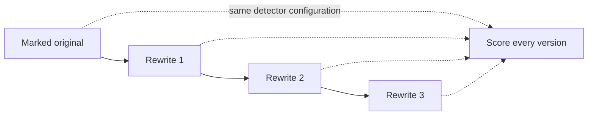
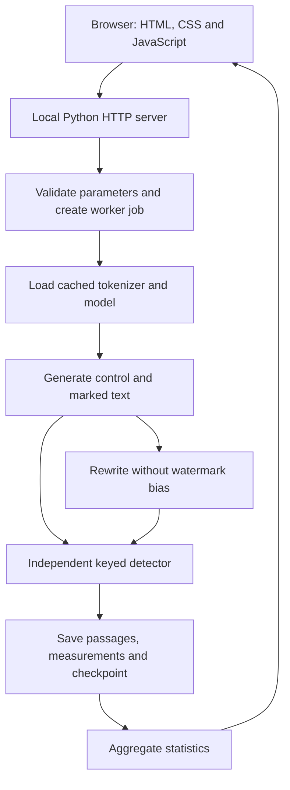

# Watermark Lab: the complete project, app, mathematics, research and presentation guide

**Prepared:** 22 October 2026.  
**Project:** Statistical watermarking of language-model text under rewriting.  
**Audience:** A reader who wants to understand and explain the project, rather than memorize technical terms.  
**Evidence:** Current source code, saved local measurements, and the primary research sources linked in this document.

The application and experiment are evolving. The results chapter is a dated snapshot of saved measurements, not a promise that the live dashboard will continue showing identical counts. Earlier presentation slides and documents describe earlier milestones. Where their planned experiment differs from the current research run, this guide explains that difference.

**Current outcome:** The planned local run has finished all 210 cells and 1,050 measurements. All three methods detected 60/60 main-stage originals. After the first rewrite, detection was 2/60 for the baseline, 5/60 for stronger bias, and 2/60 for the fixed variant. After the third rewrite, those counts were 0/60, 0/60 and 1/60. This establishes a substantial local robustness limitation, while quality review and human false-positive evaluation remain unfinished. Chapter 11 gives the verified tables and their limits.

## Contents

1. [What this project actually is](#1-what-this-project-actually-is)
2. [The problem statement and why we chose it](#2-the-problem-statement-and-why-we-chose-it)
3. [What a text watermark means](#3-what-a-text-watermark-means)
4. [How the model writes and how we add the pattern](#4-how-the-model-writes-and-how-we-add-the-pattern)
5. [Every score and setting explained](#5-every-score-and-setting-explained)
6. [A worked explanation of your screenshot](#6-a-worked-explanation-of-your-screenshot)
7. [The complete application UI](#7-the-complete-application-ui)
8. [The research dashboard](#8-the-research-dashboard)
9. [What happens behind the interface](#9-what-happens-behind-the-interface)
10. [The experiment design](#10-the-experiment-design)
11. [Measured results and what they support](#11-measured-results-and-what-they-support)
12. [Why rewriting weakens detection](#12-why-rewriting-weakens-detection)
13. [The research papers and what they say](#13-the-research-papers-and-what-they-say)
14. [What we have achieved and what we have not](#14-what-we-have-achieved-and-what-we-have-not)
15. [The next research steps and what a better number means](#15-the-next-research-steps-and-what-a-better-number-means)
16. [How to present and demonstrate the app](#16-how-to-present-and-demonstrate-the-app)
17. [Questions a reviewer may ask](#17-questions-a-reviewer-may-ask)
18. [Running, recovering and troubleshooting](#18-running-recovering-and-troubleshooting)
19. [Code and data reference](#19-code-and-data-reference)
20. [Glossary and references](#20-glossary-and-references)

## 1. What this project actually is

Watermark Lab is a local research application for answering a specific question:

> If we intentionally influence an AI model's word choices using a secret pattern, can we detect that pattern later, and how much of it survives rewriting?

The app contains three connected capabilities:

1. **Insertion:** Generate text while slightly favoring a secret set of token choices.
2. **Detection:** Reconstruct the secret choices and measure how unusually often the text follows them.
3. **Stress testing:** Rewrite the text, score it again, and compare methods across many saved examples.

The important distinction is between **detecting a deliberately inserted pattern** and **detecting every possible piece of AI writing**. Our detector does the first. A paragraph from an unrelated model may be entirely AI-generated and still have no match to our key.

The project has two browser interfaces:

| Interface | Address | Purpose |
|---|---|---|
| Single-passage lab | [localhost:8765](http://127.0.0.1:8765/) | Generate a pair, inspect one passage, try rewriting, and inspect earlier experiments. |
| Research bench | [localhost:8766](http://127.0.0.1:8766/) | Run and inspect a resumable comparison of three methods across topics, seeds and lengths. |

These addresses are local to the computer running the servers. Opening the same link on a different machine does not connect to this machine's experiment.

The writing model used in the current real-text research run is `Qwen/Qwen2.5-0.5B-Instruct`. The watermark is applied at generation time. We have not trained a new language model or fine-tuned Qwen to create this watermark.

The most accurate current project description is:

> A reproducible local testbed for studying the detectability, rewriting sensitivity and quality tradeoffs of keyed statistical text watermarks.

Calling it a proven solution for plagiarism, a universal AI detector, or a rewrite-proof watermark would go beyond the evidence.

## 2. The problem statement and why we chose it

### 2.1 The practical problem

Text is easy to copy, edit and redistribute. A generation service may want an identifiable signal in its output even when a person copies only the words and leaves behind filenames, account information or metadata.

A watermark attempts to carry evidence in the actual text. That makes the problem interesting: a signal embedded in word choices may survive copying, but edits can change those choices.

Our research problem can be stated precisely:

> Evaluate whether a keyed token-selection watermark remains detectable after recursive paraphrasing, and compare detectability against generation quality, output length, accidental detector triggers and computational cost.

The current measured study addresses recursive paraphrasing. Back-translation is implemented elsewhere in the project but is not part of this research run's completed measurements. Semantic watermarking is a proposed comparison, not a currently implemented feature.

### 2.2 Why this baseline was a sensible starting point

The baseline offered several practical advantages for a prototype:

- It can be added to the generation process without retraining the model.
- The insertion rule and detector use the same explicit mechanism.
- The detector can work without loading the model's neural-network weights.
- Its main statistic can be explained mathematically and demonstrated with small examples.
- Strength and length can be varied in controlled experiments.
- Failures are observable: the same text can be followed through multiple rewrites.

These properties let us build something testable before attempting a more complex method. This rationale is our engineering interpretation of why the approach suits this project; it is not evidence that we compared every possible method before selecting it.

The foundational green-list approach is described by Kirchenbauer and colleagues in [A Watermark for Large Language Models](https://proceedings.mlr.press/v202/kirchenbauer23a.html). Our implementation belongs to that general family, with project-specific keying, pseudorandom partitioning and scoring choices. It is not a certified reproduction of every experiment or security claim in the paper.

### 2.3 Why study something that can fail?

Research should characterize when a mechanism works and when it breaks. A method can be valuable as a baseline even if it is unsuitable as the final solution.

There are two separate milestones:

1. **Engineering milestone:** We can insert, recover, measure and display a signal correctly.
2. **Research milestone:** We can demonstrate a useful operating range under declared transformations and error rates.

The first does not automatically establish the second. Our app makes that gap visible. A paraphrase that defeats the detector is a meaningful result, provided we also examine whether it preserved the original meaning and whether the original was detectable in the first place.

### 2.4 The threat model

The current setting assumes:

- We control the model's sampling process while generating the marked original.
- Detection uses the correct watermark scheme, key, tokenizer and favored fraction.
- An attacker can obtain the marked text and ask a model to rewrite it.
- The rewriting step does not apply our watermark processor again.
- The detector is then asked to identify the original pattern in the rewritten text.

The current automatic attack does not query the detector repeatedly to optimize a rewrite. It is an instruction-based paraphrase chain using declared seeds. Adaptive detector-guided attacks, spoofing, key extraction and commercial-scale adversaries are additional research settings.

## 3. What a text watermark means

### 3.1 Tokens, words and token IDs

A language model chooses **tokens**, which are units from its tokenizer's vocabulary. A token may represent a whole word, part of a word, punctuation or a space-related fragment. Each token has a numerical ID.

The numbers seen in the numeric test are token IDs. They are not scores and are not supposed to form readable paragraphs.

The same sentence may tokenize differently under different models. Therefore, the tokenizer is part of the watermark configuration. The detector cannot assume that a token ID from one tokenizer means the same thing under another.

### 3.2 A pattern spread through many choices

Our watermark does not insert a visible label, zero-width characters, a fixed phrase, or a hidden file attachment. Instead, it makes certain valid next-token choices more likely.

For each generation step, some eligible tokens are designated **green**, meaning favored. Other eligible tokens remain available. A sentence can still be written normally, while a collection of choices across the paragraph carries a statistical pattern.

An individual green token is not proof of a watermark. Ordinary text also contains green choices. Detection depends on their aggregate frequency relative to the expected baseline.

### 3.3 The key, the random seed and the tokenizer are different things

| Item | Role | Secret? |
|---|---|---|
| Watermark key | Determines the favored vocabulary partitions. | Intended to remain private. |
| Generation random seed | Initializes the model's sampling randomness. | Usually recorded openly for reproducibility. |
| Tokenizer | Converts text to IDs and IDs to text. | Normally public. |
| Model weights | Produce the next-token logits. | Required for generation, not for this detector. |
| Detection cutoff | Converts a numerical score into a binary verdict. | Public experimental setting. |

The same generation seed does not replace the key. The same key does not guarantee identical text, because the prompt, seed, model and sampling settings can still differ.

### 3.4 Why a detector can operate without the language model

During detection, we do not ask Qwen whether a paragraph sounds like its writing. We tokenize the paragraph, reconstruct which choices would have been green, and count matches.

That process needs the tokenizer and the keying rule. It does not require running the model's large matrix operations. Checking a passage may still load tokenizer files, but that is different from loading generation weights.

### 3.5 What this is not

This is not a digital signature of every byte in a document. It does not authenticate a named human author. It is not encryption. It does not establish that the text's factual claims are true. A high score means the passage aligns unusually strongly with this particular pattern under the test being used.

## 4. How the model writes and how we add the pattern

### 4.1 Ordinary generation

The model receives a prompt and computes a score, called a **logit**, for each possible next token. Sampling turns those scores into a probability distribution and chooses a token. The chosen token becomes part of the context for the next step.

In `generate.py`, generation uses:

- The model's chat template when one is available.
- Sampling rather than purely greedy decoding.
- Temperature and top-p settings.
- `top_k=0`, disabling a separate top-k restriction.
- A maximum number of new tokens.
- CUDA and float16 when CUDA is available; otherwise CPU and float32.

The model is placed in evaluation mode and run with inference mode. There is no training loop in this workflow.

### 4.2 Constructing the green list

`watermark.py` starts with sorted eligible vocabulary IDs, excluding the tokenizer's special IDs.

For a previous token ID `u`, it:

1. Encodes a versioned message containing `u`.
2. Computes an HMAC-SHA256 digest using the private watermark key.
3. Uses the first 16 digest bytes as a seed for NumPy's PCG64 generator.
4. Permutes the eligible vocabulary deterministically.
5. Takes the first `floor(gamma_requested × vocabulary_size)` IDs as green.

The same key, previous token and vocabulary reproduce the same green list. A different context normally produces a different partition.

The actual green fraction is:

```text
gamma_actual = floor(gamma_requested × eligible_vocabulary_size)
               / eligible_vocabulary_size
```

This can differ slightly from the requested value because the green-list size must be a whole number. The baseline detector uses the actual fraction stored in the scheme.

HMAC-SHA256 is a cryptographic primitive, but the full construction uses PCG64, which is not a cryptographically secure pseudorandom generator. Using HMAC in one step does not establish cryptographic security for the whole scheme. The project explicitly identifies this as a research baseline.

### 4.3 Applying watermark strength

For token `v` at a step whose green list is `G`, the processor applies:

```text
modified_logit(v) = original_logit(v) + delta    if v belongs to G
modified_logit(v) = original_logit(v)            otherwise
```

`delta` is the watermark strength. It is an additive bias on logits, not a percentage of words changed.

To understand the effect, consider a simplified softmax without subsequent temperature changes or probability truncation. Promoting a green token by `delta` multiplies its unnormalized probability weight by `exp(delta)`. At delta 2 this factor is about 7.39; at delta 3 it is about 20.09.

This does **not** mean its final probability is multiplied by exactly that amount: the distribution is normalized again, other green tokens are also boosted, temperature changes relative weights, and top-p can change the retained candidate pool. With temperature `tau`, a simplified relative-odds factor is `exp(delta/tau)` when the bias is applied before temperature scaling.

At delta 0 the processor leaves the logits unchanged. At positive delta it encourages the pattern without requiring every chosen token to be green.

### 4.4 Why stronger bias can damage writing

The model may prefer a non-green token for grammatical or factual reasons. A large green-list bias can push it toward a less suitable alternative. Possible symptoms include repetition, awkward phrasing, reduced instruction following, irrelevant additions or failure to end naturally.

These are hypotheses to evaluate using passages, quality reviews and completion statistics. A large original z-score does not measure fluency or factual correctness.

### 4.5 Paired ordinary and watermarked generation

The app generates an ordinary control and a marked passage using the same prompt and generation seed. The marked generation receives the watermark processor; the control does not.

This is a useful comparison, but it does not hold every word fixed. As soon as sampling chooses a different token, the model's subsequent context changes. The passages can therefore diverge substantially. We must compare their actual quality, not assume that matched seeds imply matched sentences.

### 4.6 The three methods in the research bench

| Method | Context used for partitioning | Strength | What it tests |
|---|---|---:|---|
| Previous-token baseline | Immediately preceding token | 2 | Current baseline insertion and rewriting sensitivity. |
| Stronger previous-token method | Immediately preceding token | 3 | Whether more bias improves survival, and at what quality/completion cost. |
| Fixed-vocabulary experimental variant | A constant context value of 0 | 3 | Whether removing dependence on the previous token changes robustness. |

All use a requested gamma of 0.25 in this run.

The fixed variant reuses the same green vocabulary set at every position. Its detector counts distinct eligible token IDs rather than distinct adjacent pairs. It is inspired by fixed-grouping research, but changes enough details that the published paper's guarantees cannot be assigned to our implementation.

It is especially important that **fixed vocabulary does not mean semantic watermarking**. There is no semantic encoder in the current fixed variant.

## 5. Every score and setting explained

### 5.1 The z-score

For the previous-token detector, let:

- `T` = number of eligible, distinct adjacent token pairs counted.
- `G` = number of those pairs whose current token belongs to the green set determined by the previous token.
- `gamma` = actual green fraction of the eligible vocabulary.

The implementation computes:

```text
expected_green_count = gamma × T
reference_standard_deviation = sqrt(T × gamma × (1 − gamma))

z = (G − gamma × T) / sqrt(T × gamma × (1 − gamma))
```

In ordinary language:

> How far above the reference green-count expectation is this passage, measured in reference standard deviations?

The reference model resembles a binomial count of green choices. Natural language is dependent and nonuniform, so this is an approximate statistical model rather than an automatic proof of a true normal null distribution.

### 5.2 How to read positive, zero and negative scores

| Score behavior | Interpretation |
|---|---|
| Large positive z | Many more green choices than the reference expectation. |
| z near 0 | Green frequency is close to the reference expectation. |
| Negative z | Fewer green choices than the reference expectation. |
| No score / `null` | There were no eligible evidence units; the denominator would be zero. |

A z-score is not constrained to 0–100. A negative result is mathematically normal. A score of 11 does not mean 11% AI. A score near zero does not mean 0% AI.

### 5.3 The detection cutoff

The ordinary rule is:

```text
detected = score exists AND z >= cutoff
```

The current main comparison uses cutoff 4. This is a declared experimental choice. It is not a universal boundary between human and AI writing.

Raising the cutoff generally reduces detections of both marked and unmarked text. Lowering it generally increases both. Changing the cutoff after seeing test outcomes can make a result look better without improving the watermark itself.

### 5.4 The approximate p-value

`detect.py` returns `norm.sf(z)`, the upper-tail probability of a standard normal variable beyond z.

Under an ideal standard-normal null, z=4 corresponds to about `3.17 × 10^-5`. That number is **not an empirically established false-positive rate for this app**. Dependence, vocabulary structure, repeated content, selection of examples and differences among domains can invalidate the ideal calibration.

A p-value is also not the probability that the passage is human-written, not the probability that AI wrote it, and not the probability that the detector's verdict is correct. Those are different inferential questions.

The fixed-vocabulary detector deliberately exports no approximate p-value. Its evidence units and dependencies differ, and reusing a familiar formula does not establish a calibrated significance test.

### 5.5 Favored choices / green ratio

```text
green_ratio = G / T
displayed_favored_share = 100 × green_ratio
```

If gamma is approximately 0.25, the reference green share is approximately 25%. A displayed share of 59.5% means 59.5% of counted evidence units were green. It does not mean 59.5% of the paragraph is AI-authored.

Do not confuse **gamma**, which defines the green portion of possible vocabulary choices, with **observed green ratio**, which measures choices actually taken in a passage.

### 5.6 Checked tokens are really counted evidence units

In the previous-token implementation, the first token of the supplied completion has no preceding completion token, so it is not scored. A pair containing an ineligible or special token is skipped. A repeated pair is counted only once by default.

For example, the sequence `a b a b a b` contains five adjacent positions but only two distinct adjacent pairs: `a→b` and `b→a`. Counting each repetition as independent evidence would exaggerate the information supplied by repeated text.

The generator does know the last prompt token when it selects the first completion token. The standalone detector is deliberately given completion text alone. It therefore does not reconstruct that first prompt-to-completion transition.

In the fixed variant, the evidence unit is a **distinct eligible token ID**. Repeating the same green token many times cannot keep increasing its evidence count.

Thus raw token count, visible word count, checked pair count and distinct-token count are different quantities. Comparing raw z-scores across these methods is not equivalent to comparing the same measurement scale under a common calibrated null.

### 5.7 Why length changes the score

Writing `r=G/T` gives:

```text
z = (r − gamma) × sqrt(T) / sqrt(gamma × (1 − gamma))
```

If the excess green fraction stays constant, more evidence increases z roughly with the square root of T. Quadrupling independent effective evidence would roughly double the score.

However, more generated tokens may repeat old pairs or old vocabulary IDs, so effective evidence need not grow proportionally to output length. Extra ordinary text can also dilute a marked passage's green fraction. Longer is not automatically stronger in every document.

### 5.8 Temperature, top-p, seed and output cap

| Setting | Meaning | Why it matters here |
|---|---|---|
| Temperature | Controls concentration of the sampling distribution. | Changes the choices available to the model and how the watermark competes with its preferences. |
| Top-p | Retains a probability-mass-based pool of candidate tokens. | Can alter which favored and unfavored alternatives remain available. |
| Seed | Initializes sampling randomness. | Makes paired and repeated experiments more reproducible within the recorded environment. |
| Maximum new tokens | Upper limit on generated completion tokens. | Controls evidence and runtime, but can cut off writing before it finishes. |
| Model revision | Which version of the model/tokenizer is requested. | A moving `main` revision can change; recording resolved assets improves reproducibility. |

An output-token cap is not a word target and is not a guarantee of a complete sentence. The research prompt asks for about 120 words and two complete paragraphs; the model can ignore that instruction or reach its cap first.

### 5.9 Output-limit flags

The research runner flags output reaching its configured token cap when the final raw token is not an end-of-sequence token. This is an observable completion diagnostic, not a complete test of coherence.

Text may end with punctuation and still hit the cap. Text may stop before the cap and still be incomplete or poor. Read the passage alongside the flag.

### 5.10 Length ratio and lexical overlap

Research rows save a token-length ratio relative to the marked original. They also save a lexical overlap statistic for paraphrases:

```text
lexical_overlap = size(unique word strings shared by original and rewrite)
                  / size(unique word strings appearing in either)
```

The code obtains word strings with a lowercase regular-expression tokenization. This is a Jaccard-style vocabulary-overlap statistic, not a learned semantic similarity measure. A rewrite can preserve meaning while changing vocabulary, or keep many words while changing a crucial claim.

The app does not currently turn lexical overlap into a validated quality verdict.

### 5.11 Detection rate, false positives and false negatives

For a set of deliberately marked originals or their transformed descendants:

```text
detection_rate = number crossing the cutoff / number evaluated
```

For ordinary controls:

```text
control_trigger_rate = unwatermarked controls crossing cutoff / controls evaluated
```

A detected ordinary control is an accidental trigger in that experiment. A marked original below the cutoff is a missed detection. A paraphrase below the cutoff shows failure to recover the source pattern after transformation, subject to the attack-fidelity checks.

The current controls are AI-generated without our watermark. They are useful negatives for this particular signal, but do not measure false-positive rates on human writing.

### 5.12 Why 0 accidental triggers does not prove a zero error rate

Small samples can miss rare events. As a rough statistical illustration, if independent trials produce zero errors, a common approximate 95% upper bound is `3/n`. Zero out of 60 would therefore still be compatible with an error rate around 5% under that approximation.

Establishing an upper bound near `10^-5` with zero errors would require on the order of 300,000 appropriately independent negatives, not twenty or sixty. Domain coverage, dependence and the method of selecting samples also matter.

### 5.13 Confidence intervals

The pooled research table displays descriptive 95% Wilson intervals for detection proportions. They express sampling uncertainty under a binomial-style model. With very few passages, an observed 0% or 100% has a wide interval.

The implementation repeats topics across seeds and shares controls across methods. Those observations are correlated. The displayed intervals do not account for that correlation and should not be described as a full uncertainty analysis of the study.

For completeness, if `k` of `n` samples are detected, the Wilson calculation uses `p=k/n`, `a=1.95996398454` and:

```text
denominator = 1 + a²/n
center = (p + a²/(2n)) / denominator
radius = a × sqrt(p(1−p)/n + a²/(4n²)) / denominator
interval = [max(0, center−radius), min(1, center+radius)]
```

The number 1.95996 is a standard-normal reference quantile for a two-sided 95% interval. A 95% interval is not a statement that 95% of individual passages have scores in that range. It concerns uncertainty in an estimated detection proportion under its modeling assumptions.

### 5.14 Human review scores

The research UI accepts ratings from 1 to 5 for meaning, fluency and preservation of claims. These are user assessments, not detector scores and not model-generated judgments.

An empty review field means unreviewed. It does not mean good quality. In particular, a mean quality score should not be invented for unrated passages.

### 5.15 Precision, accuracy and AUROC are different metrics

The current app prominently reports scores, detection proportions and control triggers. It does not currently establish a population-level precision or a general AI-detection accuracy.

**Precision** asks what fraction of positive verdicts are true positives in the population being tested. It depends on how common genuinely marked text is, as well as the detector's sensitivity and false-positive rate:

```text
precision = TPR × prevalence
            / (TPR × prevalence + FPR × (1−prevalence))
```

As a hypothetical arithmetic example, suppose only 1% of tested passages truly contain the target mark, TPR is 90%, and FPR is 1%. Out of 10,000 passages, the expected counts would be 90 true detections and 99 accidental triggers. Precision would be about 47.6%, despite the apparently attractive TPR. These are invented demonstration parameters, not measured performance of our app.

**Accuracy** combines correctly classified positives and negatives. It can look high in a dataset dominated by negatives even when marked text is rarely detected. That is one reason the dashboard exposes separate positive and negative condition rates.

**AUROC** measures ranking performance across thresholds using a positive and negative dataset. A single z-score, one threshold or one detection rate is not AUROC. The current research dashboard does not compute a full ROC/AUROC evaluation or claim one.

Attack survival can also be reported unconditionally over all transformed marked examples, or conditionally only over those whose originals were detected. The main table currently uses the former. In this completed run all main-stage originals were detected, so the denominators coincide; in a future run they might not. A study should declare the definition rather than silently excluding weak originals.

## 6. A worked explanation of your screenshot

The saved urban-gardens rewrite chain in `.runtime/ui-jobs/d4bb09fa5a361a1d/output.json` contains:

| Version | Checked pairs T | Green pairs G | Favored share | z-score | Cutoff 4 |
|---|---:|---:|---:|---:|---|
| Before attack | 195 | 116 | 59.49% | 11.122014 | Detected |
| Paraphrase 1 | 194 | 48 | 24.74% | -0.082744 | Below cutoff |
| Paraphrase 2 | 194 | 42 | 21.65% | -1.077583 | Below cutoff |
| Paraphrase 3 | 198 | 50 | 25.25% | 0.082222 | Below cutoff |

With gamma approximately 0.25, the original's reference expectation is:

```text
expected count = 195 × 0.25 = 48.75
reference standard deviation = sqrt(195 × 0.25 × 0.75) ≈ 6.05
z ≈ (116 − 48.75) / 6.05 ≈ 11.12
```

For the first rewrite:

```text
expected count = 194 × 0.25 = 48.5
reference standard deviation = sqrt(194 × 0.25 × 0.75) ≈ 6.03
z ≈ (48 − 48.5) / 6.03 ≈ −0.083
```

The rewritten text contains almost exactly the reference number of green choices. Its detector behavior is therefore unsurprising.

The checked evidence count barely changes between the original and first rewrite: 195 versus 194. This particular collapse cannot be explained simply by saying that the rewrite became much shorter. The favored fraction itself fell sharply.

The scores in this saved chain agree between the raw-ID and re-tokenized text paths. That agreement is checked for this example; it is not guaranteed for every generation.

The original and rewrites in this historical example also visibly stop mid-discussion at the configured generation limit. They contain changes in claims. The example demonstrates loss of detectability, but does not establish that a high-quality, fully faithful paraphrase attack succeeded under a formal rubric.

**A script you can say aloud:**

> The original contains far more favored token choices than our detector expects by chance, giving a score of 11.12 above the cutoff of four. After one rewrite, the share falls to about 24.7%, close to the 25% reference level, and the score becomes approximately minus 0.08. The rewritten passage is still produced by AI, but the detector no longer finds strong evidence of the original watermark. This is a failure case for watermark persistence in this example. We also need to review completeness and meaning before calling it a successful quality-preserving attack.

## 7. The complete application UI

### 7.1 Why the interface is organized around writing

The earlier experience exposed numbers and token fragments before making the actual paragraphs easy to read. That made it difficult to understand what had been generated or rewritten.

The current presentation puts the decoded passage first, with paragraph breaks preserved. Token highlights and technical measurements are available through disclosures. The intended reading order is:

1. Read the topic and the actual passage.
2. Compare the ordinary, marked or rewritten text.
3. Read the simple verdict.
4. Inspect the score and evidence count.
5. Open highlights and technical details when needed.

The app uses a light sheet-like workspace, restrained green/teal accents, a navigation area, clearly labeled controls and a mobile layout that stacks comparisons. These choices organize a working research tool; the colors themselves do not encode statistical confidence.

The following saved screenshot illustrates the paragraph comparison layout. It was captured during an earlier verification session, before the final run completed; its selected example and numbers are illustrative saved app state, not a screenshot of the final results table.


### 7.2 Generate & compare

**Purpose:** Demonstrate insertion using an ordinary control and a marked sample.

Workflow:

1. Select **Generate readable paragraphs**.
2. Keep the default Qwen model or provide an installed compatible model.
3. Choose a preset topic or write your own prompt.
4. Keep defaults initially; open Advanced settings only when studying a parameter.
5. Click **Generate two samples**.
6. Watch the progress message while the local model loads and generates.
7. Read the **Without watermark** and **With watermark** passages.
8. Compare their verdicts and scores.
9. Use **Check this sample** or **Try rewriting this** to move the selected passage and its settings into the next task.

The controls carry the key, tokenizer/model selection and other relevant settings when using those handoff buttons. Copying only the text into a fresh session can lose that context.

### 7.3 Readable paragraphs versus numeric mechanism test

| Mode | Model behavior | Output | Appropriate claim |
|---|---|---|---|
| Readable paragraphs | A pretrained instruction model generates conditioned language. | Decoded prose. | A real-text insertion/detection example under the selected setup. |
| Numeric mechanism test | A tiny untrained GPT-2 generates from a fixed ID prefix. | Number sequences. | Integration of sampling, watermark bias and detector arithmetic. |

The numeric test uses a tiny random model with a 128-ID model vocabulary and a fixed starting sequence. It does not understand the entered topic or demonstrate paraphrasing. It exists so the mechanics can be tested without downloading pretrained weights.

An installation can therefore be complete enough for the numeric test while still lacking the trained model required for paragraphs. The missing-model error you saw referred to that distinction.

### 7.4 Check a passage

**Purpose:** Score a supplied passage for this watermark.

Use the same key, tokenizer/model version, gamma and scheme as insertion. The watermark strength does not enter the detector equation directly: the detector measures the resulting choices, not the bias setting itself.

The main outcomes mean:

- **Pattern matches / detected:** The score crosses the selected cutoff for this configuration.
- **No strong match / below cutoff:** There is insufficient evidence at that cutoff; human authorship is not established.
- **Not enough tokens:** No eligible evidence units were available.

A different key changes the pattern being tested. A different tokenizer can change the IDs and pair boundaries. The absence of a match under the wrong configuration says little about the original insertion.

### 7.5 Try rewriting

**Purpose:** Test whether a detectable source signal survives a transformation.

The simplest reliable demonstration begins with a marked sample that was actually detected. Select **Use my last watermarked sample** or the sample's rewriting button so its settings accompany it.

For recursive paraphrasing, the chain is:



Round 2 rewrites round 1, rather than independently rewriting the original. Round 3 rewrites round 2. The instruction requests different wording and sentence structure while preserving meaning, facts and approximate length. Requesting that behavior is not proof the model obeyed.

The model is called without the watermark processor during rewriting. Otherwise we would be testing newly inserted marks rather than persistence of the original one.

The result summary compares the first and final scores. Read the intermediate cards too: the loss may happen immediately or fluctuate across rounds. If the original was already below cutoff, the UI warns that the run cannot demonstrate removal of an originally detectable watermark.

The translation option performs English → French → English using two Marian models. It is a real translation path, not a word-replacement simulation. Missing translation assets can prevent that action from finishing even when Qwen paraphrasing works.

### 7.6 Batch experiment

This is the older full-language experiment path in `evaluate.py`. For each selected topic it saves an ordinary control, marked original and three paraphrases, then performs back-translation of the originals using the two translation models.

It writes measurements incrementally, so partial data can exist after a failure. Its progress export should not be confused with the newer research runner's explicit resume plan. The research bench is the appropriate UI for the current three-method resumable comparison.

### 7.7 Saved experiments

The archive lists earlier runs, their status, measurements and available saved passages. Its chart shows average z-scores by condition, with a shared zero-centered scale. Average z-score is not the detection rate: a few large scores can raise an average while many samples remain below cutoff.

Individual rows show which sample crossed the threshold. Saved text should be read alongside those rows.

The older archive expects the older flat text-file layout and `summary.json` format. Research runs use a different nested sample structure and report shape. Use the research bench for their detailed passages and method comparisons; do not assume the two archive views are interchangeable.

### 7.8 Highlights, technical measurements and copying

- **Green:** A favored eligible choice counted by the detector.
- **Plain:** Another counted eligible choice.
- **Gray:** Excluded from the evidence, for example the first token, a special-token boundary or a repeated pair.

The highlight view decodes token fragments individually, which may look awkward for some tokenizers or Unicode sequences. The full paragraph is decoded as a sequence and is the primary readable representation.

Technical measurements expose the approximate p-value and, when available, the score obtained by re-tokenizing the displayed text. These disclosures support inspection without making a beginner read every diagnostic before seeing the writing.

### 7.9 A subtle score difference between screens

In `ui_worker.py`, generated single-passage samples are primarily scored from their raw generated IDs. A second `text_stats` score is calculated from the decoded text. A passage pasted into detection is tokenized from visible text.

In `research.py`, the main reported score is calculated from re-tokenized visible text, and raw generated IDs are also saved. This is appropriate for testing what a detector sees when someone copies the output.

Decoding can remove special tokens; re-tokenization can change segmentation. Therefore raw-ID and text scores may differ even when both implementations are behaving as written. Always state which representation produced a score. A future UI improvement would make the text-visible score the consistently labeled default across all screens.

### 7.10 Session and key behavior

The main lab creates a fresh key during initialization. Reloading the page creates a new default key. To check old samples, preserve their original key privately and restore the relevant configuration.

Single-sample results have on-disk worker outputs, but the main browser UI does not provide a complete persistent single-job browser history after reload. Saved batch and research runs have their own archive mechanisms.

## 8. The research dashboard

### 8.1 Live experiment

The run selector identifies the saved experiment. The page shows:

- Whether it is loading, running, stopped, failed or complete.
- Completed cells out of the planned total.
- The current topic, seed, method, condition and token cap.
- Saved measurement count.
- Accumulated run time and an estimated remaining duration.
- Stop, resume, CSV and full-report controls.

A **cell** is one topic × seed × method × token-cap combination. It contains five scored conditions. A **row** is one condition measurement. A partially finished cell can therefore add rows without increasing the completed-cell count.

The displayed remaining time extrapolates elapsed time per completed cell. It is an estimate, not a scheduler guarantee. Loading, hardware load and the switch to longer generations can change the actual duration. The time counter accumulates active run time; a long stopped interval is not automatically added as generation time.

### 8.2 Method comparison

The table compares original detection, detection after one and three rewrites, ordinary-control triggers, the cutoff and saved review counts.

The chart also includes the second rewrite. Its lines connect the proportion detected at successive rounds. They do not show a single passage's z-score, and do not imply equal sets of completed cases while a run is only partly finished.

The summary's combined numerator and denominator pool measured first rewrites across methods. They are not a count of independent topics, because the methods share topic/seed settings. Prefer the per-method denominators for a method comparison.

### 8.3 Exploratory and held-out views

**All measured seeds:** Pools the main-stage seed indices at cutoff 4. Useful for inspecting the run, but includes development and calibration data.

**Held-out seed at calibrated cutoffs:** Uses seed index 1 ordinary controls to set a method-specific exploratory cutoff, then evaluates seed index 2 passages. Seed index 0 is designated development.

The rule is:

```text
calibrated_cutoff = max(4, highest calibration-control score + 0.000001)
```

When no calibration controls have been measured, a calibrated result is unavailable. During a partial run, calibration is provisional. Twenty calibration controls per method do not establish a rare-error guarantee.

The label held-out describes this declared split. Once we repeatedly inspect it to choose methods or settings, it is no longer a pristine final confirmation set. A new independent test is required for a strong final claim.

### 8.4 Actual passages

Select a topic/seed/token cap, a method and a comparison condition. The dashboard loads the saved marked original on the left and the selected rewrite or control on the right.

The metadata shows the score, re-tokenized token count, recorded generation time, cap warning and evidence-unit definition. A missing sample is shown as unfinished, not generated as a fake preview.

Full paragraphs are not restricted to the scrollable token-highlight pane used by the older UI. On narrow displays they stack vertically so the reading width remains usable.

### 8.5 Quality review

The review form belongs to the version on the right. It saves three ratings and notes under that sample's ID. Selecting the ordinary control means comparing it against the marked original, which are separate generations; that comparison is not the same task as rating a paraphrase's fidelity.

Current reviews are lightweight local records: one current review per sample, with a timestamp. They do not implement multiple anonymous reviewers, inter-rater agreement, blind assignment or a full edit history. Those are possible extensions for a rigorous quality study.

### 8.6 Length and completion checks

The length table groups measurements by method and cap. The 256-token main stage and exploratory 128/512-token sweep use different case coverage. The sweep has only five topics and one seed index. Therefore cross-cap differences are not automatically a fully matched length effect over all twenty topics.

The main score comparison excludes the separate length sweep. This prevents the main results from silently changing their text-length distribution when the sweep begins.

### 8.7 Stop, resume and exports

Stop requests are cooperative: the current generation finishes, a checkpoint is saved, and the runner stops between generations. The UI message explains that delay.

Resume loads saved controls and passages and continues incomplete work. Rows are upserted by sample ID, preventing a resumed partial cell from being counted twice.

CSV contains measurement rows. The full JSON report contains settings, status, metrics, reviews and saved passages. The private watermark key is excluded from these HTTP exports. Excluding it means an exported report alone is not enough to reproduce keyed scores; authorized local verification still needs the privately retained key.

### 8.8 Visible pending work

The roadmap intentionally distinguishes local comparisons from translation, semantic candidates, human quality evaluation and human false-positive evaluation. A button or code path existing in the repository does not mean the corresponding research evaluation has been completed.

## 9. What happens behind the interface



### 9.1 Frontend and server

The frontend is plain HTML/CSS/JavaScript. The local HTTP servers use Python's standard `ThreadingHTTPServer`. There is no React build, cloud database or required hosted service for the current interface.

The browser polls the single-job API roughly every 1.2 seconds while jobs run, with slower retries after connection failures. The research page refreshes roughly every three seconds. The workers keep doing generation between browser polls.

### 9.2 Separate workers

Generation runs in subprocesses so the HTTP server can continue serving progress requests. This also keeps model lifetimes separate from the browser page.

The main lab tracks jobs in server memory and cleans up active child jobs when its server exits. The research bench saves enough state to resume and launches a separate research worker. Closing the browser does not request a stop. A reboot, process termination or system failure can still interrupt it.

Each server prevents multiple conflicting jobs within its own workflow. They do not currently coordinate a global GPU queue across both servers. Starting interactive generation while the research worker is using the GPU can create contention or memory pressure.

### 9.3 Model loading and the installation error

`model_loading.py` first attempts `local_files_only=True`. When required local files are missing, it falls back to the ordinary loader, which may download them.

This prevents an already cached installation from failing merely because a remote metadata check cannot connect. It does not synthesize missing weights or bypass a model's access restrictions.

The error you saw meant the trained language model was unavailable to the process and a download could not connect. The numeric test remained possible because it constructs a tiny untrained model locally. Once the real model was cached in the location used by the server, readable generation could run.

The translation loader is a separate Marian path and requires its own assets. Qwen being cached does not imply English–French or French–English models are installed.

### 9.4 Files instead of a database

The research run directory contains:

```text
results/research-20261021-115335-998767/
    manifest.json
    status.json
    completed.json
    measurements.jsonl
    results.csv
    samples/
    watermark.key
    worker.log
```

`reviews.json` appears when reviews are saved. `summary.json` is written at completion. A stop-request marker can be present during stopping.

The manifest records the plan and environment. Status describes current progress. Completed IDs identify finished cells. The JSONL file stores one structured measurement per line. Sample JSON files retain text, metrics and raw IDs.

This organization makes the experiment inspectable and recoverable. It is not a tamper-evident audit log: someone with filesystem access can edit these files.

### 9.5 Windows file-lock recovery

During live testing, a Windows sharing error prevented replacing a status file while another process was reading it. The research writer now uses unique temporary filenames and bounded retries around atomic replacement. Measurement JSONL writes use the same helper.

The server also checks whether a worker recorded as running is still alive. If the worker exited before updating its final status, the UI shows a resumable stopped state rather than pretending that stale progress is live.

These fixes improve persistence. They do not make the runner immune to disk failures, interrupted writes or every possible process race.

### 9.6 Local privacy and security scope

Both servers bind to loopback. Mutating API requests use a per-server dashboard token. Run paths and sample IDs are validated to keep the API within expected local data.

These are useful local safeguards, not a complete multi-user authentication system. Model downloads can contact external hosts when assets are missing. Local request files temporarily contain parameters including a key; the main job monitor removes its request file on completion. Experiment keys intentionally remain private on disk for later verification.

No cloud inference is part of the current Qwen generation path. User-entered research passages are processed by the local model once its files are available.

## 10. The experiment design

### 10.1 The current run

The run ID is `research-20261021-115335-998767`.

Main-stage plan:

```text
20 topics × 3 seed indices × 3 methods = 180 cells
180 cells × 5 scored conditions = 900 measurement rows
```

The conditions are ordinary control, marked original, paraphrase 1, paraphrase 2 and paraphrase 3.

Separate length sweep:

```text
5 topics × 1 seed index × 2 additional caps × 3 methods = 30 cells
30 cells × 5 conditions = 150 measurement rows
```

Total planned: **210 cells and 1,050 scored rows**.

### 10.2 Measurement rows are not all unique generations

For each topic/seed/cap combination, an ordinary control is generated once and reused across the methods. It is scored with each method's detector and saved in each method's condition rows.

At full completion, the main stage contains 60 distinct ordinary controls and 720 marked/rewrite generations: 780 generated texts represented by 900 rows. The length sweep adds 10 controls and 120 marked/rewrite generations: 130 generated texts represented by 150 rows.

Thus the full plan has **910 distinct generation calls if there are no discarded/repeated failed calls**, represented by **1,050 measurement rows**. The extra control rows are not independent negative passages.

### 10.3 Settings and seeds

The current manifest declares model Qwen2.5-0.5B-Instruct, temperature 0.8, top-p 0.95, base seed 1234 and cutoff 4. The main cap is 256 tokens. The additional caps are 128 and 512.

For a topic and seed index:

```text
generation_seed = 1234 + 100 × prompt_id + seed_index
rewrite_seed(round) = generation_seed + 1000 × round
```

The methods share these assignments. Because their marked originals differ, the paraphraser receives different texts even with matched seeds. This is a controlled comparison, not an identical-input attack on identical prose.

Reproducibility also depends on installed software, hardware, model files and sampling kernels. Recording a seed alone is insufficient to guarantee bit-identical outputs on every machine.

### 10.4 The twenty topics

The prompts concern urban trees, solar energy, public libraries, coral reefs, remote work, plastic recycling, vaccines, freshwater protection, satellite navigation, sleep and learning, electric versus petrol vehicles, biodiversity in agriculture, museums, public transport, passwords and multifactor authentication, urban expansion and wildlife, food supply chains, experimental controls, wind turbines and online education.

They are manually selected explanatory topics in `prompts.json`, not a representative random sample of all writing and not the C4 or RealSumm datasets. They test a useful local workflow but offer limited domain coverage. Generated statements about any of these topics are model output, not fact-checked instructional material.

### 10.5 What is controlled, and what is not

Controlled factors include topic, seed assignment, model, sampling parameters, nominal cap and main cutoff. The methods intentionally differ in partition context and bias strength; the fixed method also differs in evidence-unit counting.

The study does not currently match methods at a demonstrated human false-positive rate or equal measured quality. It uses one watermark key for this run, one generator model and the same model family for rewriting. Those are limitations, not hidden forms of validation.

### 10.6 Why the presentation's earlier arithmetic differs

The existing presentation proposed 20 topics × 3 seeds × 6 conditions = 360 scored texts, including back-translation, for a single-method pilot. That was a proposed next study when the deck was written.

The live research plan subsequently became a three-method comparison with five conditions plus a separate length sweep. It has 1,050 planned rows and excludes translation. Do not combine the deck's earlier proposal with the current run's counts or say that the translation proposal was completed because the live benchmark finished.

## 11. Measured results and what they support

<!-- VERIFIED_RESULTS_START -->

**Verified snapshot:** 2026-10-22T18:14:53.684357+00:00.

**Final local-run state:** `complete`; **210/210 cells and 1,050 scored rows**. The final saved update is `2026-10-22T18:09:15.931104+00:00`. This completes the planned local three-method generation/paraphrasing and length comparison, not every research stage.

Accumulated runner time: 6,256 seconds (104.3 minutes), excluding long stopped intervals. This includes loading and bookkeeping and is not a pure model-speed benchmark.

The measurements contain 900 main-stage rows and 150 length-sweep rows. All 1,050 sample IDs are unique, all corresponding sample files exist, and all 210 planned cells have a completed checkpoint. All sixty main topic/seed pairs contain every condition for every method.

### Final main-stage comparison at cutoff 4

| Method | Original | Rewrite 1 | Rewrite 2 | Rewrite 3 | Ordinary control triggers |
|---|---:|---:|---:|---:|---:|
| Previous-token, strength 2 | 60/60 (100.0%) | 2/60 (3.3%) | 0/60 (0.0%) | 0/60 (0.0%) | 0/60 (0.0%) |
| Previous-token, strength 3 | 60/60 (100.0%) | 5/60 (8.3%) | 0/60 (0.0%) | 0/60 (0.0%) | 0/60 (0.0%) |
| Fixed vocabulary, strength 3 | 60/60 (100.0%) | 2/60 (3.3%) | 0/60 (0.0%) | 1/60 (1.7%) | 0/60 (0.0%) |

Each method has 60 cases per condition. Controls are shared text across methods, so 0/60 for multiple methods must not be combined into 0/180 independent negative passages.

### Main-stage score and completion diagnostics

| Method | Mean original z | Mean rewrite 1 z | Originals at cap | Rewrite 1 at cap | Human-reviewed main rows |
|---|---:|---:|---:|---:|---:|
| Previous-token, strength 2 | 9.546 | 0.730 | 9/60 | 7/60 | 0 |
| Previous-token, strength 3 | 15.549 | 1.062 | 25/60 | 8/60 | 0 |
| Fixed vocabulary, strength 3 | 12.244 | 0.944 | 35/60 | 17/60 | 0 |

Mean z-scores are descriptive and use different evidence units for the fixed method. Cap flags show a completion concern, not a complete quality assessment. No automatic semantic quality rating has been substituted for human review.

### Held-out seed-index 2 results

| Method | Calibration controls | Calibrated cutoff | Original | Rewrite 1 | Rewrite 3 | Control triggers |
|---|---:|---:|---:|---:|---:|---:|
| Previous-token, strength 2 | 20 | 4.000000 | 20/20 (100.0%) | 2/20 (10.0%) | 0/20 (0.0%) | 0/20 (0.0%) |
| Previous-token, strength 3 | 20 | 4.000000 | 20/20 (100.0%) | 2/20 (10.0%) | 0/20 (0.0%) | 0/20 (0.0%) |
| Fixed vocabulary, strength 3 | 20 | 4.000000 | 20/20 (100.0%) | 0/20 (0.0%) | 1/20 (5.0%) | 0/20 (0.0%) |

These thresholds use only seed-index 1 controls. The negatives are still unwatermarked AI passages. Repeated inspection and method selection using this held-out view require a new independent confirmation set for a final superiority claim.

### Matched five-topic, seed-index 0 length comparison

This table restricts **every cap**, including 256, to the same first five topics and seed index 0. Each row has five originals and five first rewrites. It is a small exploratory comparison, not a high-power estimate.

| Method | Cap | Original detected | Rewrite 1 detected | Original at cap | Mean original text-token count |
|---|---:|---:|---:|---:|---:|
| Previous-token, strength 2 | 128 | 5/5 (100.0%) | 0/5 (0.0%) | 5/5 | 128.0 |
| Previous-token, strength 2 | 256 | 5/5 (100.0%) | 0/5 (0.0%) | 0/5 | 197.6 |
| Previous-token, strength 2 | 512 | 5/5 (100.0%) | 0/5 (0.0%) | 0/5 | 197.6 |
| Previous-token, strength 3 | 128 | 5/5 (100.0%) | 0/5 (0.0%) | 5/5 | 128.0 |
| Previous-token, strength 3 | 256 | 5/5 (100.0%) | 0/5 (0.0%) | 4/5 | 241.2 |
| Previous-token, strength 3 | 512 | 5/5 (100.0%) | 0/5 (0.0%) | 0/5 | 298.2 |
| Fixed vocabulary, strength 3 | 128 | 5/5 (100.0%) | 0/5 (0.0%) | 5/5 | 128.0 |
| Fixed vocabulary, strength 3 | 256 | 5/5 (100.0%) | 0/5 (0.0%) | 2/5 | 234.8 |
| Fixed vocabulary, strength 3 | 512 | 5/5 (100.0%) | 0/5 (0.0%) | 1/5 | 310.6 |

A larger cap is only an upper limit: the model can emit EOS earlier, so increasing a cap does not force a proportional increase in evidence. The table reports actual mean re-tokenized output length to expose that distinction.

### Provenance of these numbers

- Model: `Qwen/Qwen2.5-0.5B-Instruct`; resolved model commit: `7ae557604adf67be50417f59c2c2f167def9a775`.
- Runtime recorded by the run: torch `2.14.1+cu126`, transformers `4.46.1`, NumPy `2.5.3`; device `cuda`.
- Measurement-file SHA256 at this snapshot: `a3867254e1b2d97634fcf84ada4877db1943e1b31caafbad186a433ce53fc96b`.
- A key-excluding machine-readable evidence snapshot is saved at [output/documentation/research-evidence-20261022.json](output/documentation/research-evidence-20261022.json).
- The private key was not read or embedded by this documentation generator.

**What remains unmeasured here:** human false-positive rates, systematic quality/factual-fidelity ratings, independent paraphrasers, additional keys and models, and semantic-watermark or translation comparisons. Local completion does not mark those as complete.

<!-- VERIFIED_RESULTS_END -->

### 11.1 Why a matched table is useful

During a live run, one method may have more completed passages than another. Comparing their pooled rates at that moment can accidentally compare different topics or seed coverage.

The verified snapshot above includes a common-case table: only topic/seed pairs with all five conditions measured for all three methods enter that table. The dashboard also shows all currently measured rows for transparency. The denominators can therefore differ between the snapshot's matched table and the live dashboard.

### 11.2 Interpreting a better first-rewrite rate

If stronger bias detects more first rewrites, that is an observed improvement under this setup. It does not by itself establish a robust method. Ask whether it survives further rewriting, whether its original writing is worse, whether its effective length differs, whether controls trigger more often, and whether the gain repeats across independent topics, keys and models.

Differences of only a few detections in sixty cases are uncertain. Do not present a percentage-point difference as statistically established superiority without an appropriate paired analysis and confirmation data.

### 11.3 The old synthetic study

Historical integration data under `results/synthetic-smoke-20261008-085721` used an untrained tiny GPT-2. The earlier presentation reports 0/20 detected ordinary controls, 20/20 marked samples and 2/20 detections after 60% synthetic replacement.

Those are mechanism checks, not results from human-readable paraphrasing or translation. Their purpose was to verify that sampling bias, detection and exported statistics were connected. They must not be mixed into real-text performance rates.

### 11.4 One example, a pilot, and a general claim

The screenshot example demonstrates one failure chain. The multi-topic run measures how frequently similar behavior occurs in a limited local setting. Neither establishes performance over all languages, models, document types or attacks.

A strong research report should preserve that ladder of evidence instead of jumping directly from a convincing screenshot to a universal claim.

## 12. Why rewriting weakens detection

### 12.1 Meaning and token history are different objects

Two passages can discuss the same topic using different words and sentence structures. Our previous-token green lists depend on exact token IDs, not on the meaning of a sentence.

Changing one token can affect both the pair ending at that token and the following pair, because the changed token also becomes the next step's context. Inserting, deleting or reordering material changes many adjacent relations. A paraphraser can therefore preserve much of the topic while disrupting a large fraction of the watermark's exact local evidence.

### 12.2 Why same-model rewriting does not recreate the watermark

The unwatermarked model is not given the private-key processor during rewriting. It does not intentionally track our green lists. Its output may accidentally include green choices, but no insertion mechanism pushes the whole paragraph toward a persistent excess.

The rewriting model can still inherit words or phrases from the source, leaving residual evidence. That is why survival can vary and scores need not fall monotonically on every individual chain.

### 12.3 Why higher original scores are not enough

A stronger original can carry more excess green choices, but extensive rewriting can replace the mechanism's evidence rather than merely reduce its amplitude. Raising delta is therefore a parameter experiment, not a structural guarantee against paraphrasing.

If a chain returns to the reference green ratio, its rewritten z-score will be near zero regardless of how impressive the original score looked.

### 12.4 Why fixed vocabulary might help, and why it can still fail

Removing dependence on the preceding token means a retained token keeps its green membership even if its neighboring token changes. That targets one specific source of fragility.

However, a paraphraser can replace the token itself. A fixed partition also introduces different statistical and security questions, and the unique-token detector's effective evidence grows with vocabulary diversity rather than repeated occurrences.

Our experiment tests that design change. It does not establish the assumptions or reproduce the theorem of the Unigram-Watermark paper.

### 12.5 Why translation is a separate challenge

English → French → English can change vocabulary, segmentation and sentence structure while retaining broad content. Detection after the round trip tests the returned English text with the original English tokenizer and key.

It is not enough to score French with the English setup and call that translation robustness. Nor can random substitutions stand in for a meaningful translation pipeline. The project uses actual translation models in its translation path, with explicit context and completion checks.

### 12.6 The project can be useful without being foolproof

A watermark may provide useful evidence in relatively intact output, copied spans or a specified edit regime. A research system must identify that regime instead of implying unrestricted protection.

For this project, the honest next question is not whether we can force every rewrite to cross a threshold. It is whether a method improves quality-preserving attack survival at a controlled accidental-trigger rate and acceptable cost.

## 13. The research papers and what they say

This is a focused reading list tied to the project and its existing presentation, not an exhaustive claim about the newest work available in 2026. Paper results refer to their own implementations, datasets, assumptions and operating points. Our local percentages should not be directly ranked against theirs without reproducing a common protocol.

### 13.1 Kirchenbauer et al. — A Watermark for Large Language Models

**Publication:** ICML 2023, PMLR volume 202.  
**Authors:** John Kirchenbauer, Jonas Geiping, Yuxin Wen, Jonathan Katz, Ian Miers and Tom Goldstein.

The paper presents a framework that softly promotes a randomized green set during generation and detects the resulting statistical signal without the generation model's parameters. It studies detectability and quality using OPT-family models and discusses robustness and security. This is the conceptual foundation for our insertion/detection baseline. [Primary paper](https://proceedings.mlr.press/v202/kirchenbauer23a.html).

**Our relationship:** We implement a keyed previous-token green-list variant with an explicit HMAC/PCG64 partition and deduplicated pair scoring. The paper's experiments are not our Qwen experiments. Our code does not inherit a production-security guarantee merely by using the same general idea.

**Use in your explanation:** This paper provides the starting mechanism; our study investigates its behavior in our local setup and after rewriting.

### 13.2 Kirchenbauer et al. — On the Reliability of Watermarks for Large Language Models

**Publication:** ICLR 2024; first preprint in 2023.

This work studies human rewriting, model paraphrasing and marked spans mixed into larger documents. It finds that surviving n-grams can support detection when enough text is observed. Its abstract gives an example of strong human paraphrasing requiring about 800 observed tokens on average at a stated false-positive operating point. It also studies detection schemes for marked spans inside larger text. [Primary paper](https://arxiv.org/abs/2306.04634).

**Our relationship:** It motivates studying effective length, residual phrases and future span/window detectors. Our main 256-token output cap and short local paraphrase chains are not the same experimental regime. Our current detector scores the whole supplied completion; it does not implement the paper's full set of span-sensitive schemes.

**Use in your explanation:** Watermark survival is conditional. Enough retained evidence can matter; a short failed example does not settle every longer-document setting.

### 13.3 Sadasivan et al. — Can AI-Generated Text be Reliably Detected?

**Publication:** TMLR; the linked preprint was first submitted in 2023 and revised in 2025.  
**Authors:** Vinu Sankar Sadasivan, Aounon Kumar, Sriram Balasubramanian, Wenxiao Wang and Soheil Feizi.

The work stress-tests several detector families with recursive paraphrasing. It reports that attacks can substantially reduce detection, examines spoofing, and connects the performance of an ideal detector to the total-variation distance between human and machine text distributions. Its quality findings concern its own evaluated attacks, not our unrated passages. [Primary paper](https://arxiv.org/abs/2303.11156).

**Our relationship:** Recursive rewriting is a direct motivation for our Try rewriting tab. We have not reproduced the paper's full detector comparison, spoofing study or theoretical evaluation. Our paraphraser uses the local Qwen model.

**Use in your explanation:** A detector should be tested against transformations, and a failed detection cannot certify human authorship.

### 13.4 Zhao et al. — Provable Robust Watermarking for AI-Generated Text

**Publication:** ICLR 2024; preprint first submitted in 2023.  
**Authors:** Xuandong Zhao, Prabhanjan Ananth, Lei Li and Yu-Xiang Wang.

The paper proposes Unigram-Watermark using a simplified fixed grouping strategy. It provides a theoretical framework for watermark effectiveness, quality and robustness and evaluates the method on several models and datasets. Its provable statements depend on the construction and assumptions used in the paper. [Primary paper](https://arxiv.org/abs/2306.17439), [author implementation](https://github.com/XuandongZhao/Unigram-Watermark).

**Our relationship:** Our fixed-vocabulary condition explores a related partitioning idea, but uses our own keying and unique-token score. We have not verified theorem equivalence or reproduced the paper's experimental pipeline. The word provable in the title does not justify calling our variant provably robust.

**Use in your explanation:** This work motivates testing partition structure instead of only raising bias strength.

### 13.5 Liu et al. — A Semantic Invariant Robust Watermark for Large Language Models

**Publication:** ICLR 2024.  
**Authors:** Aiwei Liu, Leyi Pan, Xuming Hu, Shiao Meng and Lijie Wen.

The paper's SIR method derives watermark behavior from semantic representations of preceding context rather than only a small exact-token context. It uses an embedding model and a trained watermark transformation and reports robustness in meaning-preserving attack settings such as substitution and paraphrasing. [Primary paper](https://arxiv.org/abs/2310.06356), [author implementation](https://github.com/THU-BPM/Robust_Watermark).

**Our relationship:** This is a future candidate. Its required encoder and transformation assets are not integrated into our current research methods. Measuring embedding similarity between two paragraphs would only assess attack fidelity; it would not implement SIR insertion or detection.

**Use in your explanation:** Semantic context is a plausible way to reduce exact-token fragility, but it requires a different implementation and evaluation. We have not yet demonstrated that improvement locally.

### 13.6 Kuditipudi et al. — Robust Distortion-free Watermarks for Language Models

**Publication:** TMLR 2024; initial preprint in 2023.  
**Authors:** Rohith Kuditipudi, John Thickstun, Tatsunori Hashimoto and Percy Liang.

This work couples sampling to a keyed random sequence and detects by aligning text against that sequence. It instantiates inverse-transform and exponential-minimum sampling schemes and evaluates robustness under perturbations. Its distribution-preservation statement is a property of its randomized construction under the paper's conditions, not a claim that every fixed key produces ordinary-looking text in every setting. The paper also discusses harder low-entropy instruction outputs. [Primary paper](https://arxiv.org/abs/2307.15593).

**Our relationship:** An alternative research direction, currently unimplemented. Our current additive-logit baseline is not distortion-free, and our detector does not implement sequence alignment.

**Use in your explanation:** Robustness research includes changing the sampling/detection construction, not just increasing the green-token bias.

### 13.7 Dathathri et al. — Scalable watermarking for identifying large language model outputs

**Publication:** Nature 2024, volume 634, pages 818–823.

The SynthID-Text paper develops tournament-based watermark sampling and studies detection, text quality and deployment efficiency. It includes non-distortionary and distortionary settings and a large-scale user-feedback assessment involving nearly twenty million responses. It is evidence that watermarking can be evaluated at production scale under defined conditions, rather than proof that all transformations preserve every watermark. [Primary paper](https://doi.org/10.1038/s41586-024-08025-4).

**Our relationship:** We do not implement SynthID-Text or reproduce its user study. Its relevance is the breadth of evaluation: quality, detectability and serving overhead must be measured together. No claim is made here about which commercial products are watermarking every response today.

**Use in your explanation:** A successful local detector is only one part of a practical system; deployment requires quality and efficiency evidence too.

### 13.8 Tu et al. — WaterBench: Towards Holistic Evaluation of Watermarks for Large Language Models

**Publication:** ACL 2024.  
**Authors:** Shangqing Tu, Yuliang Sun, Yushi Bai, Jifan Yu, Lei Hou and Juanzi Li.

WaterBench proposes joint evaluation of watermark generation and detection, matching strength for fairer comparisons and diversifying tasks and length regimes. It evaluates instruction-following quality as well as detection. This matters because a high detector score obtained by degrading output is not an adequate success criterion. [Primary paper](https://aclanthology.org/2024.acl-long.83/).

**Our relationship:** Our quality panel and explicit tradeoff discussion follow the need for broader evaluation, but we have not implemented the full WaterBench protocol. Our twenty explanatory prompts and manual ratings are not a WaterBench reproduction, and the current methods are not yet matched at equal measured quality.

**Use in your explanation:** The final comparison should jointly report writing quality, detection, errors and cost.

### 13.9 Why the papers can appear to disagree

One paper can find useful post-editing detection, while another finds strong paraphrasing failures, without either claiming a universal result. Relevant differences include text length, model, keying rule, retained fragments, attack model, false-positive operating point, detector design and quality constraints.

This is our methodological synthesis of the papers, not a new theorem. The correct response is to specify conditions and reproduce a fair comparison, rather than select the paper whose headline sounds most favorable.

## 14. What we have achieved and what we have not

### 14.1 Implemented engineering

- A deterministic keyed partitioning mechanism and soft logit-bias insertion.
- A model-weight-independent detector with distinct-pair handling.
- A trained local model path for readable generation.
- A clearly separate untrained numeric fixture.
- Original/control comparisons and recursive paraphrasing.
- A real Marian back-translation implementation with explicit length checks.
- Full-paragraph UI presentation and optional token highlights.
- Saved batch data and a resumable three-method research runner.
- Live progress, control measurements, length diagnostics and exports.
- A local human-review form that does not invent ratings.
- Automated checks for formulas, parameter boundaries, API boundaries, cache-first loading and checkpoint behavior.

### 14.2 Measured outcomes

The project has observed real-text insertion and recovery of the original signal, concrete rewriting failures, and a multi-topic comparison saved on disk. The results chapter states the actual scope and counts.

These are more substantial than a mockup or a plotted illustrative curve. They still do not establish general semantic fidelity, human false-positive performance or superiority to published alternatives.

### 14.3 Not established

- Reliable detection of arbitrary AI text from unknown systems.
- A guaranteed human false-positive rate.
- Cryptographic security of the complete HMAC/PCG64 watermark construction.
- A faithful semantic-watermark implementation or local SIR benchmark.
- A completed translation benchmark in this research run.
- A systematic blind, multi-rater quality evaluation.
- Performance across independent paraphrasers, many keys or several generator models.
- A production-ready multi-user deployment.
- A new algorithmic contribution with validated superiority.

### 14.4 Test evidence is not research evidence

Unit tests can verify that the detector computes a known z-score, repeated pairs are deduplicated, a checkpoint resumes without duplicate rows, a missing model can fall back to download, or an API rejects an invalid path.

They cannot prove that generated paragraphs are good, that a paraphrase preserves meaning or that a method achieves an extremely low false-positive rate. Those need empirical datasets and evaluation protocols.

## 15. The next research steps and what a better number means

### 15.1 Define success before optimizing it

A useful objective is:

> Increase the fraction of quality-preserving transformed passages that remain detectable, at a declared empirical false-positive operating point and an acceptable writing-quality and runtime cost.

Original z-score is a diagnostic. Attack survival at controlled error and quality is the research objective.

Do not treat reducing the cutoff, generating much longer passages, switching to easier topics or allowing an unrelated rewrite as a method improvement unless the comparison explicitly studies those changes.

### 15.2 Finish and freeze this comparison

Finish the planned cells. Retain failures and cap-limited passages. Check for missing or duplicate IDs. Separate the 256-token main stage from the exploratory length sweep. Save the manifest and code version used to generate the data.

An analysis should report both all-case performance and any quality-filtered subset, including how many examples were excluded and why. Removing failed generations only from the weaker-looking method would bias the result.

### 15.3 Evaluate writing and attack fidelity

Use a declared rubric:

| Dimension | Practical review question |
|---|---|
| Meaning preservation | Are the central statements and relationships retained? |
| Claims preservation | Are numbers, entities, causal claims and qualifications changed or invented? |
| Fluency | Is the writing grammatical, coherent and readable? |
| Completeness | Does it finish the requested discussion and final sentence? |
| Instruction following | Does it meet the task, format and length request? |

An example future acceptance rule might require all three saved review ratings to be at least 4 and no unfinished output. That would be a proposed study rule, not an achieved standard or an automatic truth about the current data. Define and freeze it before comparing methods.

For stronger evidence, blind the method labels, use multiple reviewers, preserve disagreements and report inter-rater reliability. Embedding-based similarity can support screening, but should not be the only test of factual preservation.

### 15.4 Calibrate false positives using appropriate negatives

Assemble a declared human-authored corpus with documented provenance, appropriate permissions and domain/length coverage. Include ordinary model outputs as a separate negative class. Keep calibration data separate from confirmation data.

Evaluate wrong keys, repeated phrases, highly formulaic text, code or lists, multilingual text and copied mixtures where relevant. Adjust thresholds using calibration data only, then freeze them before testing.

The needed corpus size depends on the claim. An extremely low FPR claim requires much larger and more varied data than a local pilot.

### 15.5 Implement a faithful semantic candidate

Choose the reference method and pin its code/assets. Load the proper embedding model and trained watermark transformation. Reproduce basic insertion and detection from the reference before substituting project components.

Then compare against the existing baseline under the same topic, length, quality and false-positive protocol. Record encoder cost and generation latency. A semantic method that costs substantially more must justify that tradeoff with measured benefits.

This is a real implementation milestone, not a rename of the fixed-vocabulary condition.

### 15.6 Add independent transformations and models

Use independent paraphrasers rather than only the generator model itself. Add actual back-translation after its assets are available. Test controlled edits, partial copying and mixed documents. Multiple random watermark keys and multiple generator models are needed to determine whether a local advantage is key- or model-specific.

Avoid changing all factors at once without recording their effects; a factorial or staged design makes the source of an improvement easier to understand.

### 15.7 Analyze paired outcomes and uncertainty

Methods share topic/seed cases. A paired analysis can compare where one succeeds and another fails. With repeated topic clusters, a topic-level resampling analysis may be more appropriate than pretending every row is independent.

The final report should include raw denominators, uncertainty, missing/cap-limited counts, quality distributions and a new confirmation set. A tiny percentage difference does not justify a winner label by itself.

For example, the stronger previous-token setting has five first-rewrite detections versus two for the baseline in the completed main stage. Those are paired cases: it matters whether the two baseline successes are among the five stronger successes, or whether the methods succeed on different cases. Marginal rates alone do not answer that question. The same case-level data should be used for paired comparisons before testing a selected improvement on fresh data.

### 15.8 Concrete outputs to produce

1. A frozen protocol with declared thresholds, attacks and acceptance rules.
2. A cleaned, auditable measurement table linked to actual saved passages.
3. Separate main-stage and length-sweep figures.
4. A human-quality/fidelity assessment with explicit coverage.
5. Human and ordinary-AI negative-control evaluation.
6. A faithful alternative-method reproduction and controlled comparison.
7. A final report that states both the useful operating regime and failure conditions.
8. An updated presentation whose quantitative claims match that report.

An honest final outcome may be a well-characterized limitation of the baseline. If a new method improves it, that improvement should be supported by the same measurements rather than assumed in advance.

## 16. How to present and demonstrate the app

### 16.1 Existing presentation artifacts

The project includes:

- [PowerPoint deck](output/presentation/Watermark_Lab_Research.pptx).
- [PDF deck](output/presentation/Watermark_Lab_Research.pdf).
- [Earlier presenter script](output/presentation/Presenter_Script.md).

The deck has twenty slides and reflects the milestone at which real-text examples had been demonstrated and a larger pilot was planned. This guide adds the subsequent research-bench design and verified measurement snapshot. The deck has not been silently rewritten as part of producing this Markdown document.

### 16.2 A complete ten-minute demonstration

| Approximate time | Show | Explain |
|---|---|---|
| 0:00–1:00 | Problem statement | We test a deliberately inserted signal under text transformation. |
| 1:00–2:00 | Generate & compare | The control and marked sample use the same task; only insertion differs. |
| 2:00–3:00 | Full paragraphs and highlights | Read quality first; green choices are statistical evidence, not bad words. |
| 3:00–4:00 | Score and worked example | Explain excess green choices and the cutoff. |
| 4:00–5:30 | Try rewriting | Follow the same passage through three unwatermarked rewrite rounds. |
| 5:30–7:00 | Research bench | Move from one example to per-method counts and denominator-aware comparisons. |
| 7:00–8:00 | Length and review sections | Show why detectability, fidelity and completion must be assessed together. |
| 8:00–9:00 | Research papers | Connect baseline, paraphrase attacks and alternative constructions. |
| 9:00–10:00 | Outcomes and next milestone | State achieved implementation, observed limitations and required confirmation. |

Use saved results if model generation would consume the presentation slot. Say that they are saved measurements. Do not present a prerecorded or saved run as a live generation.

### 16.3 Opening script

> Our project studies whether AI-generated text can carry a deliberately inserted statistical watermark that remains detectable after rewriting. We control the sampling stage, use a secret key to favor certain token choices, and later reconstruct that pattern with an independent detector. The application lets us inspect the writing, not just a score. Our main research question is how detection changes after paraphrasing and what quality or completion costs accompany stronger watermarking.

### 16.4 Explaining Generate & compare

> These two passages begin from the same prompt and sampling seed. The control is generated normally. The marked passage receives an additional preference for a keyed set of next-token choices. The passages can differ because sampling choices change their later context. I first compare their meaning and fluency, then inspect whether the marked version contains enough excess favored choices for detection.

### 16.5 Explaining the numbers

> The score measures how many favored choices appear above a reference expectation. It is a z-score, not an AI percentage. With a green fraction near one quarter, ordinary unmarked text can naturally use green choices. We look for an unusual excess. Four is the current experimental cutoff; it is not a calibrated universal boundary for authorship.

### 16.6 Explaining a rewriting failure

> The rewrite was generated without reapplying our watermark processor. If its score falls below cutoff, the detector no longer recovers enough of the original signal. The text can still be AI-generated. I also check whether the rewrite preserves facts and finishes its argument, because replacing a paragraph with unrelated or incomplete writing would not demonstrate a useful meaning-preserving attack.

### 16.7 Explaining the research bench

> One example is not a performance estimate. The research bench uses twenty topics, three seeds and three method settings, with a separate length sweep. It saves actual passages and measurements as they finish. The table shows detections over measured counts, and the held-out view separates exploratory calibration from evaluation. Human quality ratings and human false-positive performance remain separate requirements.

### 16.8 Explaining the next step

> A stronger original score is not our final success metric. We want more faithful rewrites to remain detectable at a controlled error rate and acceptable quality. The next stage is to evaluate quality, calibrate on appropriate negatives and reproduce a semantic or other alternative method under a fair comparison. We will claim an improvement only if independent measurements support it.

### 16.9 What to say if a live run behaves unexpectedly

If an ordinary control crosses the cutoff:

> This is an accidental trigger on an unwatermarked control. It shows why we measure negative examples rather than treating the score as proof of authorship.

If the original fails detection:

> The insertion step ran, but this output did not accumulate enough evidence at the current threshold. This particular chain cannot demonstrate removal of a previously detectable mark.

If the rewrite remains detected:

> This example retained enough signal for detection. We need the aggregate rates and quality review to know how representative it is.

If output is cut off:

> The generation reached its token limit. We keep the measurement and flag it, and we assess completeness as part of the quality tradeoff.

## 17. Questions a reviewer may ask

### Is this an AI detector?

It detects our keyed watermark pattern. It is not a universal classifier of human versus AI writing.

### Does a high score prove the text came from our model?

It supplies evidence of alignment with the pattern under the chosen statistical test. It does not authenticate a specific author, account or model instance. Accidental triggers, key compromise and spoofing are relevant limitations.

### Does below cutoff mean human-written?

No. The text may come from another model, use a different key, be too short, be rewritten, or simply lack enough recoverable evidence.

### Why choose gamma 0.25 and delta 2?

They are practical baseline settings used to make a quarter-sized green partition and a visible soft bias. The project has not established that they are globally optimal. Delta 3 is included to measure one stronger setting, not because it is known to solve paraphrasing.

### Why not increase delta to a very large number?

That can distort the generation distribution, harm writing and still fail after extensive rewriting. We must measure both quality and transformed detection.

### Why not lower the cutoff until every rewrite is detected?

That can also label ordinary passages as marked. A fair comparison controls accidental triggers using calibration data rather than choosing a cutoff to rescue known failures.

### Why does the key need to stay the same?

It determines the green lists. Changing it asks the detector to look for a different pattern.

### Why are repeated pairs excluded?

Repeated occurrences are not wholly new evidence about the same partition relation. Counting them repeatedly can let repetition inflate a score. Deduplication reduces this problem but does not establish complete statistical independence.

### Is this a new algorithm?

The current contribution is implementation, inspectable workflow and controlled local evaluation of existing ideas and experimental variants. A novel algorithmic claim would require a clearly specified new construction and convincing comparative evidence.

### Why use a small Qwen model?

It makes local readable generation feasible with available resources. That choice supports a working pilot but limits generalization to stronger models, broader writing tasks and independent attack systems.

### Does the fixed method reproduce Unigram-Watermark?

No. It explores a related fixed-grouping idea with our implementation and unique-token scoring. Faithful reproduction is a separate milestone.

### Is a semantic similarity score the same as semantic watermarking?

No. Similarity evaluates whether two texts are related. Semantic watermarking changes insertion and detection using semantic representations. Adding a similarity model to our review stage would not turn the baseline into SIR.

### What does 100% original detection establish?

It shows the detector recovered the insertion signal in every measured original under that setup. It says nothing by itself about rewrite survival, human false positives or the quality of those originals.

### What is the point if rewriting removes it?

The project identifies a concrete limitation and measures whether parameter changes or alternative constructions improve it. A baseline's useful range and failure conditions are legitimate research outcomes. Deployment claims must stay inside that demonstrated range.

## 18. Running, recovering and troubleshooting

### 18.1 Start the interfaces

From the repository directory in PowerShell:

```powershell
.\run.ps1 ui
```

Open [the single-passage lab](http://127.0.0.1:8765/). In another terminal:

```powershell
.\run.ps1 research
```

Open [the research bench](http://127.0.0.1:8766/). Keep the server processes running. The launcher selects the Python executable recorded in `.runtime/python-path.txt` when present, then a local virtual environment if available, otherwise `python`.

### 18.2 Resume the existing study

Choose the saved research run in the research bench. If it is stopped, use **Resume saved experiment**. It continues saved work rather than creating a new experiment or throwing away earlier measurements.

Starting a new run is a separate action. Its files and private key are separate from the old run.

### 18.3 If readable paragraphs fail to load

Run the project's download helper from a normal PowerShell terminal with internet access:

```powershell
.\download_model.ps1
```

For a different model, the helper supports its model and revision options. The app can also be given an appropriate downloaded local model folder. Check that the server uses the intended Python environment and cache location.

Do not interpret a successful numeric test as confirmation that pretrained model files are installed.

### 18.4 If translation fails

Check the two required assets independently:

- `Helsinki-NLP/opus-mt-en-fr`
- `Helsinki-NLP/opus-mt-fr-en`

Also inspect context-length and output-completion errors. The translation implementation refuses silent input truncation and rejects outputs that reach the translation limit before EOS.

### 18.5 If the score changes after copying

Confirm the key, tokenizer, model revision, gamma, scheme and cutoff. Check whether one display uses raw IDs while another re-tokenizes text. Compare text precisely, including edits or omitted sections. A cutoff change changes the verdict without changing z.

### 18.6 If a run stops or progress looks stale

Check the UI status and the saved worker log. The research UI can recover an exited worker from its checkpoint. A stale file on disk saying running is not enough to establish that its process is alive.

Avoid launching multiple model jobs merely because the browser appears quiet: generation may still be active. The research dashboard's latest saved update and worker state are the relevant checks.

### 18.7 Verification commands

The relevant test modules can be run with the project's configured Python environment:

```powershell
$taskPython = (Get-Content .runtime/python-path.txt -Raw).Trim()
& $taskPython -m unittest test_watermark test_model_loading test_ui test_research
```

These include an offline generation integration check and a mocked checkpoint test. Their fixture passages are test data, not experimental research results. Running tests does not conduct a new quality or false-positive evaluation.

## 19. Code and data reference

| File or directory | Responsibility |
|---|---|
| [watermark.py](watermark.py) | Eligible vocabulary, key/context partitioning, actual gamma, watermark logit processor and tokenizer fingerprint. |
| [generate.py](generate.py) | Model/tokenizer loading, seed initialization, chat formatting, sampling and completion decoding. |
| [detect.py](detect.py) | Pair-based scoring, approximate normal tail, key loading and standalone detection CLI. |
| [attacks.py](attacks.py) | Recursive rewrite instruction and Marian translation class. |
| [model_loading.py](model_loading.py) | Cache-first pretrained loading with download fallback when local assets are missing. |
| [ui_server.py](ui_server.py) | Main lab HTTP routes, validation, subprocess jobs, cancellation and older archive. |
| [ui_worker.py](ui_worker.py) | Single-passage generation, numeric fixture, detection, highlighting and rewriting jobs. |
| [ui/index.html](ui/index.html) | Main lab navigation, controls and result sections. |
| [ui/app.js](ui/app.js) | Tab behavior, parameter handoff, job polling, readable results and archive presentation. |
| [ui/style.css](ui/style.css) | Shared workspace layout, typography, controls, passages and responsive behavior. |
| [evaluate.py](evaluate.py) | Earlier full-language batch path including actual translation stage. |
| [smoke.py](smoke.py) | Synthetic integration experiment; not a prose robustness benchmark. |
| [research.py](research.py) | Current paired plan, three variants, resume/checkpoints, measurement collection and aggregation. |
| [research_server.py](research_server.py) | Research API, worker launching, run state, review saving and key-excluding exports. |
| [ui/research.html](ui/research.html) | Research dashboard sections and controls. |
| [ui/research.js](ui/research.js) | Live refresh, comparison views, chart, filters, passages, reviews and exports. |
| [ui/research.css](ui/research.css) | Research-specific layout and readable comparison styling. |
| [prompts.json](prompts.json) | Twenty manually chosen explanatory topics. |
| [plot_results.py](plot_results.py) | Earlier batch plotting. |
| [check_detector.py](check_detector.py) | Standalone detector validation workflow. |
| [run.ps1](run.ps1) | Main launcher for tests, smoke run, experiment and two UIs. |
| [requirements.txt](requirements.txt) | Python package requirements; ranges do not pin every dependency to one exact version. |
| `results/research-20261021-115335-998767/` | Current research run, checkpoints, passages and measurements. |
| `.runtime/ui-jobs/` | Local interactive-job outputs and logs. |
| [output/presentation](output/presentation) | Existing PowerPoint, PDF and presenter script. |
| [RESEARCH.md](RESEARCH.md) | Concise research protocol and limitations. |
| [output/research-progress.md](output/research-progress.md) | Earlier provisional results snapshot; its date and counts may precede this guide. |

Important research-row fields:

| Field | Meaning |
|---|---|
| `prompt_id`, `seed_index` | Which declared topic/seed case was used. |
| `variant`, `stage`, `max_new_tokens` | Method, main/sweep stage and generation cap. |
| `sample_id`, `condition` | Stable sample identity and control/original/rewrite condition. |
| `z_score`, `detected`, `threshold` | Numerical evidence, verdict and cutoff used for that stored row. |
| `scored_tokens`, `green_tokens`, `green_ratio` | Counted evidence units, green count and observed share. |
| `scoring_unit` | Distinct adjacent pairs or distinct token IDs. |
| `token_count`, `raw_token_count`, `characters` | Re-tokenized length, generated-ID length and text length. |
| `generation_seconds` | Recorded time for that generation call; reused controls retain their original generation time. |
| `hit_token_limit` | Raw-generation cap/EOS diagnostic. |
| `length_ratio`, `lexical_overlap` | Descriptive length and vocabulary-overlap diagnostics. |

Summing row-level generation time would overcount shared controls. The code does not currently separate base-model cost from watermark overhead in a dedicated timing experiment.

The tokenizer fingerprint hashes the vocabulary mapping. It is useful provenance but does not by itself fully fingerprint normalization rules, merges, chat-template behavior and every tokenizer configuration file. For a strict reproduction, retain the exact assets and code revision as well.

## 20. Glossary and references

### 20.1 Glossary

| Term | Meaning in this project |
|---|---|
| Watermark | A deliberately inserted statistical pattern in generation choices. |
| Token | A vocabulary unit used by the language model. |
| Tokenizer | The rules and assets that convert text to token IDs and back. |
| Logit | A model score before normalization into sampling probabilities. |
| Green list | The eligible choices favored by the watermark at a step. |
| Gamma | Fraction of eligible vocabulary designated green. |
| Delta | Additive logit boost applied to green choices. |
| Key | Private value determining the pattern. |
| Seed | Starting state for generation randomness. |
| Bigram / token pair | Two adjacent tokens considered together. |
| Deduplication | Counting an identical evidence unit only once. |
| Null model | The reference behavior assumed for an unmarked passage. |
| z-score | Standardized excess of observed green choices over a reference expectation. |
| p-value | A tail probability under a specified null, approximate here. |
| Cutoff / threshold | Score at which the app declares a detection. |
| False positive | Detection of the pattern in a designated unwatermarked negative. |
| False negative | Failure to detect a marked sample under the test's definition. |
| TPR / recall | Fraction of designated positive samples detected. |
| FPR | Fraction of designated negative samples incorrectly detected. |
| Paraphrase | Rewording intended to retain meaning. |
| Recursive attack | Repeated transformation of the previous output. |
| Back-translation | Translate into another language and then return to the original language. |
| Semantic fidelity | Preservation of meaning and claims through a transformation. |
| Calibration | Choosing a decision rule using a declared calibration set. |
| Held-out evaluation | Testing on data not used to set that rule, subject to later reuse caveats. |
| Cell | One topic/seed/method/cap combination containing five measured conditions. |
| Checkpoint | Saved state sufficient to continue work after interruption. |
| Distortion-free | A property of particular randomized watermark constructions; not a property established for our additive-bias baseline. |
| Provenance | Information about where a text or measurement came from. |

### 20.2 Primary reading list

1. Kirchenbauer et al. **A Watermark for Large Language Models.** ICML 2023. [PMLR](https://proceedings.mlr.press/v202/kirchenbauer23a.html).
2. Kirchenbauer et al. **On the Reliability of Watermarks for Large Language Models.** ICLR 2024. [Paper](https://arxiv.org/abs/2306.04634).
3. Sadasivan et al. **Can AI-Generated Text be Reliably Detected?** TMLR; preprint revised 2025. [Paper](https://arxiv.org/abs/2303.11156).
4. Zhao et al. **Provable Robust Watermarking for AI-Generated Text.** ICLR 2024. [Paper](https://arxiv.org/abs/2306.17439), [reference code](https://github.com/XuandongZhao/Unigram-Watermark).
5. Liu et al. **A Semantic Invariant Robust Watermark for Large Language Models.** ICLR 2024. [Paper](https://arxiv.org/abs/2310.06356), [reference code](https://github.com/THU-BPM/Robust_Watermark).
6. Kuditipudi et al. **Robust Distortion-free Watermarks for Language Models.** TMLR 2024. [Paper](https://arxiv.org/abs/2307.15593).
7. Dathathri et al. **Scalable watermarking for identifying large language model outputs.** Nature 2024. [Paper](https://doi.org/10.1038/s41586-024-08025-4).
8. Tu et al. **WaterBench: Towards Holistic Evaluation of Watermarks for Large Language Models.** ACL 2024. [ACL Anthology](https://aclanthology.org/2024.acl-long.83/).

### 20.3 The defensible project statement

> We have built an inspectable local system for adding and detecting keyed statistical watermarks in language-model text, and for measuring their behavior under recursive rewriting. Our results demonstrate insertion and recovery of the original pattern, along with important rewriting and quality limitations. The next research milestone is a quality-aware, false-positive-controlled comparison of faithful alternative methods on independent confirmation data.
